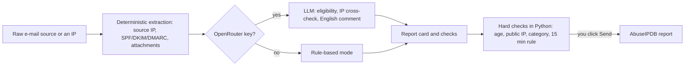
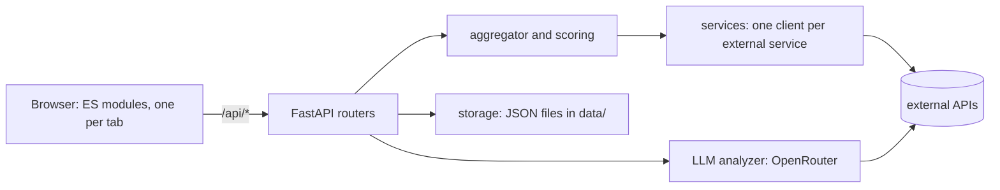

<p align="center"></p>
<p align="center"><b>Seisa 2.0.57</b></p>

# Seisa

**English** | [Polski](README.pl.md)

   

**Seisa** is a local tool for looking closely at suspicious things without handing them to yet another web service: IP reputation from several sources merged into one explained score, live URL scans, DMARC aggregate reports, an educational analysis of an e-mail's source and the preparation of AbuseIPDB abuse reports. It is one Python process on `127.0.0.1` with no login, no database and no build step.

<!-- Screenshot to add: docs/img/hero-ip.png (the IP tab with a verdict and the address identity card) -->

- **Local by design.** It listens only on `127.0.0.1` and sends nothing anywhere except the actions you start yourself; [what leaves your machine](#what-leaves-your-machine) is one table.
- **Explains instead of only scoring.** Every score shows the sources behind it; the e-mail analysis teaches how to read headers instead of only giving a verdict.
- **Hard checks live in code, not in the LLM.** Whether a report to AbuseIPDB may be sent (age of the attack, public IP, category) is computed in Python and re-checked by the backend; the LLM only advises.
- **Works with what you have.** A missing API key only switches that service off; without an OpenRouter key the LLM layer is off and the deterministic analysis still works.
- **Bilingual.** The whole interface, the backend messages and the reports exist in English and Polish.

**Seisa** (精査, *せいさ*, pronounced roughly "say-sah") is a Japanese word meaning a thorough, detailed examination - looking at something closely. 精 (*sei*) = precise, exact, detailed; 査 (*sa*) = to examine, to inspect.

Author: Arkadiusz Polak ([GitHub: arcymonek](https://github.com/arcymonek), e-mail: kontakt (at) arkadiuszpolak (dot) pl). Security issues: see [SECURITY.md](SECURITY.md).

## Contents

- [What Seisa does](#what-seisa-does)
- [Quick start](#quick-start)
- [Configuration](#configuration)
- [Privacy and data flow](#privacy-and-data-flow)
- [Tabs](#tabs): [IP](#ip), [URLScan](#urlscan), [DMARC](#dmarc), [Email](#email), [AbuseIPDB](#abuseipdb), [History](#history), [Logs](#logs), [Info](#info), [Interface language](#interface-language-plen)
- [Walkthrough: from a suspicious e-mail to a report](#walkthrough-from-a-suspicious-e-mail-to-a-report)
- [For developers and forks](#for-developers-and-forks)
- [Troubleshooting and FAQ](#troubleshooting-and-faq)
- [Changelog](#changelog)
- [License and contributing](#license-and-contributing)

## What Seisa does

| Tab | What it does | Needs | What it sends out |
|---|---|---|---|
| [IP](#ip) | Reputation of an IP address (batch mode also takes domain names) from VirusTotal, OTX, Cloudflare Radar, AbuseIPDB, GreyNoise and RDAP/reverse DNS, merged into one 0-100 score | a key per service (each optional) | the address, to the services you have keys for, plus the free RDAP/DNS lookups |
| [URLScan](#urlscan) | A live scan of a URL through urlscan.io with a verdict, a screenshot, redirects, forms and certificates | `URLSCAN_API_KEY` | the URL, to urlscan.io |
| [DMARC](#dmarc) | Aggregate DMARC reports (`.xml`, `.gz`, `.zip`) unpacked and analysed in the browser | nothing | nothing (an optional button sends one IP to ipwho.is) |
| [Email](#email) | An educational analysis of an e-mail's source: deterministic findings at once, plus an optional streamed LLM lesson | OpenRouter key for the LLM part | the whole source to OpenRouter, only after an explicit click |
| [AbuseIPDB](#abuseipdb) | Prepares and sends an abuse report: source IP, eligibility, categories, an English comment, hard checks | `ABUSEIPDB_API_KEY` (OpenRouter optional) | the IP and, on "Send", the report, to AbuseIPDB |
| [History](#history) | Everything Seisa remembers, reopenable, comparable, pinnable | nothing | nothing |
| [Logs](#logs) | Errors and warnings of every service | nothing | nothing |
| [Info](#info) | Version, key status, API limits, recent changes, license | nothing | quota requests only on "Refresh limits" |

<!-- Screenshots to add: docs/img/tab-*.png (one per tab, see the Tabs section) -->

## Quick start

### Requirements

- **Python 3.11+** on **macOS** or **Linux**. On Debian/Ubuntu install the venv module first (`sudo apt install python3-venv`). Windows is not supported natively; it works through WSL as Linux.
- A current web browser. `git` is optional (the Info tab reads the release list from `git log` when the directory is a checkout).
- No API key is required to start; see [First steps without any keys](#first-steps-without-any-keys).

### Install and run

Get the code (clone the repository or unpack a release archive) and, in the project directory:

```bash
python3 -m venv .venv
./.venv/bin/pip install -r requirements.txt
cp .env.example .env
chmod 600 .env
./seisa.sh
```

`requirements.lock` holds the exact tested versions (`pip install -r requirements.lock` instead of `requirements.txt`). The start script launches the server and opens the browser at `http://127.0.0.1:54321` (macOS: `open`; Linux with a desktop: `xdg-open`; otherwise it only prints the address to open by hand). If `.venv/` is missing it says so and stops.

Without the script:

```bash
./.venv/bin/uvicorn backend.main:app --port 54321 --host 127.0.0.1
```

To use another port, start `uvicorn` yourself with `--port`. You can add a shell alias for the script (for example `alias seisa='~/path/to/seisa/seisa.sh'`). Restart Seisa after editing `.env`; the keys are read at start.

### First steps without any keys

Try the whole interface on fictitious data, with no keys and no network traffic, by starting the mocked application used by the test harness (all external services are replaced by fixed answers, data goes to a temporary directory):

```bash
./.venv/bin/python scripts/api_harness.py --serve 8765
```

Then open `http://127.0.0.1:8765`. With the real application and no keys:

- **Works:** the [DMARC](#dmarc) tab completely, the deterministic analysis in the [Email](#email) tab, WHOIS/rDNS (RDAP and reverse DNS) in the [IP](#ip) tab, [History](#history), [Logs](#logs), [Info](#info) and the language switch.
- **Switched off, per service:** every service without a key shows "no API key" and is left out of the aggregate score. Without `OPENROUTER_API_KEY` the LLM layer is off (the [AbuseIPDB](#abuseipdb) tab then runs in rule-based mode and never claims that an e-mail qualifies). Sending a report and the "what AbuseIPDB already knows" card need `ABUSEIPDB_API_KEY`.

## Configuration

### API keys (.env)

Copy `.env.example` to `.env`, fill in the keys you have and make the file readable only for you (`chmod 600 .env`). `.env` is gitignored and the keys never reach the browser.

| Variable | Required? | Where to get it |
|---|---|---|
| `URLSCAN_API_KEY` | yes, for urlscan.io | [urlscan.io/user/signup](https://urlscan.io/user/signup) |
| `VIRUSTOTAL_API_KEY` | yes, for VirusTotal | [virustotal.com](https://www.virustotal.com) |
| `OTX_API_KEY` | yes, for OTX | [otx.alienvault.com](https://otx.alienvault.com) |
| `CLOUDFLARE_RADAR_API_KEY` | yes, for Cloudflare Radar | [dash.cloudflare.com/profile/api-tokens](https://dash.cloudflare.com/profile/api-tokens) |
| `ABUSEIPDB_API_KEY` | yes, for AbuseIPDB (reading and reports) | [abuseipdb.com](https://www.abuseipdb.com) |
| `GREYNOISE_API_KEY` | yes, for GreyNoise | [greynoise.io](https://www.greynoise.io) |
| `OPENROUTER_API_KEY` | no, optional | [openrouter.ai](https://openrouter.ai) - enables the LLM analysis in the Email tab and the eligibility assessment and draft report comment in the AbuseIPDB tab |
| `OPENROUTER_MODEL` | no | `anthropic/claude-sonnet-4.5` by default - verify the exact slug on the OpenRouter model list |

> **Warning:** the Cloudflare key **must be a scoped API Token with Radar read permission, not the old Global API Key** (the latter gives a 401 error).

A missing key for any service does not block the rest of the tool - the service simply shows the status "no API key" and is excluded from the aggregate score.

### Limits and throttling

| What | Limit | Notes |
|---|---|---|
| VirusTotal | 4 requests/min, 500/day | a visible throttle in batch mode; the daily counter (`data/vt_usage.json`) resets at 00:00 UTC |
| Result cache | 15 minutes, in memory | an option forces a refresh |
| Batch lookup | 200 indicators | |
| E-mail source | 3 million characters | |
| LLM answer | 64000 tokens | a ceiling that includes the model's hidden reasoning (about 45% of the output); you pay only for what is generated |
| AbuseIPDB report | one per IP per 15 minutes, comment up to 1024 characters, up to 30 categories | the 15-minute rule is enforced (HTTP 409) before a call is spent |
| History | 25 unpinned entries | pinned entries never fall out |
| Logs shown | newest 500 entries | |

The free-plan quotas of every keyed service (used / limit / reset) are in the [Info](#info) tab, in the "API limits" card.

## Privacy and data flow

Seisa listens only on `127.0.0.1` and has no login. Nothing leaves the machine except what is listed here, and every row is triggered by an action of yours. The frontend loads nothing from a CDN, no fonts, no analytics; `marked.min.js` is bundled.

### What leaves your machine

| Action | What is sent | To | When |
|---|---|---|---|
| IP lookup (and batch) | the IP address (in batch mode also a domain name) | VirusTotal, AlienVault OTX, Cloudflare Radar, AbuseIPDB, GreyNoise - only those with a key | when you run the lookup |
| IP lookup, free part | the IP address; a domain name in batch mode | `rdap.org` (an RDAP bootstrap that redirects to the regional registry), your DNS resolver (reverse DNS), and WHOIS servers for domain names (`python-whois`) | when you run the lookup |
| URL scan | the URL and the chosen visibility; the domain in the "Earlier scans" search; the scan id when the result, the screenshot and the DOM are fetched | urlscan.io | when you scan |
| DMARC "geo/ASN" | one IP address, from your browser | [ipwho.is](https://ipwho.is) | only on the click in an expanded row |
| Email: "Analyze" (not "Analyze without LLM"), "Finish the analysis", "Ask" | the whole e-mail source (with personal data), and for "Ask" the question and the fragment | OpenRouter | only on that click; the interface says so before sending |
| AbuseIPDB: "Analyze" | the whole e-mail source | OpenRouter | only on that click |
| AbuseIPDB: address check | the IP | AbuseIPDB (`/check`) | when an IP is entered and a key exists |
| AbuseIPDB: "Send" | the IP, categories, timestamp, comment | AbuseIPDB (`/report`) - **public** | only on a deliberate click |
| Info: "Refresh limits" | your keys' quota requests | VirusTotal, urlscan.io, OpenRouter | only on the click; none of these calls uses quota |
| Cisco Talos | nothing from Seisa; the button only helps you open Talos yourself | - | you click it |

Seisa's requests to OpenRouter identify the application as Seisa. Everything else in the interface (History, Logs, comparisons, exports, the citation check, the duplicate check) is local.

### What stays local

- `data/` holds the history, the counters, the log of sent reports and the saved e-mail analyses (with the raw messages, files `0600`, the directory `0700`); `logs/` holds errors and warnings. Both are gitignored. See [Data files](#data-files).
- API keys stay in `.env` (gitignored) and are never sent to the frontend; the Info tab shows only whether a key is set.
- The browser stores only per-viewer conveniences in `localStorage` (the interface language under `seisa.lang`, the chosen pane, which cards you left open).
- There is no telemetry and no update check.

### Threat model

**Seisa defends against:**

- untrusted content (e-mails, DMARC XML, urlscan pages, comments in third-party API answers) running code in the interface or making the tool fetch something: an HTML allow-list, a Content-Security-Policy, non-clickable "defanged" links, and nothing from a message is ever opened or downloaded;
- another web page talking to your local API (a loopback-only `Host` header blocks DNS rebinding; scripts only from Seisa's own origin);
- leaking data by accident: the LLM is called only after an explicit click, the AbuseIPDB comment gets a personal-data scan with masking, and the hard checks are re-computed in the backend.

**Seisa does not defend against:**

- someone with access to your machine or user account: there is no authentication, any local process can call the API, `.env` is plain text;
- exposing port 54321 to a network: it is a single-user tool, do not do that;
- what you send to third parties: once an e-mail reaches OpenRouter or a report reaches AbuseIPDB (which shows comments publicly) it is theirs;
- a wrong LLM answer: the verdict is an aid, the citation check is a hint, not proof.

### LLM cost

Only calls to OpenRouter cost money (per token, depending on the model; the tokens include the model's hidden reasoning). The cost is read from the `usage.cost` that OpenRouter returns and is shown next to the action button; Seisa has no price table.

| Paid (OpenRouter) | Free (local or free-plan APIs) |
|---|---|
| Email: "Analyze", "Finish the analysis", "Ask" | Email: the deterministic analysis, the duplicate check, the citation check, comparison, all exports |
| AbuseIPDB: "Analyze" | AbuseIPDB: the hard checks, the personal-data scan, "Send" (an AbuseIPDB call, no LLM) |
| | IP, URLScan, DMARC, History, Logs, Info |

Before a paid e-mail analysis Seisa checks whether the same message was analysed already and offers to open the saved analysis instead.

## Tabs

The tab row: [IP](#ip), [URLScan](#urlscan), [DMARC](#dmarc), [Email](#email), [AbuseIPDB](#abuseipdb), [History](#history), [Logs](#logs) and the round info button ([Info](#info)). The IP, URLScan, DMARC, Email, AbuseIPDB, History, Logs and Info tabs share one layout: a verdict banner (colour by level), summary tiles, then collapsible cards that open by themselves only when they carry a signal.

### IP

> The reputation of an IP address from six sources, merged into one explained 0-100 score.

**Input:** an IP address (batch: many addresses or domains) | **Output:** a report (verdict, tiles, identity card, source cards) | **Sends out:** the address to the services you have keys for, plus free RDAP and DNS lookups | **Keys:** each service optional. Scanning a URL lives in the [URLScan](#urlscan) tab.

<!-- Screenshot to add: docs/img/tab-ip.png -->

| Service | What it provides |
|---|---|
| [VirusTotal](https://www.virustotal.com) | AV engine detections, reputation, ASN, categories, tags, WHOIS |
| [AlienVault OTX](https://otx.alienvault.com) | threat-intel pulses, geolocation, ASN |
| [Cloudflare Radar](https://radar.cloudflare.com) | network/context data - ASN, location, routing (not a verdict) |
| [AbuseIPDB](https://www.abuseipdb.com) | confidence score, number of reports, author of the latest report, ISP |
| [GreyNoise](https://www.greynoise.io) | full IP Lookup (`/v3/ip`) - actor, tags, VPN/Tor, network metadata; falls back to the free community endpoint if the key has no access to the full API; "no information in the service" counts as a contribution of 0.0, not as "unknown" |
| WHOIS / rDNS | reverse DNS (PTR) + full RDAP (RFC 9083, the successor of WHOIS) - network range, owner, abuse/technical contact, registration dates - no API key needed |
| Cisco Talos | no official API - only a button for a manual check |

What you get:

- **One aggregate score** 0-100 and a verdict banner: LOW below 25, MEDIUM 25-59, HIGH from 60 (colour by level, with the values behind it).
- **Summary tiles:** abuse confidence, detections, GreyNoise, OTX pulses, country, ASN, IP type, and the component-score table.
- **An address identity card** that merges owner, ASN, country, network, reverse DNS, usage type and Tor from all sources, and shows how many sources agree.
- **One collapsible card per source**, open only for sources with a signal (source risk of 25 or more); lists (tags, CVEs, ports, pulses) are chips with "show more".
- **Batch mode** (many addresses at once, with the VirusTotal throttle visible) and a 15-minute in-memory cache with an option to force a refresh.
- **Export:** "Save .md" (the browser's native save dialog) or copy; the Markdown contains the whole report including the identity table.

<details>
<summary>Details: the scoring model, the identity card, raw responses</summary>

**Scoring** (`backend/scoring.py`). A noisy-OR model: every source - AbuseIPDB, VirusTotal, GreyNoise, OTX - gives a risk of 0-100 on a non-linear scale and has its own credibility (0.9, 0.8, 0.7 and 0.5). A source without data does not vote, so it cannot dilute the result. A known good IP (an AbuseIPDB whitelist entry, GreyNoise benign/RIOT, an OTX validation) lowers the score to 15 unless strong contradicting signals exist. Cloudflare Radar is contextual and deliberately excluded from the number. The report also states how many sources took part and adds notes.

**Address identity** (`backend/identity.py`). The values are normalised first (ASN to a number, country to an ISO code, owner names without legal-form suffixes, RDAP ranges to CIDR). Each field shows how many sources agree. Where they disagree, the majority value is shown with an amber badge (a click lists every value with its sources); on a tie the value of the highest-priority source (RDAP first, as the registry) is shown with a red badge. The registration country (RDAP) and the geolocation country are separate fields, since they legitimately differ for hosting and anycast. This affects the display only, not the score.

**Raw responses.** The complete API response of each source, with line numbers, sits in a "Full API response" section of its card.

</details>

### URLScan

> A live scan of a URL through urlscan.io, laid out like the IP tab.

**Input:** a URL (defanged links accepted) | **Output:** verdict, screenshot, page identity, detail cards | **Sends out:** the URL to urlscan.io | **Keys:** `URLSCAN_API_KEY`.

<!-- Screenshot to add: docs/img/tab-urlscan.png -->

What you get:

- **A verdict banner** coloured from the urlscan.io score and the engine and community verdicts; "no verdict" is shown neutrally and explicitly not as "safe".
- **Summary tiles:** score, HTTP status, server country, ASN, requests, certificate age (with a "new" mark below 7 days), redirects.
- **The page screenshot** and a **Page identity** card: submitted and final URL, the redirect chain, title, domain, main IP with a **Check IP** button, location, PTR, server, MIME type, scan time and visibility.
- **Collapsible detail cards:** the urlscan.io verdict (open only when it signals a risk), forms, the TLS certificate, technologies, contacted IP addresses (each with **Check IP**), contacted domains and links.
- **Earlier scans** of the same domain, so a recent report can be opened instead of ordering a new scan; "Scan again" repeats the scan.
- **Export:** "Save .md" and "Copy Markdown"; addresses found on the scanned page are defanged and never clickable there either.

<details>
<summary>Details: submission, cleaning, the Forms card, history</summary>

**How a scan runs.** `POST /api/v1/scan/`, then polling `GET /api/v1/result/{uuid}/` every 5 seconds until the result is ready (urlscan.io answers 404 while the scan is running; a three-step indicator shows the progress). The backend cleans the address first: a defanged link (`hxxps://evil[.]example`) is restored, a missing scheme becomes `https://`, and what urlscan.io can never scan is refused with a clear message (non-HTTP schemes, `localhost`, private and local addresses, intranet names).

**Fixed submission choices.**

- **Visibility, your choice:** `unlisted` by default (not on the urlscan.io front page or in public search, but visible to verified security researchers in urlscan Pro), `private` (only your account) or `public` (anyone; the tab warns about it).
- **Earlier scans:** urlscan.io is first searched for earlier scans of the same domain (public ones plus those of your account); a hit is marked when it is the very same URL.
- **The default user agent** (no `customagent`) and **automatic choice of the scan country** (no `country`): both fields are deliberately left out of the request.

**Screenshot.** The backend fetches it from urlscan.io and serves it from your own origin, so neither the browser nor the Content-Security-Policy ever touch urlscan.io or the scanned page.

**The Forms card** reads the rendered DOM that urlscan.io keeps (structure only - nothing from the page is loaded): where each form posts, its method and fields. A password field that posts to another domain or over plain HTTP is the classic phishing kit and lifts a "low" or missing urlscan.io verdict to Medium (with a note).

**History.** Every finished scan is saved in the [History](#history) tab as a structured summary plus a small JPEG thumbnail of the screenshot (640 px wide, tens of KB). "Reopen" shows it again in this tab, and "Load full report" fetches the complete result from urlscan.io by its identifier.

</details>

### DMARC

> Drag in aggregate DMARC reports and see everything they contain, without anything leaving your browser.

**Input:** `.xml`, `.gz` or `.zip` reports exactly as providers send them (Google, Microsoft and others) | **Output:** verdict, tiles, policy hints, sources aggregated by IP | **Sends out:** nothing (the optional geo/ASN button sends one IP to ipwho.is) | **Keys:** none.

<!-- Screenshot to add: docs/img/tab-dmarc.png -->

What you get:

- **Unpacking and parsing 100% in the browser**; a report loaded twice (the same provider and report ID) is skipped and marked in the file list.
- **A verdict banner:** red when a source fails both SPF and DKIM, amber when only one of them fails, green otherwise; report errors get their own banner. The rating rule is unchanged: high = SPF and DKIM both failed, medium = one of them failed.
- **Hints on the latest published policy of each domain:** `p=none` only monitors, a policy that can probably be tightened, `pct` below 100.
- **Summary tiles:** messages, unique IPs, suspicious sources, the share of messages that pass DMARC, and a bar of the policy decisions reject/quarantine/none; with more than one report, a table by provider.
- **Sources aggregated by IP address**, riskiest first, filterable (all / suspicious / passing), with SPF and DKIM pass/fail counts and policy decisions.
- **Diagnosis, not only a verdict:** a click on a row expands every single record, which shows exactly *why* alignment failed.
- **Export:** "Save .md" and "Copy Markdown"; every import is saved in [History](#history) with its records and "Reopen" restores the full analysis.

<details>
<summary>Details: what each part shows</summary>

**Reports.** Each uploaded report is an expandable block with every field of its metadata and published policy: provider, contact and additional contact, report ID and version, period, domain, `p`/`sp`/`pct`/`fo`, alignment (`adkim`/`aspf`, with defaults marked), report errors and any other element the report carries (for example `np`, `testing` or vendor tags).

**Sources.** An override such as `forwarded` is noted next to the policy decision, so legitimate forwarding is not mistaken for an attack.

**Records.** An expanded row shows: header/envelope from and to, the reason of a policy override (`policy_evaluated > reason`), the raw `auth_results` outcome (domain/selector/result/`human_result` for DKIM, domain/scope/result for SPF) and any extra fields.

**geo/ASN and next steps.** The optional "geo/ASN" button in the expanded row sends that single IP address to [ipwho.is](https://ipwho.is) (from your browser, only on click) and shows the country and ASN. From there you can jump to a full reputation check (the [IP](#ip) tab) or to preparing an AbuseIPDB report.

**Glossary and export.** A short glossary of SPF, DKIM, the policy terms and the table closes the tab. The Markdown export holds the summary, the reports, the sources and every record (values from the XML sit in code spans).

</details>

### Email

> An educational analysis of an e-mail's source: what the headers say, why, and what to do.

**Input:** the pasted source (headers + body) or an `.eml` file (UTF-8 or windows-1252; the mbox envelope and line endings are normalised) | **Output:** deterministic findings at once, plus an optional LLM lesson | **Sends out:** with "Analyze", the whole source to OpenRouter | **Keys:** `OPENROUTER_API_KEY` for the LLM part. Binary base64 attachments never go to the model (only their size and sha256 stay); text base64 parts are decoded.

<!-- Screenshots to add: docs/img/tab-email-overview.png and docs/img/tab-email-lesson.png -->

What you get:

- **A deterministic analysis, immediately and locally** (no LLM): anomalies, the Received route with the role of each hop in the chain of trust, authentication, domain alignment, a UTC timeline, the MIME tree, attachments, links, hidden content and the recipient's anti-spam filters.
- **A detailed LLM analysis**, streamed live (OpenRouter, the same key and model as in AbuseIPDB), following the guide `docs/email-analysis-guide.md`; the first line is the verdict with a confidence level.
- **Three panes with a table of contents:** Overview (route diagram, warnings, checklist, what to do, the citation check), Facts (the deterministic analysis as collapsible cards) and Lesson (the whole LLM analysis).
- **Evidence cards and a source drawer:** quotes from the message show line numbers and a "Show in source" button.
- **Saved analyses** with duplicate detection, comparison of two analyses, follow-up questions and exports (`.md`, `.html`).
- **Nothing from the message is opened or downloaded**; links are shown as non-clickable, defanged text.

<details>
<summary>Details: the deterministic analysis</summary>

Findings about anomalies, the Received route with the role in the chain of trust, authentication (SPF/DKIM/DMARC/ARC, authserv-id, signed and unsigned headers, `bh=` length), domain alignment relative to `From`, a UTC timeline, epoch conversions, the MIME tree, attachments (sha256, double extensions), links (text vs `href`), hidden content, HTML comments, template placeholders, the recipient's anti-spam filters (SCL/BCL/CAT, the Junk target folder, AuthAs, the decoded X-Message-Delivery) and flags set by the sender (X-Message-Flag, Importance, read-receipt requests). When the whole Received chain belongs to one operator (for example Microsoft), the table marks the oldest entry as the trust boundary. Identical findings caused by repeated links are reported once with a count, for example `(x4)`. The logic is in `backend/email_forensics.py`.

</details>

<details>
<summary>Details: the layout of the result</summary>

Like the IP, DMARC and URLScan tabs:

- **A verdict banner** on top: the verdict, the confidence, the summary of the analysis, the citation check status and the actions (report, save/copy, finish a truncated analysis).
- **A row of tiles:** warnings, SPF/DKIM/DMARC as written by the recipient's server, sender identity alignment, the IP at the trust boundary (with a button that puts it into the IP tab), links/attachments/hidden content, the recipient's filter, the delivery time.
- **Three panes with a table of contents on the left:** **Overview** (the route of the message as a diagram with the trust boundary, the warnings, the checklist and the "what to do" part of the analysis, the citation check), **Facts** (the deterministic analysis as collapsible cards; a card opens by itself only when it carries a signal, and shows a one-line state in its header) and **Lesson** (the whole LLM analysis).
- The source collapses to a one-line bar after the analysis ("Edit source" brings the field back). The tab remembers the chosen pane.

</details>

<details>
<summary>Details: the LLM lesson</summary>

- The guide `docs/email-analysis-guide.md` drives the analysis: a mental model, a line-by-line analysis of both the good and the bad elements, a checklist, traps, an assessment, control questions with answers in collapsible sections.
- The text is split at its `##` headings into collapsible cards. All cards start collapsed; the state you choose is remembered; "Expand all" / "Collapse all"; the sub-blocks of the line-by-line part are collapsible too. If the model breaks the structure, the text is shown as one block. The lesson can be searched (hits open the collapsed cards).
- Quotes from the message become **evidence cards** with line numbers and a "Show in source" button that opens the **source drawer** (the message with line numbers, the quoted lines highlighted, several hits can be stepped through). A quote that is not literally in the source is marked as a diagram or example. Inline code found in the source is clickable in the same way.
- Technical terms (SPF, DKIM, DMARC, ARC, PTR, SCL, HELO...) get a dotted underline and a short explanation on hover, once in the whole analysis.
- The LLM analysis does not reproduce the tables visible in the deterministic analysis (timeline, links, Received and so on), it only interprets them, so that you do not pay for repetition; the complete set is in the export.
- The output is rendered safely: raw HTML from the e-mail and links are neutralised.
- The response limit of the model is 64000 tokens (counted together with the hidden reasoning of the model, about 45% of the output; it is a ceiling, you pay for the tokens actually generated). If the analysis is cut off anyway, the tab shows a warning and a **"Finish the analysis"** button (the model receives the text so far and writes the missing parts; token usage and cost add up in the saved analysis).

</details>

<details>
<summary>Details: verdict protocol, language, citation check</summary>

- **Verdict protocol** (`backend/verdict.py`): the first line of the model answer has the form `VERDICT: <legit|phishing|spam|scam|malware|inconclusive> | CONFIDENCE: <high|medium|low>` and always uses these canonical codes, whatever the language of the analysis; the interface maps them to labels in the selected language. Analyses saved earlier with Polish tokens (`WERDYKT`/`PEWNOSC`) are read without any file migration.
- **Analysis language:** the analysis is written in the interface language (a directive in the prompt plus a table of literal headings and tags `[Fakt]`/`[Fact]` for both languages in `docs/email-analysis-guide.md`); the language is stored in the record (`lang`; older records = Polish). "Finish the analysis" uses the language of the stored record, not the current interface language. A saved analysis in a language other than the interface is marked with a PL/EN badge, and opening it shows a banner with a paid re-analysis button (the cost of the previous one is given as a guide); the facts and the text stay in the language they were created in, while the labels and the `.md` export use the interface language. Duplicate detection does not depend on the language: the banner shows the language of the existing analysis.
- **Citation check** (local, free; `backend/citation_check.py`): after the analysis the code checks whether the IP addresses, the header lines quoted in code blocks, `Header: value` quotes, SCL/BCL numbers and identifiers given by the model appear in the source or in the deterministic analysis. The banner shows the result ("quotes verified" or a warning that jumps to the details in the Overview pane); discrepancies are also in the `.md` export. This is information, not proof of an error (an example or a paraphrase may be flagged too). It does not check domains or entries such as `spf=pass`, because the analysis also discusses examples of a legitimate message.

</details>

<details>
<summary>Details: saved analyses, duplicates, comparison, questions, exports, hand-offs</summary>

- **Saved analyses:** every completed analysis is saved together with the raw e-mail in `data/analyses/` (files 0600, gitignored); the list of saved analyses (open/delete/compare) is at the bottom of the tab.
- **Duplicate detection:** before a paid analysis Seisa checks the fingerprint (sha256 of the normalised source) in `data/analyses/`. If the message was already analysed, it offers to open the saved analysis (with the date, verdict and cost) or to run it again deliberately.
- **Comparison:** tick two saved analyses and click "Compare selected" to see their facts side by side (verdict, SPF/DKIM/DMARC, sender IP, domains, IPs, hosts of links, attachment hashes) with the shared items highlighted - a local operation, nothing is sent.
- **Ask about this message** (a card at the end of the Lesson pane): a follow-up question about a saved analysis, optionally with a fragment of the source (select text in the source drawer and click "Ask about the selection"; the "Show source" button next to "Ask" opens the drawer). Every question is an explicit, paid click that sends the whole source, the question and the fragment to OpenRouter; the answer is streamed, rendered safely and saved together with the analysis (`questions` in the record; `POST /api/email/analyses/{id}/ask`, question up to 600 and fragment up to 2000 characters). The questions are part of the exports.
- **Exports:** "Save .md", "Copy Markdown" and "Save .html". The export labels follow the interface language at the moment of export, while the text of the LLM analysis stays in the language it was written in. They export the whole set: metadata (date, verdict, model, input/output tokens, cost), the whole deterministic analysis (tables), the LLM analysis and the follow-up questions. The HTML file is a self-contained copy of the result with all cards expanded (no scripts; a Content-Security-Policy forbids everything but inline styles).
- **Hand-offs (nothing is sent by them):** next to every link of the deterministic analysis (links, plain URLs, List-Unsubscribe) there is a **URLScan** button, and next to public IP addresses an **IP** button; they only put the address into the URLScan or IP tab - nothing is opened, scanned or looked up until you click the action there. Rows of the Received and authentication tables have a "source" button that highlights the header in the source drawer. The **"Report to AbuseIPDB"** button (visible only when the verdict is not `legit`) pastes the original source into the e-mail field of the AbuseIPDB tab (overwriting the field) and takes you there.

</details>

### AbuseIPDB

> Prepare, check and send an abuse report that follows the AbuseIPDB reporting policy.

**Input:** the raw source of a suspicious e-mail (optional; you can also start from an IP alone) | **Output:** a checked report ready to send | **Sends out:** the source to OpenRouter on "Analyze"; the IP and, on "Send", the report to AbuseIPDB | **Keys:** `ABUSEIPDB_API_KEY`; `OPENROUTER_API_KEY` optional. The workflow follows the [AbuseIPDB reporting policy](docs/abuseipdb-reporting-policy.md) (60-day limit, no reporting based on the confidence score alone, the 1024-character comment limit and so on). The Email and AbuseIPDB tabs are two different tools that only share small UI elements and the LLM on an e-mail's source: the Email tab teaches, this one reports.

<!-- Screenshot to add: docs/img/tab-abuseipdb.png -->



In words: the code extracts the facts, the optional LLM assesses and writes the comment, the report card and the checks are shown, the backend re-checks the hard criteria, and only your click sends anything.

**Checks before sending** (a collapsible card that opens by itself when something blocks, with a state on its header):

| Kind | Items | Effect |
|---|---|---|
| Required | age of the attack, public IP, category selected, the 15-minute rule, the eligibility verdict | gate the "Send" button |
| Blocking, judged by the LLM | `Received` verified, the source is not spoofed (only a "fail" blocks) | gate the "Send" button |
| Informational | Spoofing, category fit, the local personal-data scan, the model's PII opinion | a hint to read before sending |

A date up to one hour in the future counts as "now" to tolerate a clock offset; a further future date fails. Spoofing is one of three states, always with a short reason: detected (SPF/DMARC fail), not detected (authentication passed) or cannot be assessed (no or ambiguous SPF/DKIM/DMARC results in the pasted source). The backend recomputes the hard checks on every change and again when sending, independently of the state of the form.

<details>
<summary>Details: the ten steps of the workflow</summary>

1. **Paste the raw source of the suspicious e-mail** (headers + body) - optional; you can also start from the IP alone (the "Report to AbuseIPDB" button in the IP or DMARC tab, or "Use as draft" on an earlier report). The "Load .eml file" button (also dragging a file onto the field), a timer of the analysis and the tokens and cost after "Analyze" are shown next to the buttons.
2. **The backend extracts the facts deterministically:** the trusted source IP address, together with a confidence level (`ip_confidence`) and the full chain of hops. In addition: the SPF/DKIM/DMARC result, attachments (with detection of double extensions such as `invoice.pdf.exe`), the Message-ID, BTC address and ransom demand patterns. **The hard checks (age of the attack, whether the IP is private) are always computed in Python and are never delegated to the LLM.**
3. **Optionally an LLM through OpenRouter** (if `.env` has `OPENROUTER_API_KEY`) assesses whether the e-mail qualifies for a report, independently verifies the IP address chosen by the code on the basis of the raw headers (`source_ip_check` - if it disagrees, the address card shows a warning with the model's suggestion and a button to use it), assesses the fit of the suggested categories and possible PII in the comment, and **writes a ready, detailed report comment in English** based on the facts and the complete raw source of the message (all headers and the whole body, up to the source size limit; the address card states how many characters the model saw). Without a key the tool works in rule-based mode.
4. **The result is laid out like the IP, DMARC and URLScan tabs.** A verdict banner (green = eligible, red = not eligible and sending blocked, blue = not assessed; the text is always white) with the reasoning and alternatives, then summary tiles (source IP with its confidence, age of the e-mail against the 60-day limit, SPF/DKIM/DMARC, attachments, and the AbuseIPDB score of the address once `/check` answers) and the **address card**: the `Received` chain with the boundary hop marked and, on every hop with a public address, a "Use this address" button (also for the address the model suggests instead). An address you have already reported is marked. Only the boundary hop is the real sender - the other hops are usually the recipient's or the provider's own servers (the tooltip says so) - so after a report the tab offers the remaining non-relay addresses of the same e-mail one by one. Attachments sit in a collapsible card that opens by itself when a double extension is found. Without an LLM the tool never claims that an e-mail qualifies: it only checks the hard criteria (public IP, age) and recognises the obvious case of a test sent from your own account to yourself (sender = envelope sender = recipient, no sign of an attack).
5. **The report card** holds the IP, the categories, the attack timestamp and the comment. The category chips carry a short description on hover, and notes appear under them where a choice is usually wrong or incomplete (`20 Exploited Host`, `22 SSH` and `13 VPN IP` alone; `23 IoT Targeted` without a device type in the comment; `17 Spoofing` when SPF/DMARC passed). The timestamp is taken from the `Date` header and shown in the browser's local time; it is sent in UTC (ISO 8601). The comment field has a character counter (limit 1024) and a **personal-data scan**: your own addresses (recipients of the message and their domains, except freemail domains), any other e-mail address and internal IP addresses are listed, and "Mask them" replaces them with placeholders (AbuseIPDB shows comments publicly and, per its documentation, is not responsible for PII you reveal); sending with findings left asks for confirmation. The "What will be sent to the API" block shows the exact request the backend will make (categories without duplicates, the comment after cleaning: ASCII only, at most 1024 characters, formula prefixes neutralised).
6. **The comment is filled with what the LLM wrote.** `comment` is an optional field in the AbuseIPDB API ([`/report`](https://docs.abuseipdb.com/#report-endpoint), only `ip` and `categories` are required), but the AbuseIPDB policy itself expects a detailed, technically justified description - hence the LLM writes the comment (attack mechanism, meaning of SPF/DKIM/DMARC, malicious attachments with a detected double extension such as `invoice.pdf.exe`, a ransom/BTC demand, mass-mailing patterns) within about 900 characters. Without an LLM (or when the analysis fails) a poorer, deterministic fallback built solely from the facts is used (with only the local part of the `Message-ID`, because the domain after `@` is usually your own). In both cases the text is fully editable before sending. If you know the port number, add it by hand.
7. **Checks before sending** (the table above).
8. **What AbuseIPDB already knows** appears under the IP field (reports, distinct reporters, confidence score and last report in 90 days; one `/check` query per address, only with an API key). It warns when the address is whitelisted and when it already has reports in one of your chosen categories from the last 7 days (a new one probably only adds noise - the policy also forbids reporting on the score alone). Your own earlier reports of the address come from `data/report_log.json`.
9. **The API contract** ([docs.abuseipdb.com](https://docs.abuseipdb.com/#report-endpoint)): a form-encoded `POST /report` with the `Key` header and `ip`, `categories` (comma-separated, at most 30, no duplicates), `comment` (at most 1024 characters) and `timestamp` (ISO 8601). AbuseIPDB accepts a repeated report of the same IP from one account only after 15 minutes, so within that time the "Send" button is disabled and the backend refuses the request (HTTP 409) instead of spending a call. The API's own answers are turned into readable errors: 429 with no requests left = the daily limit is used up (with the limit and the time it resets, from `X-RateLimit-Limit` and `X-RateLimit-Reset`), 429 otherwise = the same-IP rule (report sent from elsewhere), 422 = the refused field with the API's own detail, 401/403 = the API key, anything else = an API error. After a success the tab shows the confidence score the API returns and the daily limit left (`X-RateLimit-Remaining`); every attempt, failed ones included, goes to the local log with the last known limit.
10. **Your reports** (a card at the bottom): sent today (UTC), the daily limit left, the number of accepted reports and a table of every attempt with its result; "Use as draft" loads an earlier report into the form. Accepted reports are also listed in the [History](#history) tab (they open as a draft and cannot be deleted from there - the log is an audit trail). "Save .md" exports the prepared report (address, categories, timestamp, verdict, the address chain, the checks and the comment) for your own archive. You can also copy the comment for manual pasting on the website.

</details>

<details>
<summary>Details: how the sender IP is chosen</summary>

The algorithm goes from the newest `Received` header downwards and looks for the first hop whose "from" host no longer belongs to the same domain as the "by" host of the newest hop. In multi-hop chains of large providers (for example Microsoft 365 or Outlook.com) the first few hops are internal transfers of the same provider and are skipped, so that their address is not taken instead of the real sender. When the first hop outside the recipient's domain is only a relay of an operator (for example Microsoft Exchange Online), the parser walks through the operator's internal hops to the hop where the address of the connecting sender was recorded. If the message originated inside a shared provider (for example a hotmail account) and there is no public sender IP, the IP stays empty (confidence low). Authentication results are also read from `X-MS-Exchange-Authentication-Results` and `ARC-Authentication-Results`. After an analysis with an LLM the tab shows how much of the content the model saw, and the hard checks (IP, age) take precedence over the opinion of the model.

</details>

### History

> Everything Seisa remembers, reopenable and comparable.

**Keeps:** IP lookups, URL scans (reopened in the URLScan tab, with a thumbnail of the screenshot), DMARC imports, saved e-mail analyses (reopened in the Email tab) and accepted AbuseIPDB reports (reopened as a draft in the AbuseIPDB tab) | **Sends out:** nothing.

<!-- Screenshot to add: docs/img/tab-history.png -->

- **Summary tiles** (the total, one per type, the number of high-risk entries) that also work as filters: a click filters the list, a second click on "High risk" removes the filter. Below them chips for the date range and the risk, and a search box over the labels.
- **Cards grouped by day** (pinned ones first), showing the type, label, risk, the language of the entry when it differs from the interface, and how long ago it was made (the exact time is in the tooltip). The list shows the newest 25 entries that are not pinned. When the same IP, URL or domain was rated differently earlier, the card says so ("Earlier: Low").
- **Actions on a card:** "Reopen" (an IP check unfolds inside the card, the others open in their own tab), "Repeat" (IP and URL scan: runs the check again in its tab, for the IP with the cache skipped), "Pin" / "Unpin" (IP, URL scan and DMARC: a pinned entry never falls out of the size limit and survives "Clear history") and "Delete" (two clicks; not for reports - the local report log is an audit trail).
- **Compare:** tick two IP checks and "Compare the selected" shows what changed between them: risk level and score, the sources used, the address identity and what every source reported.
- **Export and clean-up:** "Export JSON" and "Export CSV" save the metadata of the list as filtered on screen (id, type, time, label, risk, pinned). "Clear history" (two clicks) removes only unpinned IP checks, URL scans and DMARC reports; e-mail analyses (with the raw messages) are deleted one by one; the report log stays.

### Logs

> Errors and warnings of every service; normal, error-free operation leaves no trace on disk.

**Keeps:** WARNING level and above | **Sends out:** nothing.

<!-- Screenshot to add: docs/img/tab-logs.png -->

- **Summary tiles** (errors, warnings, the service with the most entries, the last entry) or, when there is nothing to show, a green banner.
- **Filters:** chips for the date range (today / 3 days / week / month / all; the default is all), the level (all / errors / warnings) and the service (built from the entries, each with a count), and a search box over the messages. The tiles and chip counts always describe the whole date range; the level, service and search only narrow the list.
- **Collapsible entry cards** (time, level, service and the first line of the message; the full text, for example a whole API error, opens on a click and can be copied); the cards you opened stay open across refreshes.
- **"Refresh every 10 s"** reloads the list on its own while the tab is open, and **"Clear logs"** (two clicks, the second one confirms) deletes all log files. Up to the newest 500 entries are shown (a banner says so when older ones are cut off).
- All OpenRouter API errors (Email and AbuseIPDB tabs: limits, insufficient credits, provider errors, timeouts) go to a single `open_router` service; the other application errors go to `app`.

### Info

> The round info button at the far right of the tab row: a short description of Seisa and its state.

**Shows:** the version (read from the page header), how many services have an API key set, the LLM model or "off" | **Sends out:** nothing, except quota requests on "Refresh limits".

<!-- Screenshot to add: docs/img/tab-info.png -->

Collapsible cards in this order (a card you opened stays open when you come back to the tab):

1. **Author:** e-mail, GitHub, website (open).
2. **Name:** the meaning of the name (精査, *せいさ*; open).
3. **Service status** (collapsed): the status of every integration - only whether a key is set; the keys are never shown or sent to the browser.
4. **API limits** (collapsed): described below.
5. **Recent changes** (collapsed): the recent releases from the git log of the directory Seisa runs from; the card says so when it is not a git checkout. The full history is in [CHANGELOG.md](CHANGELOG.md).
6. **License** (collapsed): the same summary as in [License and contributing](#license-and-contributing).

<details>
<summary>Details: the API limits card</summary>

The card shows the usage of the limits of the *free plans* for every service that has a key, one row per service and window: a bar and "used / limit", when the window resets and where the number comes from.

- **Real quota, on demand:** VirusTotal (per hour, day and month), urlscan (per day, per kind of scan, search and retrieval) and OpenRouter (credits of the key, free-model requests). Seisa asks for it only when you click "Refresh limits" (one request to each; none of these calls uses up quota, and the last answer is remembered).
- **From rate-limit headers** of your latest requests: AbuseIPDB (`check` and `report` separately; the limit is read from the answer, 5,000/day assumed until the first request) and Cloudflare Radar (1,200 requests per 5 minutes).
- **Counted by Seisa:** GreyNoise (50 searches per 7 days) and OTX (10,000 requests per hour) report nothing. That count is a lower bound, because requests made elsewhere (for example in the GreyNoise Visualizer) are invisible to it, and the limits marked with `*` are assumptions for the free plans.
- The summary line of the card names the entry closest to its limit (amber from 70%, red from 90%). Counters and the last known values live in `data/api_usage.json`.

</details>

### Interface language (PL/EN)

The `EN | PL` switch is in the footer. The choice is remembered by the browser (`localStorage`, key `seisa.lang`); without a stored choice the browser language is used (`en` or `pl`), and English in all other cases. Changing the language reloads the page (you are asked first if that would lose work in progress).

<details>
<summary>Details: how the languages work</summary>

- The interface texts live in the catalogs `frontend/i18n/pl.json` and `en.json` (flat keys, `{name}` parameters, plural forms through `Intl.PluralRules`); dates use the `pl-PL` or `en-GB` format. The development mode `/?lang=qa` shows `[[key]]` instead of texts, so places that bypass the translations are visible at once.
- The frontend sends the selected language in the `X-Seisa-Lang` header (only to its own backend) and the backend translates error messages, the deterministic e-mail analysis, the IP scoring notes and the Markdown reports on its side (catalogs `backend/locales/pl.json` and `en.json`, module `backend/i18n.py`).
- Analyses and history entries saved earlier keep the language they were created in. The logs (Logs tab) are in English regardless of the interface language.
- LLM answers (Email and AbuseIPDB tabs) are written in the interface language of the moment of the request; the prompts and guides are single, in English, and the answer language is set by an explicit directive. The AbuseIPDB report comment is always in English (an AbuseIPDB policy requirement). The cost of requests depends on the model.

</details>

## Walkthrough: from a suspicious e-mail to a report

The tabs are designed to hand work to each other. A typical path:

1. **Load the message.** In the [Email](#email) tab paste the source or load the `.eml` file. The deterministic analysis appears at once, locally.
2. **Read the Overview.** The route diagram shows where the trust boundary is; the warnings and tiles show SPF/DKIM/DMARC as the recipient's server wrote them, and what the sender's domains do not match.
3. **Ask for the lesson (optional, paid).** Click "Analyze": a streamed explanation with a verdict and evidence cards. Open a card, jump to the quoted lines with "Show in source", and use "Ask" for follow-up questions. The citation check tells you whether the quotes really are in the source.
4. **Check what it points to.** Next to a link the **URLScan** button and next to the source IP the **IP** button carry the address to their tabs; nothing is scanned until you click there. The [IP](#ip) tab gives the aggregate score and the address identity; [URLScan](#urlscan) shows a live scan, screenshot and forms.
5. **Report it.** If the verdict is not `legit`, "Report to AbuseIPDB" moves the source into the [AbuseIPDB](#abuseipdb) tab, where the code finds the sender IP, the hard checks run and an English comment is drafted. Read it, mask personal data, choose categories.
6. **Send deliberately.** When the checks pass, "Send" reports the address. Everything you did is in [History](#history); the report is also in "Your reports". For a mailbox that receives DMARC reports, the [DMARC](#dmarc) tab is the counterpart for spotting sources that spoof your domain.

## For developers and forks

Everything you need to decide about a fork and to work on one is on this page; there is no other documentation site. The two files in `docs/` are prompt context for the LLM, summarised where they matter (the [AbuseIPDB](#abuseipdb) and [Email](#email) tabs).

### Should you fork?

| You may | You may not |
|---|---|
| use, copy, modify and distribute Seisa (forks included) for noncommercial purposes: personal, hobby, educational and research use, and use by charitable, educational, public and government organisations | use it commercially: selling it, commercial forks, work for the profit of a company (this needs a separate permission of the author) |
| keep the `LICENSE` file and its "Required Notice" line in your fork | submit code changes upstream: pull requests are not accepted (issues with ideas and bug reports are welcome; see [CONTRIBUTING.md](CONTRIBUTING.md)) |

This is a *source-available* license, not an open-source license in the OSI sense. A fork is a reasonable choice if you want to keep a local, dependency-light tool and adapt it: add a threat-intel source, a language, a tab, another LLM provider. It is a poor choice if you need multi-user access, authentication, remote hosting or a database; those are non-goals (below).

### Design decisions and non-goals

- **Local, single user, no login.** The attack surface stays small because nothing is exposed; the price is that you must never expose the port.
- **No database.** All persistence is plain JSON files in `data/` with atomic writes. They are easy to read, back up and delete; the price is no concurrency and a capped history (25 unpinned entries).
- **No frontend framework and no build step.** Plain ES modules; you edit a file and refresh (the server sends no-cache headers).
- **Deterministic first, LLM second.** Facts, hard checks and scores are computed in Python; the LLM explains and drafts and cannot unblock a report the code has blocked.
- **Every user-visible string goes through the catalogs** (PL and EN together).
- **Untrusted content is data.** Nothing from an e-mail, a scanned page or an API answer is executed, opened or downloaded.
- **Non-goals:** multi-user access, authentication, remote hosting, native Windows, bulk or automatic reporting, background jobs.

### Stack

Python 3.11+ with FastAPI, uvicorn, pydantic and pydantic-settings, httpx and python-whois (`requirements.txt`; `requirements.lock` pins the tested versions). Frontend: plain JavaScript (ES modules), CSS, and `marked.min.js` bundled locally. Development tools (not dependencies): `ruff`. The only automated test is the API harness.

### Architecture

A single Python FastAPI process serves both the API and the static frontend on `127.0.0.1:54321`.



In words: the browser talks to routers (`backend/routers/`); a lookup goes through the aggregator, which queries the services in `backend/services/` in parallel and computes the score in `backend/scoring.py`; the e-mail and AbuseIPDB tabs use `email_forensics.py`, `email_parser.py` and `report_builder.py` for the deterministic part and `services/llm_analyzer.py` for the LLM part; everything persistent goes through `storage.py`, `analyses.py` and `logging_config.py`.

<details>
<summary>The file tree</summary>

```
seisa/
├── .env                    # API keys (gitignored, see .env.example)
├── seisa.sh                 # start script (starts the server and opens the browser)
├── README.md / README.pl.md  # this documentation in English (the main one) and in Polish
├── CHANGELOG.md             # every release, newest first
├── pyproject.toml           # ruff configuration (linter only, not a package)
├── LICENSE                  # PolyForm Noncommercial 1.0.0 license
├── CONTRIBUTING.md          # contribution rules (no external code changes)
├── SECURITY.md              # how to report a vulnerability
├── .github/ISSUE_TEMPLATE/  # bug report template
├── backend/
│   ├── main.py               # FastAPI, routing, no-cache/CSP and language middleware, Host check, error handling
│   ├── config.py             # paths, limits, settings from .env
│   ├── models.py             # Pydantic models
│   ├── aggregator.py         # fan-out to the services, aggregate risk score
│   ├── markdown_report.py    # Markdown report builder
│   ├── ratelimit.py          # VirusTotal throttle
│   ├── api_limits.py         # usage of the API limits (Info tab): headers, own counters, quota endpoints
│   ├── cache.py              # in-memory result cache
│   ├── storage.py            # atomic JSON storage (history, VirusTotal counter, report log)
│   ├── sse.py                # Server-Sent Events framing shared by the streaming endpoints
│   ├── logging_config.py     # WARNING+ logs to logs/*.jsonl
│   ├── email_parser.py       # fact extraction from the raw e-mail (AbuseIPDB tab)
│   ├── email_forensics.py    # deterministic analysis of the e-mail source (Email tab)
│   ├── citation_check.py     # local check of the LLM's quotes against the source
│   ├── analyses.py           # storage of e-mail analyses in data/analyses/
│   ├── i18n.py               # backend translations: request language (ContextVar), t()/tn(), catalogs in locales/
│   ├── locales/              # backend text catalogs: pl.json, en.json
│   ├── verdict.py            # canonical verdict protocol (EN codes, mapping of the old PL tokens)
│   ├── scoring.py            # aggregate IP reputation score (noisy-OR)
│   ├── identity.py           # merged address identity (ASN, owner, country, network) with per-field source agreement
│   ├── report_builder.py     # AbuseIPDB comment builder + policy validation
│   ├── report_utils.py       # text sanitisation, IP checks, personal-data scan and masking
│   ├── urlscan_report.py     # structured summary + Markdown report of a urlscan.io scan result
│   ├── urlscan_input.py      # cleaning and validation of the URL to scan (refang, scheme, private hosts)
│   ├── urlscan_forms.py      # forms of a scanned page (from its DOM): action, method, fields, password/external flags
│   ├── routers/               # /api/* endpoints: lookup, urlscan, email_analysis, abuseipdb_report, history, logs, about
│   └── services/               # a client for every service (common IntelService interface; urlscan.py separately - submit+poll; llm_analyzer.py - OpenRouter)
├── frontend/
│   ├── index.html
│   ├── favicon.ico            # icon: the kanji 査 (16/32/48/64 px)
│   ├── logo.png               # round logo (page header and README)
│   ├── css/style.css          # dark theme
│   ├── i18n/                  # interface text catalogs: pl.json, en.json
│   ├── js/                    # one module per tab and shared helpers, listed below
│   └── vendor/marked.min.js   # Markdown rendering, bundled locally (no CDN)
├── tests/fixtures/          # SYNTHETIC e-mails (.eml) for comparisons; fictitious data (.example domains, documentation address ranges; the header layout of `multihop.eml` imitates a large mail provider), no personal data
├── scripts/
│   ├── api_harness.py         # the only automated test: every API endpoint with all external services mocked (also `--serve PORT`)
│   ├── dump_facts.py          # dumps the deterministic analysis of the fixtures to JSON (compares two code versions byte for byte)
│   └── check_i18n.py          # checks the PL/EN catalogs, README parity and the version; `--strict` looks for Polish literals in code
├── data/                    # history.json, vt_usage.json, api_usage.json, report_log.json, analyses/ (gitignored)
├── logs/                    # error logs, one .jsonl file per day (gitignored)
└── docs/
    ├── abuseipdb-reporting-policy.md   # policy summary + AbuseIPDB category table (English, LLM prompt context)
    └── email-analysis-guide.md         # e-mail analysis guide loaded into the LLM prompt (Email tab), English, with a PL/EN label table
```

Frontend modules in `frontend/js/`:

- `app.js` (tabs and the `window.seisaApp` hand-offs), `i18n.js`, `api.js`, `util.js` (shared helpers), `markdown-render.js` (the HTML allow-list);
- `lookup.js` + `lookup-result.js` (the IP tab and its report view), `urlscan.js` + `urlscan-result.js`, `dmarc.js` + `archive.js` (unpacking `.gz` and `.zip`);
- `email.js` + `email-facts.js`, `email-lesson.js`, `email-source.js`, `email-glossary.js`, `email-ask.js`, `email-compare.js`, `email-export.js` (the deterministic facts, the lesson cards, the source drawer, glossary tooltips, follow-up questions, comparison and exports);
- `report-builder.js` (the AbuseIPDB tab) + `report-result.js`, `report-history.js`, `report-export.js` (the analysis view, the log of sent reports and the Markdown export);
- `history.js` + `history-compare.js`, `logs.js`, `about.js`.

</details>

### API endpoints

All routes are under `/api`, answer JSON (errors as `{"detail": "..."}`) and read the language from the `X-Seisa-Lang` header. Routes marked SSE stream Server-Sent Events. The frontend is served from `/`.

| Method and path | Purpose | Calls out? |
|---|---|---|
| `POST /api/lookup` | reputation of one IP (or domain) | intel services |
| `POST /api/lookup/batch` (SSE) | many indicators, with the VirusTotal throttle visible | intel services |
| `POST /api/urlscan/scan` | submit a URL scan | urlscan.io |
| `GET /api/urlscan/result/{uuid}` | poll the result (`pending` or `done`) | urlscan.io |
| `GET /api/urlscan/screenshot/{uuid}` | the screenshot, served from your origin | urlscan.io |
| `GET /api/urlscan/search` | earlier scans of a domain | urlscan.io |
| `POST /api/email/find` | duplicate check by fingerprint | no (local) |
| `POST /api/email/analyze` (SSE) | streamed LLM analysis | OpenRouter (paid) |
| `POST /api/email/analyses/{id}/continue` (SSE) | finish a truncated analysis | OpenRouter (paid) |
| `POST /api/email/analyses/{id}/ask` (SSE) | a follow-up question | OpenRouter (paid) |
| `GET /api/email/analyses`, `GET` / `DELETE /api/email/analyses/{id}` | saved analyses | no (local) |
| `POST /api/abuseipdb/email/analyze` | facts, eligibility and the drafted comment | OpenRouter (optional, paid) |
| `GET /api/abuseipdb/categories` | the category table | no |
| `POST /api/abuseipdb/report/preview` | recompute the hard checks | no |
| `POST /api/abuseipdb/report/redact` | mask personal data in the comment | no |
| `GET /api/abuseipdb/ip-info` | what AbuseIPDB already knows about an IP | AbuseIPDB |
| `POST /api/abuseipdb/report/submit` | send the report (re-validated, 409 within the 15-minute rule) | AbuseIPDB |
| `GET /api/abuseipdb/report/history` | the local log of sent reports | no |
| `GET /api/history`, `GET` / `PATCH` / `DELETE /api/history/{id}`, `POST /api/history`, `DELETE /api/history` | history (pin, delete, clear) | no |
| `GET /api/logs`, `DELETE /api/logs` | logs | no |
| `GET /api/about`, `POST /api/about/limits/refresh` | the Info tab, quota refresh | quota endpoints (on refresh) |

### Data files

| Path | Holds | Notes |
|---|---|---|
| `data/history.json` | the history (IP lookups, URL scans with thumbnails, DMARC imports, pins) | 25 unpinned entries; atomic writes |
| `data/vt_usage.json` | the VirusTotal daily counter | resets at 00:00 UTC |
| `data/api_usage.json` | counters and last known limits (Info tab) | |
| `data/report_log.json` | the log of every AbuseIPDB report attempt | an audit trail, not deleted by "Clear history" |
| `data/analyses/` | saved e-mail analyses with the raw messages | files `0600`, directory `0700` |
| `logs/*.jsonl` | WARNING and above, one file per day | |

All of `data/` and `logs/` is gitignored (the directories are kept by `.gitkeep`). To reset Seisa, stop it and delete their contents. Releases before 2.0.27 used `data/analizy/` and `logi/`; Seisa does not migrate them, so rename them by hand before the first start of a newer release (`mv data/analizy data/analyses`, and move the `*.jsonl` files from `logi/` to `logs/`).

### Security invariants

If you change the code, keep these true; each names where it lives.

1. **Loopback-only `Host` header** (`backend/main.py`, `TrustedHostMiddleware`): blocks DNS rebinding.
2. **Content-Security-Policy on every response** (`backend/main.py`): scripts only from the tool's own origin. If the frontend must call another host, add it to `connect-src` there (today only `https://ipwho.is`).
3. **Third-party text is data.** Rendered Markdown goes through an allow-list (`frontend/js/markdown-render.js`: only the tags the reports use, links only with `http(s)`, anything else shown as inert text), and the result of `t()` put into `innerHTML` always goes through `escapeHtml` (`frontend/js/util.js`).
4. **Links from e-mails and scans are never clickable** and are shown defanged; nothing from a message is opened or downloaded; the urlscan screenshot is fetched by the backend.
5. **The LLM is called only after an explicit click**, and the banners that say so must stay (`email.js`, `report-builder.js`).
6. **Hard checks are re-computed in the backend** on every change and when sending (`backend/report_builder.py`, `backend/routers/abuseipdb_report.py`); never move that validation to the frontend only.
7. **Indicators are validated before they reach URL paths** (`is_valid_indicator` in `backend/aggregator.py`: only real IP addresses and host names), urlscan ids must be UUIDs, and request sizes are bounded (`backend/config.py`).
8. **File permissions:** `data/analyses/` is `0700` and its files `0600` (they hold raw e-mails).
9. **Keys stay in the backend** (`.env`); `GET /api/about` exposes only whether a key is set.

To verify: `./.venv/bin/python scripts/api_harness.py` includes security probes (a foreign `Host`, the CSP header, path injection) and its mocked answers contain hostile HTML; in the browser (`--serve`), XSS payloads must leave `window.__xss` at 0.

### How to extend

#### Add a threat-intel service

1. `backend/services/<name>.py`: subclass `IntelService` (`backend/services/base.py`) with a `name`, `query_ip` and `query_domain`; use `fetch_json` for HTTP so errors are readable and rate-limit headers are observed.
2. Register it in `SERVICE_REGISTRY` in `backend/aggregator.py`.
3. Add its key to `Settings` in `backend/config.py` and to `.env.example`; show its status in `backend/routers/about.py`.
4. If it should influence the score, add a `CREDIBILITY` entry and a `score_<name>` function in `backend/scoring.py` and register it in `compute_risk_score`.
5. Frontend: the service metadata in `frontend/js/lookup-result.js` and the `ALL_SERVICES` list in `frontend/js/lookup.js`; Markdown: the title and `SERVICE_ORDER` in `backend/markdown_report.py`.
6. Optionally its free-plan limit in `backend/api_limits.py`.
7. i18n keys (`md.service.<name>` and any messages) in both catalogs; a mocked answer in `scripts/api_harness.py`; run the checks below.

#### Add a language

1. Add `frontend/i18n/<xx>.json` and `backend/locales/<xx>.json` with the same keys as the English ones (`scripts/check_i18n.py` compares keys, `{placeholders}` and plural forms; the required plural suffixes per language are in `PLURALS_REQUIRED` there).
2. Add the language to `SUPPORTED` and `LOCALES` in `frontend/js/i18n.js` and to `SUPPORTED` in `backend/i18n.py`.
3. The LLM prompts are single and in English; extend the label table and the language directive in `docs/email-analysis-guide.md` for the new language.
4. Translate the README under the same heading structure.

#### Add a tab

1. A button and a `<section>` in `frontend/index.html`; the panel in `frontend/js/app.js`.
2. One module in `frontend/js/` in the style of the neighbours (ES modules, no framework), with its texts in the catalogs.
3. A router in `backend/routers/` included in `backend/main.py` if it needs a backend; a place in the harness.
4. Follow the shared layout (verdict banner, tiles, collapsible cards) and the action row: the timer, the status and related buttons sit next to the action button.

### Workflow, tests and conventions

- **Verification:** `./.venv/bin/python scripts/api_harness.py` runs every endpoint against mocked services (no keys, no network) and exits with 1 on an unexpected answer, a request that left the mocks, or a failed security probe. `--out file.json` writes the normalised answers and `--root` points at an older checkout (`git archive`): after a refactor the two versions must give the same output. `scripts/dump_facts.py` and the synthetic `tests/fixtures/*.eml` do the same for the deterministic e-mail analysis (after changing texts in `email_forensics.py` the dump in `pl` must stay identical). The interface is checked by hand.
- **Linting:** `ruff check backend scripts` (configuration in `pyproject.toml`; a development tool, not a dependency). For a frontend module: `cp file.js $TMPDIR/x.mjs && node --check $TMPDIR/x.mjs`.
- **i18n:** every text visible to the user goes through the catalogs (`t()`/`tn()` in the frontend, `backend/i18n.py` in Python). A new key needs a PL and an EN entry; run `python3 scripts/check_i18n.py` (also checks README heading parity and that the version is the same in all five places) and look at the UI in `/?lang=qa`. Catalogs hold plain text; never HTML.
- **Versioning:** every change to the tool raises the version by 0.0.1 (after `X.Y.99` comes `X.(Y+1).0`, for example after 2.0.99 comes 2.1.0). The version is in five places: the `<title>`, the header and the footer of `frontend/index.html`, and under the logo in both READMEs. Add an entry to [CHANGELOG.md](CHANGELOG.md). Version 2.0.0 is the first release under the name Seisa.
- **Documentation:** `README.md` (English, the main one) and `README.pl.md` (Polish) have the same heading structure and change together.
- **Language and style:** code, comments, docstrings, log messages and commits are in English; the whole project avoids the long dash (Unicode U+2014), only a plain "-".
- **Action rows:** every tab that runs an action shows the timer (always one decimal, for example `13.1 s`), the status (for example the loaded file) and related buttons in one row next to the action button, during and after the run; in the Email tab the tokens and cost sit there too.
- **OpenRouter:** never guess a model slug or prices; the cost comes from the `usage.cost` that OpenRouter returns (`"usage": {"include": true}`).

## Troubleshooting and FAQ

**A service shows "no API key".** The key is missing or misspelled in `.env`. Restart Seisa after editing it. The Info tab shows which keys are set (never their values).

**Cloudflare Radar answers 401.** The key is probably the old Global API Key. Create a scoped API Token with Radar read permission.

**An OpenRouter call fails.** Open the [Logs](#logs) tab and look at the `open_router` entries (limits, insufficient credits, provider errors, timeouts). Also verify the exact model slug (`OPENROUTER_MODEL`) on the current OpenRouter model list.

**The LLM analysis stops in the middle.** The response limit was reached. Click "Finish the analysis": the model gets the text so far and writes the missing parts.

**A batch lookup is slow.** VirusTotal's free plan allows 4 requests a minute; the throttle is visible in the batch progress.

**The browser shows "Invalid host header".** Seisa accepts only `127.0.0.1` and `localhost` as the host name (protection against DNS rebinding). Open `http://127.0.0.1:54321`.

**Port 54321 is already in use.** Start `uvicorn` yourself with another `--port` (see [Install and run](#install-and-run)).

**The browser did not open (Linux without a desktop).** The start script then only prints the address; open it by hand.

**`seisa.sh` says `.venv/` is missing.** Run the install steps in [Install and run](#install-and-run) first.

**Saved analyses and logs vanished after an upgrade from a release before 2.0.27.** The directories were renamed; see [Data files](#data-files).

**Why is there no "open the service website" button for WHOIS/rDNS?** It is a direct protocol query without a single external service to link to.

**Does Seisa run on Windows?** Not natively; it works through WSL as Linux.

**Where are my data and how do I reset Seisa?** In `data/` and `logs/` (see [Data files](#data-files)); stop Seisa and delete their contents.

## Changelog

The latest releases; every release is in [CHANGELOG.md](CHANGELOG.md), and the Info tab lists the recent ones from the git log.

- **2.0.57** - the README (EN and PL) rebuilt: structure, privacy table, threat model, developer and fork guide, endpoints and data files; the full [CHANGELOG.md](CHANGELOG.md) added.
- **2.0.56** - Info: the collapsed API limits card with the free-plan limits of every keyed service; the VirusTotal daily counter resets at 00:00 UTC.
- **2.0.55** - Info: the privacy banner removed and the cards reordered.
- **2.0.54** - Email: all Lesson cards start collapsed; a "Show source" button next to "Ask".
- **2.0.53** - Email: the Received table in the Facts pane no longer gets huge row heights.

## License and contributing

Seisa is made available under the [PolyForm Noncommercial 1.0.0](https://polyformproject.org/licenses/noncommercial/1.0.0) license - the full text is in the [LICENSE](LICENSE) file. The code is public (*source-available*), but **this is not an open-source license in the OSI sense**: you may use, copy, modify and distribute it (including forks) only for noncommercial purposes, among others personal, hobby, educational and research use and use by charitable, educational, public and government organisations. Commercial use (including selling, commercial forks and work for the profit of a company) requires a separate permission of the author.

The bundled `frontend/vendor/marked.min.js` remains under its own MIT license (the header in the file).

Rules for reporting bugs and contributing: [CONTRIBUTING.md](CONTRIBUTING.md) - external code changes (pull requests) are not accepted. Security issues: [SECURITY.md](SECURITY.md).
