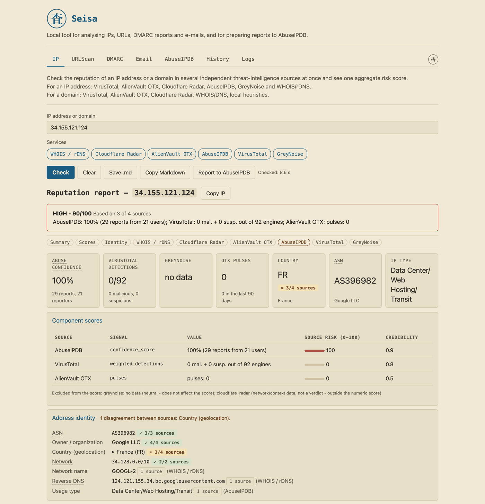
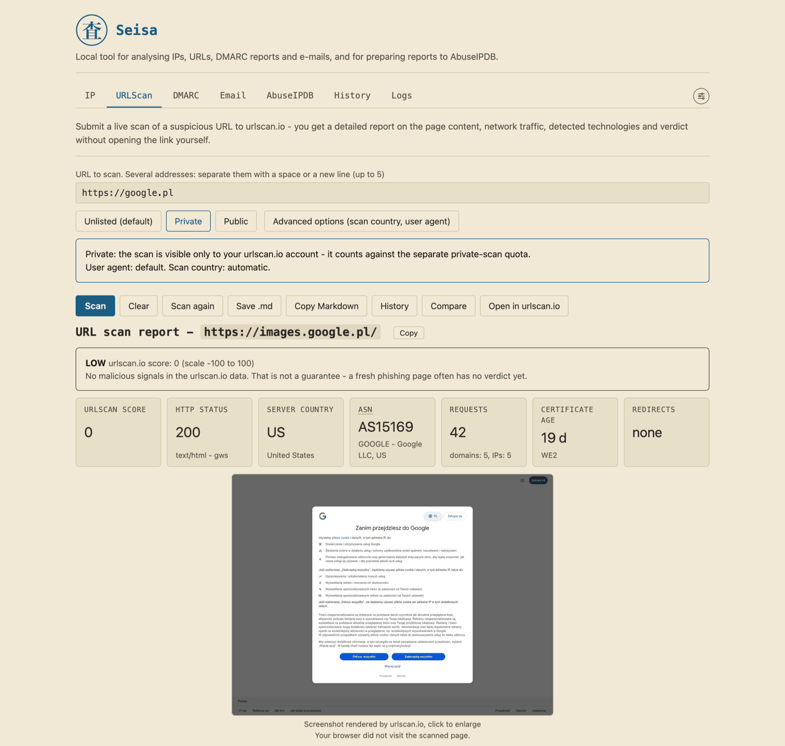
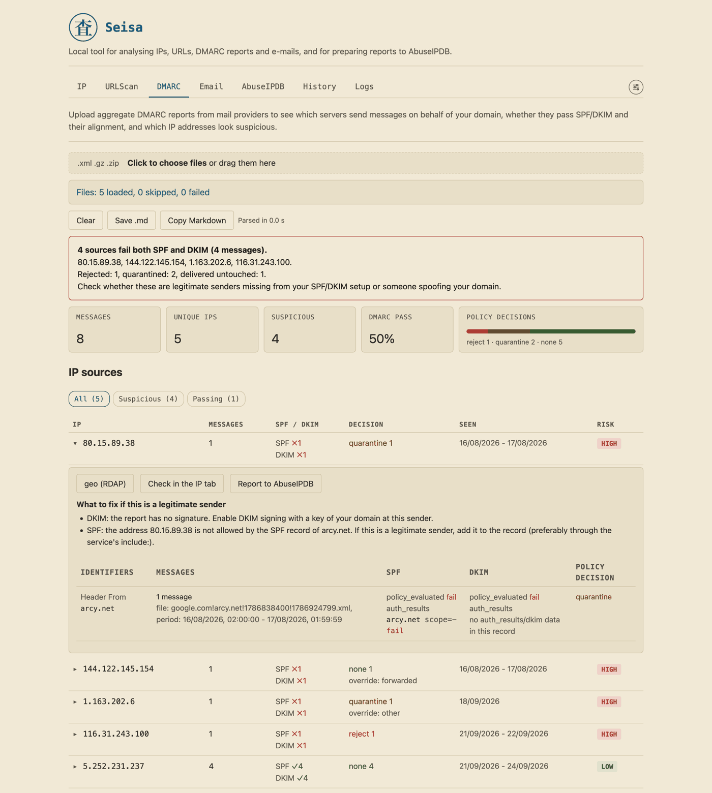
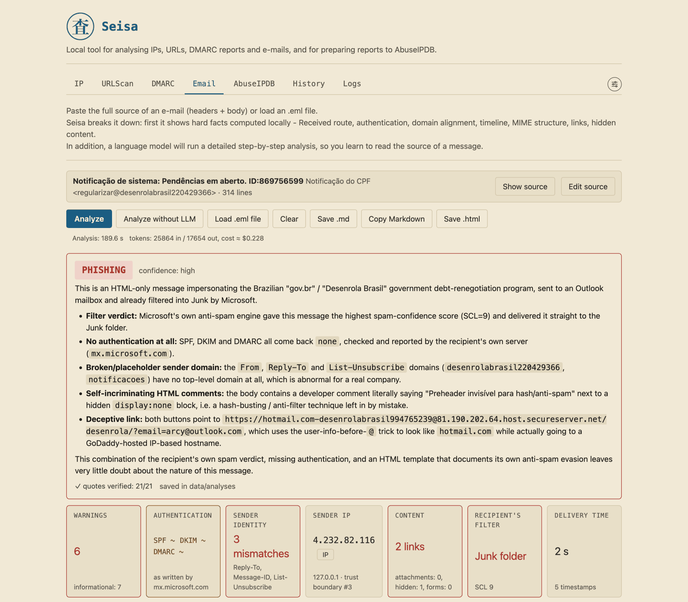
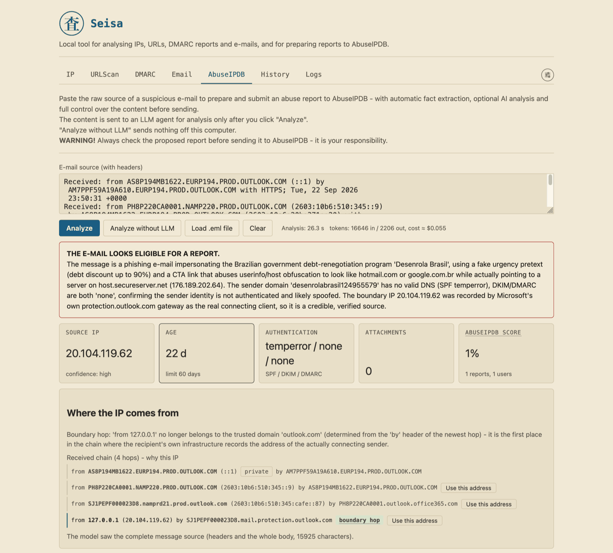

<p align="center">
  <br>
  <b>Seisa</b>
</p>

<p align="center">
  <a href="LICENSE"></a>
  <a href="https://github.com/arcymonek/seisa/actions/workflows/ci.yml"></a>
  
  
  <a href="CONTRIBUTING.md"></a>
</p>

**English** | [Polski](README.pl.md)

# Seisa

Seisa is a tool that runs on your own computer and helps you judge whether an IP address, a web link, a DMARC report or an e-mail can be trusted, and report abuse to AbuseIPDB.

You do not need to be an IT specialist: every result comes with a plain explanation. The name comes from the Japanese 精査, "a careful, detailed examination".

## Screenshots

Click a picture to see it full size.

| IP | URLScan | DMARC |
|---|---|---|
| <a href="docs/images/ip_en.png"></a> | <a href="docs/images/urlscan_en.png"></a> | <a href="docs/images/dmarc_en.png"></a> |
| **Email** | **AbuseIPDB** | |
| <a href="docs/images/email_en.png"></a> | <a href="docs/images/abuseipdb_en.png"></a> | |

## What Seisa does

Pick the tab that matches what you have in your hand. [docs/USER_GUIDE.md](docs/USER_GUIDE.md) describes every tab in detail.

| Tab | What it does | Needs an API key? |
|---|---|---|
| IP | Looks up an IP address or a domain in several sources at once and combines them into one 0-100 risk score | Each source has its own key. WHOIS, RDAP and DNS need none |
| URLScan | Has urlscan.io open a suspicious link for you and returns a report with a screenshot | `URLSCAN_API_KEY` |
| DMARC | Reads the DMARC reports of your domain (summaries that mail providers send about mail sent in your domain's name) and shows who sends mail as you | No |
| Email | Explains a suspicious e-mail step by step: local facts, plus an optional lesson from a language model | Only for the lesson |
| AbuseIPDB | Prepares, checks and, on your click, sends an abuse report about the sender of an e-mail | To send |
| History | Your recent checks, scans, imports, analyses and reports in one place | No |
| Logs | Errors and warnings of the services | No |
| Info | Version, API keys (enter them here), limits, language, theme and the application icon | No |

## Quick start

### What you need

- macOS or Linux. Windows is not supported directly (it may work through WSL, Linux inside Windows, but this has not been tested).
- Python 3.11 or newer. The installer tells you what to install if it is missing.
- A web browser, and port 54321 free: Seisa opens at `http://127.0.0.1:54321`.
- Optional: git, to update Seisa and to see "Recent changes" in the Info tab.

### Install and run

```bash
git clone https://github.com/arcymonek/seisa.git
cd seisa
bash install.sh
./seisa.sh
```

The installer sets up a private Python environment, installs the libraries and creates your `.env` settings file. The last command starts Seisa and opens your browser. Keep the terminal window open while you use it; closing it stops Seisa.

A ZIP download instead of git, the application icon, updating and troubleshooting are in [docs/OPERATIONS.md](docs/OPERATIONS.md). To remove Seisa later, run `bash uninstall.sh` in the same folder: it asks before every step and keeps your data unless you confirm ([Uninstalling](docs/OPERATIONS.md#8-uninstalling)).

### Try it without any key

You do not need an account anywhere to see Seisa at work. Right after the installation:

- **DMARC:** load a DMARC report file (`.xml`, `.gz` or `.zip`) from your mail provider.
- **Email:** paste the source of a suspicious e-mail and click "Analyze without LLM".
- **IP:** check an address; WHOIS, RDAP and DNS answer without a key.

Each API key you add later switches on one more service.

## API keys (.env)

An API key is a long code that a service gives you so it knows who is asking. Create an account with the service (the "Open ..." button next to each key in the Info tab takes you to its site). Then open the Info tab (the slider icon at the right end of the tab bar), paste the key in the "API keys" card and click "Save keys". Seisa writes it into the `.env` file for you and uses it at once.

You can also edit `.env` by hand: paste the key after the `=` sign and restart Seisa. A service without a key is simply skipped.

| Key | Service | What it switches on | Where to get it |
|---|---|---|---|
| `URLSCAN_API_KEY` | urlscan.io | The URLScan tab: scans, earlier scans, screenshots | [urlscan.io](https://urlscan.io) |
| `VIRUSTOTAL_API_KEY` | VirusTotal | An IP tab source for IPs and domains (Seisa limits itself to 4 requests a minute and 500 a day) | [virustotal.com](https://www.virustotal.com) |
| `OTX_API_KEY` | AlienVault OTX | An IP tab source for IPs and domains | [otx.alienvault.com](https://otx.alienvault.com) |
| `CLOUDFLARE_RADAR_API_KEY` | Cloudflare Radar | Context in the IP tab: network and place of an IP, ranking of a domain (not part of the score) | [dash.cloudflare.com](https://dash.cloudflare.com) |
| `ABUSEIPDB_API_KEY` | AbuseIPDB | An IP tab source; in the AbuseIPDB tab the history of an address and sending reports | [abuseipdb.com](https://www.abuseipdb.com) |
| `GREYNOISE_API_KEY` | GreyNoise | An IP tab source for IPs | [greynoise.io](https://www.greynoise.io) |
| `OPENROUTER_API_KEY` | OpenRouter | The language model: the Email lesson and the AbuseIPDB assessment and draft comment (paid by use) | [openrouter.ai](https://openrouter.ai) |
| `OPENROUTER_MODEL` | OpenRouter | Which model to use (the default is `anthropic/claude-sonnet-4.5`) | - |

WHOIS, RDAP and DNS, the public registries of who owns an address or a domain, need no key and are always on. The Info tab shows whether each key is "set" or "not set", never the key itself. The account pages and prices belong to the services and may change; check them there.

## Privacy

### Principles

- **Local.** Seisa listens only on `127.0.0.1`. It has no account, no telemetry and no update check.
- **Nothing without your click.** Nothing goes to an outside service until you click, with one documented exception (see the table below).
- **Facts come from code.** Security facts (the sender's address, the route of the mail, SPF/DKIM/DMARC results, which show whether a message really comes from the domain it claims) are computed by ordinary program code. The language model only explains them and may give an advisory second opinion.
- **Untrusted by default.** Links in e-mails and scanned pages are never clickable, and nothing in an e-mail is opened or downloaded.
- **Reports by hand.** A report reaches AbuseIPDB only after your click, and only after checks in the backend.

### What leaves your computer

This is a short version of the full table in [docs/PRIVACY.md](docs/PRIVACY.md), which lists every call.

| Action | What is sent | To whom |
|---|---|---|
| IP: "Check" | The IP address or domain | The sources you selected (WHOIS, RDAP and DNS without a key; the others with their keys) |
| URLScan: "Scan" | The URL and your options | urlscan.io, which opens the page itself |
| DMARC: "geo (RDAP)" | One source IP. Loading a report sends nothing | RDAP and DNS |
| Email: "Analyze" | The e-mail (headers, decoded text, attachments only as a size and hash) and the computed facts. "Analyze without LLM" sends nothing | OpenRouter and the model provider |
| AbuseIPDB: "Analyze" | As for Email | OpenRouter and the model provider |
| AbuseIPDB: address in the form | The IP, looked up **automatically** (the only call without a click of its own, and only with a key) | AbuseIPDB |
| AbuseIPDB: "Send via AbuseIPDB API" | The public report: IP, categories, time and comment | AbuseIPDB |
| Info: "Refresh limits" | Quota queries | VirusTotal, urlscan.io, OpenRouter |
| Info: "Search models" | A request for the public model list (no key, none of your data) | OpenRouter |

## Contributing

Bug reports, ideas and pull requests are welcome. You do not have to be a programmer to help:

- **Report a bug** or something that confused you, with the "Bug report" template.
- **Fix a sentence** in the documentation, in English or in Polish.
- **Improve a text** in the interface; the catalogs are in `frontend/i18n/`.
- **Pick a task** with the `good first issue` label.

Start with [CONTRIBUTING.md](CONTRIBUTING.md); the developer set-up is in [docs/DEVELOPMENT.md](docs/DEVELOPMENT.md). Please report security problems privately, as described in [SECURITY.md](SECURITY.md). Everyone taking part is expected to follow the [Code of Conduct](CODE_OF_CONDUCT.md).

### Project status

Seisa has one maintainer, and it is a hobby project. Replies to issues and pull requests can take a few days. Only the `main` branch receives fixes; older versions do not. If a report goes quiet for a while, please be patient.

## Documentation

- [docs/USER_GUIDE.md](docs/USER_GUIDE.md): every tab, step by step, with an example from a suspicious e-mail to a report.
- [docs/OPERATIONS.md](docs/OPERATIONS.md): installing, starting, updating, limits, your data, uninstalling, troubleshooting.
- [docs/PRIVACY.md](docs/PRIVACY.md): what leaves your computer, what stays on it, the safeguards and the threat model.
- [docs/COMPLIANCE.md](docs/COMPLIANCE.md): how reports follow AbuseIPDB's rules, the role of the model, licences.
- [docs/ARCHITECTURE.md](docs/ARCHITECTURE.md): how Seisa is built and why.
- [docs/API.md](docs/API.md): the endpoints.
- [docs/DEVELOPMENT.md](docs/DEVELOPMENT.md): set-up, checks, hooks, versioning, writing documentation.
- [CONTRIBUTING.md](CONTRIBUTING.md), [SECURITY.md](SECURITY.md), [CODE_OF_CONDUCT.md](CODE_OF_CONDUCT.md), [CHANGELOG.md](CHANGELOG.md).
- [AGENTS.md](AGENTS.md): rules for AI coding agents.

## Built with Claude Code

Seisa's code, tests and documentation are written with Claude Code, Anthropic's AI coding assistant, under the author's direction. The author decides, reviews the behaviour and is responsible for the releases.

## License and contact

Copyright (c) 2026 Arkadiusz Polak.

Seisa is free software under GPL-3.0-or-later: you may use it, change it and share it, also commercially, and a modified version you pass on must stay under the same licence, with its source. The full text is in [LICENSE](LICENSE).

The bundled `marked` library (MIT) renders Markdown; the logo and icons are the author's work under the project licence.

Website: [arkadiuszpolak.pl](https://arkadiuszpolak.pl)<br>
Contact: `github@arkadiuszpolak.pl`
