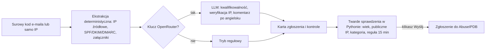
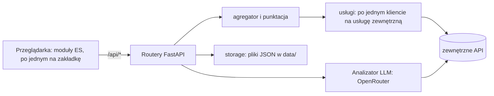

<p align="center"></p>
<p align="center"><b>Seisa 2.0.57</b></p>

# Seisa

[English](README.md) | **Polski**

   

**Seisa** to lokalne narzędzie do dokładnego przyjrzenia się podejrzanym rzeczom bez oddawania ich kolejnej usłudze w sieci: reputacja adresu IP z kilku źródeł scalona w jeden objaśniony wynik, żywe skany URL, raporty zbiorcze DMARC, edukacyjna analiza źródła e-maila i przygotowywanie zgłoszeń nadużyć do AbuseIPDB. To jeden proces Pythona na `127.0.0.1`, bez logowania, bez bazy danych i bez etapu budowania.

<!-- Zrzut ekranu do dodania: docs/img/hero-ip.png (zakładka IP z werdyktem i kartą tożsamości adresu) -->

- **Lokalne z założenia.** Nasłuchuje wyłącznie na `127.0.0.1` i nie wysyła nic nigdzie poza akcjami, które sam uruchamiasz; [co opuszcza Twój komputer](#co-opuszcza-twój-komputer) to jedna tabela.
- **Wyjaśnia, zamiast tylko punktować.** Każdy wynik pokazuje źródła, na których się opiera; analiza e-maila uczy czytać nagłówki, a nie tylko wydaje werdykt.
- **Twarde sprawdzenia są w kodzie, nie w LLM.** To, czy zgłoszenie do AbuseIPDB może zostać wysłane (wiek ataku, publiczne IP, kategoria), liczy Python i ponownie sprawdza backend; LLM tylko doradza.
- **Działa z tym, co masz.** Brak klucza API wyłącza tylko tę usługę; bez klucza OpenRouter warstwa LLM jest wyłączona, a analiza deterministyczna nadal działa.
- **Dwujęzyczne.** Cały interfejs, komunikaty backendu i raporty istnieją po polsku i angielsku.

**Seisa** (精査, *せいさ*, wym. „sejsa") - japońskie słowo oznaczające dokładne, szczegółowe zbadanie, przyjrzenie się czemuś z bliska. 精 (*sei*) = dokładny, precyzyjny, szczegółowy; 査 (*sa*) = badać, kontrolować.

Autor: Arkadiusz Polak ([GitHub: arcymonek](https://github.com/arcymonek), e-mail: kontakt (at) arkadiuszpolak (dot) pl). Problemy z bezpieczeństwem: zobacz [SECURITY.md](SECURITY.md).

## Spis treści

- [Co robi Seisa](#co-robi-seisa)
- [Szybki start](#szybki-start)
- [Konfiguracja](#konfiguracja)
- [Prywatność i przepływ danych](#prywatność-i-przepływ-danych)
- [Zakładki](#zakładki): [IP](#ip), [URLScan](#urlscan), [DMARC](#dmarc), [Email](#email), [AbuseIPDB](#abuseipdb), [Historia](#historia), [Logi](#logi), [Informacje](#informacje), [Język interfejsu](#język-interfejsu-plen)
- [Przykład: od podejrzanego e-maila do zgłoszenia](#przykład-od-podejrzanego-e-maila-do-zgłoszenia)
- [Dla deweloperów i forków](#dla-deweloperów-i-forków)
- [Rozwiązywanie problemów i FAQ](#rozwiązywanie-problemów-i-faq)
- [Historia zmian](#historia-zmian)
- [Licencja i współpraca](#licencja-i-współpraca)

## Co robi Seisa

| Zakładka | Co robi | Czego potrzebuje | Co wysyła na zewnątrz |
|---|---|---|---|
| [IP](#ip) | Reputacja adresu IP (tryb wsadowy przyjmuje też nazwy domen) z VirusTotal, OTX, Cloudflare Radar, AbuseIPDB, GreyNoise oraz RDAP/odwrotnego DNS, scalona w jeden wynik 0-100 | klucza dla każdej usługi (każdy opcjonalny) | adres, do usług, dla których masz klucze, oraz darmowe zapytania RDAP/DNS |
| [URLScan](#urlscan) | Żywy skan adresu URL przez urlscan.io z werdyktem, zrzutem ekranu, przekierowaniami, formularzami i certyfikatami | `URLSCAN_API_KEY` | adres URL, do urlscan.io |
| [DMARC](#dmarc) | Raporty zbiorcze DMARC (`.xml`, `.gz`, `.zip`) rozpakowane i przeanalizowane w przeglądarce | niczego | nic (opcjonalny przycisk wysyła jeden adres IP do ipwho.is) |
| [Email](#email) | Edukacyjna analiza źródła e-maila: od razu ustalenia deterministyczne, opcjonalnie streamowana lekcja LLM | klucza OpenRouter dla części LLM | cały kod źródłowy do OpenRouter, wyłącznie po jawnym kliknięciu |
| [AbuseIPDB](#abuseipdb) | Przygotowuje i wysyła zgłoszenie nadużycia: IP źródłowe, kwalifikowalność, kategorie, komentarz po angielsku, twarde sprawdzenia | `ABUSEIPDB_API_KEY` (OpenRouter opcjonalnie) | IP oraz, po "Wyślij", zgłoszenie, do AbuseIPDB |
| [Historia](#historia) | Wszystko, co Seisa pamięta, z ponownym otwieraniem, porównywaniem i przypinaniem | niczego | nic |
| [Logi](#logi) | Błędy i ostrzeżenia każdej usługi | niczego | nic |
| [Informacje](#informacje) | Wersja, status kluczy, limity API, ostatnie zmiany, licencja | niczego | zapytania o limity tylko po "Odśwież limity" |

<!-- Zrzuty ekranu do dodania: docs/img/tab-*.png (po jednym na zakładkę, patrz sekcja Zakładki) -->

## Szybki start

### Wymagania

- **Python 3.11+** na **macOS** lub **Linuksie**. Na Debianie/Ubuntu najpierw zainstaluj moduł venv (`sudo apt install python3-venv`). Windows nie jest wspierany natywnie; działa przez WSL jako Linux.
- Aktualna przeglądarka. `git` jest opcjonalny (zakładka Informacje czyta listę wydań z `git log`, gdy katalog jest checkoutem).
- Do startu nie jest wymagany żaden klucz API; zobacz [Pierwsze kroki bez kluczy](#pierwsze-kroki-bez-kluczy).

### Instalacja i uruchomienie

Pobierz kod (sklonuj repozytorium albo rozpakuj archiwum wydania) i w katalogu projektu:

```bash
python3 -m venv .venv
./.venv/bin/pip install -r requirements.txt
cp .env.example .env
chmod 600 .env
./seisa.sh
```

`requirements.lock` zawiera dokładnie przetestowane wersje (`pip install -r requirements.lock` zamiast `requirements.txt`). Skrypt startowy uruchamia serwer i otwiera przeglądarkę na `http://127.0.0.1:54321` (macOS: `open`; Linux z pulpitem: `xdg-open`; w pozostałych przypadkach tylko wypisuje adres do otwarcia ręcznie). Gdy brakuje `.venv/`, informuje o tym i kończy działanie.

Bez skryptu:

```bash
./.venv/bin/uvicorn backend.main:app --port 54321 --host 127.0.0.1
```

Aby użyć innego portu, uruchom `uvicorn` samodzielnie z `--port`. Możesz dodać do skryptu alias powłoki (np. `alias seisa='~/ścieżka/do/seisa/seisa.sh'`). Po edycji `.env` uruchom Seisę ponownie; klucze są czytane przy starcie.

### Pierwsze kroki bez kluczy

Całe UI możesz wypróbować na fikcyjnych danych, bez kluczy i bez ruchu sieciowego, uruchamiając aplikację na atrapach, której używa harness testowy (wszystkie usługi zewnętrzne są zastąpione stałymi odpowiedziami, dane trafiają do katalogu tymczasowego):

```bash
./.venv/bin/python scripts/api_harness.py --serve 8765
```

Potem otwórz `http://127.0.0.1:8765`. Prawdziwa aplikacja bez kluczy:

- **Działa:** w pełni zakładka [DMARC](#dmarc), analiza deterministyczna w zakładce [Email](#email), WHOIS/rDNS (RDAP i odwrotny DNS) w zakładce [IP](#ip), [Historia](#historia), [Logi](#logi), [Informacje](#informacje) i przełącznik języka.
- **Wyłączone, osobno dla usługi:** każda usługa bez klucza pokazuje "brak klucza API" i jest wyłączona z wyniku zbiorczego. Bez `OPENROUTER_API_KEY` warstwa LLM jest wyłączona (zakładka [AbuseIPDB](#abuseipdb) działa wtedy w trybie regułowym i nigdy nie twierdzi, że e-mail się kwalifikuje). Wysłanie zgłoszenia i karta "co AbuseIPDB już wie" wymagają `ABUSEIPDB_API_KEY`.

## Konfiguracja

### Klucze API (.env)

Skopiuj `.env.example` do `.env`, uzupełnij klucze, które masz, i ustaw plikowi dostęp tylko dla siebie (`chmod 600 .env`). `.env` jest w `.gitignore`, a klucze nigdy nie trafiają do przeglądarki.

| Zmienna | Wymagana? | Gdzie zdobyć |
|---|---|---|
| `URLSCAN_API_KEY` | tak, dla urlscan.io | [urlscan.io/user/signup](https://urlscan.io/user/signup) |
| `VIRUSTOTAL_API_KEY` | tak, dla VirusTotal | [virustotal.com](https://www.virustotal.com) |
| `OTX_API_KEY` | tak, dla OTX | [otx.alienvault.com](https://otx.alienvault.com) |
| `CLOUDFLARE_RADAR_API_KEY` | tak, dla Cloudflare Radar | [dash.cloudflare.com/profile/api-tokens](https://dash.cloudflare.com/profile/api-tokens) |
| `ABUSEIPDB_API_KEY` | tak, dla AbuseIPDB (odczyt i zgłoszenia) | [abuseipdb.com](https://www.abuseipdb.com) |
| `GREYNOISE_API_KEY` | tak, dla GreyNoise | [greynoise.io](https://www.greynoise.io) |
| `OPENROUTER_API_KEY` | nie, opcjonalny | [openrouter.ai](https://openrouter.ai) - włącza analizę LLM w zakładce Email oraz ocenę kwalifikowalności e-maila i szkic komentarza zgłoszenia w zakładce AbuseIPDB |
| `OPENROUTER_MODEL` | nie | domyślnie `anthropic/claude-sonnet-4.5` - zweryfikuj dokładny slug na liście modeli OpenRouter |

> **Uwaga:** klucz Cloudflare **musi być zakresowanym API Tokenem z uprawnieniem odczytu Radar, nie starym Global API Key** (ten drugi daje błąd 401).

Brak klucza dla dowolnej usługi nie blokuje reszty narzędzia - usługa po prostu pokazuje status "brak klucza API" i jest wykluczona z wyniku zbiorczego.

### Limity i ograniczenia

| Co | Limit | Uwagi |
|---|---|---|
| VirusTotal | 4 zapytania/min, 500/dzień | widoczny throttle w trybie wsadowym; dzienny licznik (`data/vt_usage.json`) zeruje się o 00:00 UTC |
| Cache wyników | 15 minut, w pamięci | opcja wymusza odświeżenie |
| Wyszukiwanie wsadowe | 200 wskaźników | |
| Źródło e-maila | 3 mln znaków | |
| Odpowiedź LLM | 64000 tokenów | sufit liczony razem z ukrytym rozumowaniem modelu (ok. 45% wyjścia); płacisz tylko za to, co wygenerowano |
| Zgłoszenie do AbuseIPDB | jedno na IP na 15 minut, komentarz do 1024 znaków, do 30 kategorii | reguła 15 minut jest egzekwowana (HTTP 409), zanim zostanie zużyte zapytanie |
| Historia | 25 nieprzypiętych wpisów | przypięte nigdy nie wypadają |
| Widoczne logi | 500 najnowszych wpisów | |

Limity planów darmowych każdej usługi z kluczem (zużyto / limit / reset) są w zakładce [Informacje](#informacje), w karcie "Limity API".

## Prywatność i przepływ danych

Seisa nasłuchuje wyłącznie na `127.0.0.1` i nie ma logowania. Nic nie opuszcza komputera poza tym, co jest wypisane tutaj, a każdy wiersz jest wywoływany Twoją akcją. Frontend nie ładuje niczego z CDN, żadnych czcionek ani analityki; `marked.min.js` jest dołączony lokalnie.

### Co opuszcza Twój komputer

| Akcja | Co jest wysyłane | Dokąd | Kiedy |
|---|---|---|---|
| Sprawdzenie IP (i tryb wsadowy) | adres IP (w trybie wsadowym także nazwa domeny) | VirusTotal, AlienVault OTX, Cloudflare Radar, AbuseIPDB, GreyNoise - tylko te z kluczem | gdy uruchamiasz sprawdzenie |
| Sprawdzenie IP, część darmowa | adres IP; w trybie wsadowym nazwa domeny | `rdap.org` (bootstrap RDAP, który przekierowuje do właściwego rejestru regionalnego), Twój resolver DNS (odwrotny DNS) oraz serwery WHOIS dla nazw domen (`python-whois`) | gdy uruchamiasz sprawdzenie |
| Skan URL | adres URL i wybrana widoczność; domena w wyszukiwaniu "Wcześniejsze skany"; identyfikator skanu przy pobieraniu wyniku, zrzutu i DOM | urlscan.io | gdy skanujesz |
| DMARC "geo/ASN" | jeden adres IP, z Twojej przeglądarki | [ipwho.is](https://ipwho.is) | tylko po kliknięciu w rozwiniętym wierszu |
| Email: "Analizuj" (nie "Analizuj bez LLM"), "Dokończ analizę", "Zapytaj" | cały kod źródłowy e-maila (z danymi osobowymi), a przy "Zapytaj" także pytanie i fragment | OpenRouter | tylko po tym kliknięciu; interfejs mówi o tym przed wysyłką |
| AbuseIPDB: "Analizuj" | cały kod źródłowy e-maila | OpenRouter | tylko po tym kliknięciu |
| AbuseIPDB: sprawdzenie adresu | IP | AbuseIPDB (`/check`) | gdy wpisano IP i istnieje klucz |
| AbuseIPDB: "Wyślij" | IP, kategorie, timestamp, komentarz | AbuseIPDB (`/report`) - **publicznie** | tylko po świadomym kliknięciu |
| Informacje: "Odśwież limity" | zapytania o limity z Twoimi kluczami | VirusTotal, urlscan.io, OpenRouter | tylko po kliknięciu; żadne z tych zapytań nie zużywa limitu |
| Cisco Talos | nic z Seisy; przycisk tylko pomaga Ci samodzielnie otworzyć Talos | - | gdy klikniesz |

Zapytania Seisy do OpenRouter przedstawiają aplikację jako Seisa. Wszystko inne w interfejsie (Historia, Logi, porównania, eksporty, kontrola cytatów, wykrywanie duplikatów) jest lokalne.

### Co zostaje lokalnie

- `data/` zawiera historię, liczniki, log wysłanych zgłoszeń i zapisane analizy e-maili (z surowymi wiadomościami, pliki `0600`, katalog `0700`); `logs/` zawiera błędy i ostrzeżenia. Oba są w `.gitignore`. Zobacz [Pliki danych](#pliki-danych).
- Klucze API zostają w `.env` (gitignored) i nigdy nie są wysyłane do frontendu; zakładka Informacje pokazuje tylko, czy klucz jest ustawiony.
- Przeglądarka przechowuje w `localStorage` wyłącznie wygody użytkownika (język interfejsu pod kluczem `seisa.lang`, wybrany panel, które karty zostawiłeś otwarte).
- Nie ma telemetrii ani sprawdzania aktualizacji.

### Model zagrożeń

**Seisa chroni przed:**

- niezaufaną treścią (e-maile, XML DMARC, strony ze skanów urlscan, komentarze w odpowiedziach zewnętrznych API), która uruchomiłaby kod w interfejsie albo kazała narzędziu coś pobrać: allow-lista HTML, Content-Security-Policy, nieklikalne "zdefangowane" linki, a nic z wiadomości nie jest nigdy otwierane ani pobierane;
- inną stroną WWW rozmawiającą z Twoim lokalnym API (nagłówek `Host` tylko z pętli zwrotnej blokuje DNS rebinding; skrypty tylko z własnego originu Seisy);
- przypadkowym wyciekiem danych: LLM jest wywoływany tylko po jawnym kliknięciu, komentarz do AbuseIPDB dostaje skan danych osobowych z maskowaniem, a twarde sprawdzenia są liczone od nowa w backendzie.

**Seisa nie chroni przed:**

- kimś z dostępem do Twojego komputera lub konta użytkownika: nie ma uwierzytelniania, każdy lokalny proces może wywołać API, a `.env` to zwykły tekst;
- wystawieniem portu 54321 do sieci: to narzędzie jednoosobowe, nie rób tego;
- tym, co wyślesz podmiotom trzecim: gdy e-mail trafi do OpenRouter lub zgłoszenie do AbuseIPDB (które pokazuje komentarze publicznie), jest już ich;
- błędną odpowiedzią LLM: werdykt jest pomocą, kontrola cytatów podpowiedzią, a nie dowodem.

### Koszt LLM

Pieniądze kosztują tylko wywołania OpenRouter (za token, zależnie od modelu; tokeny obejmują ukryte rozumowanie modelu). Koszt jest czytany z `usage.cost` zwracanego przez OpenRouter i pokazywany obok przycisku akcji; Seisa nie ma cennika.

| Płatne (OpenRouter) | Darmowe (lokalne lub API planów darmowych) |
|---|---|
| Email: "Analizuj", "Dokończ analizę", "Zapytaj" | Email: analiza deterministyczna, wykrywanie duplikatów, kontrola cytatów, porównanie, wszystkie eksporty |
| AbuseIPDB: "Analizuj" | AbuseIPDB: twarde sprawdzenia, skan danych osobowych, "Wyślij" (zapytanie do AbuseIPDB, bez LLM) |
| | IP, URLScan, DMARC, Historia, Logi, Informacje |

Przed płatną analizą e-maila Seisa sprawdza, czy ta sama wiadomość była już analizowana, i proponuje otwarcie zapisanej analizy.

## Zakładki

Rząd zakładek: [IP](#ip), [URLScan](#urlscan), [DMARC](#dmarc), [Email](#email), [AbuseIPDB](#abuseipdb), [Historia](#historia), [Logi](#logi) i okrągły przycisk informacji ([Informacje](#informacje)). Zakładki IP, URLScan, DMARC, Email, AbuseIPDB, Historia, Logi i Informacje mają wspólny układ: baner werdyktu (kolor wg poziomu), kafelki podsumowania, a niżej zwijane karty, które otwierają się same tylko przy sygnale.

### IP

> Reputacja adresu IP z sześciu źródeł, scalona w jeden objaśniony wynik 0-100.

**Wejście:** adres IP (tryb wsadowy: wiele adresów lub domen) | **Wynik:** raport (werdykt, kafelki, karta tożsamości, karty źródeł) | **Wysyła na zewnątrz:** adres do usług, dla których masz klucze, oraz darmowe zapytania RDAP i DNS | **Klucze:** każda usługa opcjonalna. Skanowanie URL jest w zakładce [URLScan](#urlscan).

<!-- Zrzut ekranu do dodania: docs/img/tab-ip.png -->

| Usługa | Co dostarcza |
|---|---|
| [VirusTotal](https://www.virustotal.com) | detekcje silników AV, reputacja, ASN, kategorie, tagi, WHOIS |
| [AlienVault OTX](https://otx.alienvault.com) | pulsy threat-intel, geolokalizacja, ASN |
| [Cloudflare Radar](https://radar.cloudflare.com) | dane sieciowe/kontekstowe - ASN, lokalizacja, routing (nie werdykt) |
| [AbuseIPDB](https://www.abuseipdb.com) | confidence score, liczba zgłoszeń, autor najnowszego zgłoszenia, ISP |
| [GreyNoise](https://www.greynoise.io) | pełny IP Lookup (`/v3/ip`) - aktor, tagi, VPN/Tor, metadane sieciowe; spada na darmowy endpoint community, jeśli klucz nie ma dostępu do pełnego API; "brak informacji w usłudze" liczone jako wkład 0.0, nie jako "unknown" |
| WHOIS / rDNS | odwrotny DNS (PTR) + pełny RDAP (RFC 9083, następca WHOIS) - zakres sieci, właściciel, kontakt abuse/techniczny, daty rejestracji - bez klucza API |
| Cisco Talos | brak oficjalnego API - tylko przycisk do ręcznego sprawdzenia |

Co dostajesz:

- **Jeden wynik zbiorczy** 0-100 i baner werdyktu: LOW poniżej 25, MEDIUM 25-59, HIGH od 60 (kolor wg poziomu, z wartościami, na których się opiera).
- **Kafelki podsumowania:** pewność nadużyć, wykrycia, GreyNoise, pulsy OTX, kraj, ASN, typ IP oraz tabela wyników składowych.
- **Karta tożsamości adresu**, która scala właściciela, ASN, kraj, sieć, odwrotny DNS, typ użycia i Tor ze wszystkich źródeł i pokazuje, ile źródeł się zgadza.
- **Jedna zwijana karta na źródło**, otwarta tylko dla źródeł z sygnałem (ryzyko źródła co najmniej 25); listy (tagi, CVE, porty, pulsy) to chipy z "pokaż więcej".
- **Tryb wsadowy** (wiele adresów naraz, z widocznym throttlem VirusTotal) oraz 15-minutowy cache w pamięci z opcją wymuszenia odświeżenia.
- **Eksport:** "Zapisz .md" (natywne okno wyboru miejsca zapisu w przeglądarce) albo kopiowanie; Markdown zawiera cały raport, także tabelę tożsamości.

<details>
<summary>Szczegóły: model punktacji, karta tożsamości, surowe odpowiedzi</summary>

**Punktacja** (`backend/scoring.py`). Model szum-OR: każde źródło - AbuseIPDB, VirusTotal, GreyNoise, OTX - daje ryzyko 0-100 nieliniową skalą i ma własną wiarygodność (0,9, 0,8, 0,7 i 0,5). Źródło bez danych nie głosuje, więc nie rozrzedza wyniku. Znane dobre IP (wpis na białej liście AbuseIPDB, GreyNoise benign/RIOT, walidacja OTX) obniża wynik do 15, chyba że występują silne sprzeczne sygnały. Cloudflare Radar jest kontekstowy i celowo wyłączony z liczby. Raport podaje też, ile źródeł wzięło udział, i dodaje uwagi.

**Tożsamość adresu** (`backend/identity.py`). Wartości są najpierw normalizowane (ASN do liczby, kraj do kodu ISO, nazwy właścicieli bez form prawnych, zakresy RDAP do CIDR). Przy każdym polu widać, ile źródeł się zgadza. Gdy się różnią, pokazywana jest wartość większości z bursztynową plakietką (kliknięcie wypisuje wszystkie wartości ze źródłami); przy remisie wartość z najwyżej cenionego źródła (RDAP jako rejestr pierwszy) z czerwoną plakietką. Kraj rejestracji (RDAP) i kraj geolokalizacji to osobne pola, bo przy hostingu i anycaście zwykle się różnią. Dotyczy to tylko wyświetlania, nie wyniku.

**Surowe odpowiedzi.** Pełna odpowiedź API każdego źródła, z numerami linii, jest w sekcji "Pełna odpowiedź API" jego karty.

</details>

### URLScan

> Żywy skan adresu URL przez urlscan.io, w układzie jak zakładka IP.

**Wejście:** adres URL (przyjmuje zdefangowane linki) | **Wynik:** werdykt, zrzut ekranu, tożsamość strony, karty szczegółów | **Wysyła na zewnątrz:** adres URL do urlscan.io | **Klucze:** `URLSCAN_API_KEY`.

<!-- Zrzut ekranu do dodania: docs/img/tab-urlscan.png -->

Co dostajesz:

- **Baner werdyktu** w kolorze z wyniku urlscan.io oraz werdyktów silników i społeczności; "brak werdyktu" jest pokazany neutralnie i wprost nie jako "bezpieczne".
- **Kafelki podsumowania:** wynik, status HTTP, kraj serwera, ASN, żądania, wiek certyfikatu (ze znacznikiem "nowy" poniżej 7 dni), przekierowania.
- **Zrzut ekranu strony** i karta **Tożsamość strony**: zgłoszony i końcowy URL, łańcuch przekierowań, tytuł, domena, główne IP z przyciskiem **Sprawdź IP**, lokalizacja, PTR, serwer, typ MIME, czas skanu i widoczność.
- **Zwijane karty szczegółów:** werdykt urlscan.io (otwarty tylko przy sygnale ryzyka), formularze, certyfikat TLS, technologie, kontaktowane adresy IP (każdy z przyciskiem **Sprawdź IP**), kontaktowane domeny i linki.
- **Wcześniejsze skany** tej samej domeny, żeby otworzyć świeży raport zamiast zlecać nowy skan; "Skanuj ponownie" powtarza skan.
- **Eksport:** "Zapisz .md" i "Kopiuj Markdown"; adresy znalezione na skanowanej stronie są zdefangowane i tam także nigdy nie są klikalne.

<details>
<summary>Szczegóły: zlecanie skanu, czyszczenie adresu, karta Formularze, historia</summary>

**Jak przebiega skan.** `POST /api/v1/scan/`, potem odpytywanie `GET /api/v1/result/{uuid}/` co 5 sekund, aż wynik będzie gotowy (urlscan.io zwraca 404, dopóki skan trwa; postęp pokazuje trzyetapowy wskaźnik). Backend najpierw czyści adres: zdefangowany link (`hxxps://evil[.]example`) zostaje przywrócony, brakujący schemat zamieniany jest na `https://`, a to, czego urlscan.io nigdy nie zeskanuje, jest odrzucane z czytelnym komunikatem (schematy inne niż HTTP, `localhost`, adresy prywatne i lokalne, nazwy z sieci wewnętrznej).

**Stałe wybory przy zlecaniu.**

- **Widoczność, którą wybierasz:** domyślnie `unlisted` (nie trafia na stronę główną ani do publicznego wyszukiwania urlscan.io, ale jest widoczny dla zweryfikowanych badaczy bezpieczeństwa w urlscan Pro), `private` (tylko Twoje konto) lub `public` (każdy; zakładka ostrzega o tym).
- **Wcześniejsze skany:** najpierw przeszukiwane jest urlscan.io pod kątem wcześniejszych skanów tej samej domeny (publicznych oraz z Twojego konta); trafienie jest oznaczone, gdy to dokładnie ten sam URL.
- **Domyślny user-agent** (bez `customagent`) i **automatyczny dobór kraju skanowania** (bez `country`): oba pola są celowo pominięte w zapytaniu.

**Zrzut ekranu.** Pobiera go z urlscan.io backend i serwuje z Twojego własnego źródła, więc ani przeglądarka, ani Content-Security-Policy nie mają styczności z urlscan.io ani ze skanowaną stroną.

**Karta Formularze** czyta wyrenderowany DOM, który przechowuje urlscan.io (tylko struktura - nic ze strony nie jest ładowane): dokąd wysyła każdy formularz, jaką metodą i z jakimi polami. Pole hasła wysyłane na inną domenę lub przez zwykłe HTTP to klasyczny zestaw phishingowy i podnosi "niski" lub brakujący werdykt urlscan.io do Średniego (z adnotacją).

**Historia.** Każdy zakończony skan trafia do zakładki [Historia](#historia) jako ustrukturyzowane podsumowanie oraz mała miniatura zrzutu w JPEG (640 px szerokości, dziesiątki KB). "Otwórz ponownie" pokazuje go znów w tej zakładce, a "Wczytaj pełny raport" pobiera z urlscan.io kompletny wynik po identyfikatorze.

</details>

### DMARC

> Przeciągnij raporty zbiorcze DMARC i zobacz wszystko, co zawierają, bez wysyłania czegokolwiek poza przeglądarkę.

**Wejście:** raporty `.xml`, `.gz` lub `.zip` dokładnie takie, jakie wysyłają dostawcy (Google, Microsoft i inni) | **Wynik:** werdykt, kafelki, wskazówki o polityce, źródła zagregowane wg IP | **Wysyła na zewnątrz:** nic (opcjonalny przycisk geo/ASN wysyła jeden adres IP do ipwho.is) | **Klucze:** brak.

<!-- Zrzut ekranu do dodania: docs/img/tab-dmarc.png -->

Co dostajesz:

- **Rozpakowywanie i parsowanie w 100% w przeglądarce**; raport wgrany dwa razy (ten sam dostawca i ID raportu) jest pomijany i oznaczony na liście plików.
- **Baner werdyktu:** czerwony, gdy jakieś źródło nie przechodzi ani SPF, ani DKIM; żółty, gdy zawodzi tylko jedna z metod; w innym razie zielony; błędy zgłoszone w raporcie mają osobny baner. Ocena ryzyka bez zmian: wysokie = SPF i DKIM oba niezgodne, średnie = jedna z metod niezgodna.
- **Wskazówki o ostatniej opublikowanej polityce każdej domeny:** `p=none` tylko monitoruje, politykę można prawdopodobnie zaostrzyć, `pct` poniżej 100.
- **Kafelki podsumowania:** wiadomości, unikalne IP, źródła podejrzane, odsetek wiadomości zgodnych z DMARC oraz pasek decyzji polityki reject/quarantine/none; przy więcej niż jednym raporcie tabela według dostawcy.
- **Źródła zagregowane wg adresu IP**, od najbardziej ryzykownych, z filtrem (wszystkie / podejrzane / przechodzące), licznikami SPF i DKIM pass/fail i decyzjami polityki.
- **Diagnoza, nie tylko werdykt:** kliknięcie wiersza rozwija każdy pojedynczy rekord, co pokazuje dokładnie, *dlaczego* dopasowanie nie przeszło.
- **Eksport:** "Zapisz .md" i "Kopiuj Markdown"; każdy import trafia do [Historii](#historia) razem z rekordami, a "Otwórz ponownie" przywraca pełną analizę.

<details>
<summary>Szczegóły: co pokazuje każda część</summary>

**Raporty.** Każdy wgrany raport to rozwijany blok z każdym polem metadanych i opublikowanej polityki: dostawca, kontakt i dodatkowy kontakt, ID i wersja raportu, okres, domena, `p`/`sp`/`pct`/`fo`, alignment (`adkim`/`aspf`, z oznaczonymi wartościami domyślnymi), błędy raportu i każdy inny element, który raport zawiera (np. `np`, `testing` albo znaczniki dostawcy).

**Źródła.** Override, np. `forwarded`, jest odnotowany obok decyzji polityki, żeby prawowite przekazywanie poczty nie wyglądało jak atak.

**Rekordy.** Rozwinięty wiersz pokazuje: header/envelope from i to, powód nadpisania polityki (`policy_evaluated > reason`), surowy wynik `auth_results` (domena/selektor/wynik/`human_result` dla DKIM, domena/scope/wynik dla SPF) i ewentualne dodatkowe pola.

**geo/ASN i dalsze kroki.** Opcjonalny przycisk "geo/ASN" w rozwiniętym wierszu wysyła ten jeden adres IP do zewnętrznej usługi [ipwho.is](https://ipwho.is) (z przeglądarki, wyłącznie po kliknięciu) i pokazuje kraj oraz ASN. Stamtąd można przejść do pełnego sprawdzenia reputacji (zakładka [IP](#ip)) albo do przygotowania zgłoszenia AbuseIPDB.

**Legenda i eksport.** Zakładkę zamyka krótka legenda pojęć SPF, DKIM, polityki i tabeli. Eksport Markdown zawiera podsumowanie, raporty, źródła i każdy rekord (wartości z XML trafiają do bloków kodu).

</details>

### Email

> Edukacyjna analiza źródła e-maila: co mówią nagłówki, dlaczego i co z tym zrobić.

**Wejście:** wklejony kod źródłowy (nagłówki + treść) albo plik `.eml` (UTF-8 lub windows-1252; koperta mbox i zakończenia linii są normalizowane) | **Wynik:** od razu ustalenia deterministyczne, opcjonalnie lekcja LLM | **Wysyła na zewnątrz:** przy "Analizuj" cały kod źródłowy do OpenRouter | **Klucze:** `OPENROUTER_API_KEY` dla części LLM. Binarne załączniki base64 nigdy nie idą do modelu (zostaje tylko ich rozmiar i sha256); tekstowe części base64 są dekodowane.

<!-- Zrzuty ekranu do dodania: docs/img/tab-email-overview.png i docs/img/tab-email-lesson.png -->

Co dostajesz:

- **Analiza deterministyczna, od razu i lokalnie** (bez LLM): anomalie, trasa Received z rolą każdego hopu w łańcuchu zaufania, uwierzytelnianie, zgodność domen, oś czasu w UTC, drzewo MIME, załączniki, linki, ukryta treść i filtry antyspamowe odbiorcy.
- **Szczegółowa analiza LLM**, streamowana na żywo (OpenRouter, ten sam klucz i model co w AbuseIPDB), według przewodnika `docs/email-analysis-guide.md`; pierwsza linia to werdykt z poziomem pewności.
- **Trzy panele ze spisem treści:** Przegląd (diagram trasy, ostrzeżenia, lista kontrolna, co robić, kontrola cytatów), Fakty (analiza deterministyczna jako zwijane karty) i Lekcja (cała analiza LLM).
- **Karty dowodowe i szuflada źródła:** cytaty z wiadomości pokazują numery linii i przycisk "Pokaż w źródle".
- **Zapisane analizy** z wykrywaniem duplikatów, porównaniem dwóch analiz, pytaniami dodatkowymi i eksportami (`.md`, `.html`).
- **Nic z wiadomości nie jest otwierane ani pobierane**; linki są pokazywane jako nieklikalny, zdefangowany tekst.

<details>
<summary>Szczegóły: analiza deterministyczna</summary>

Uwagi o anomaliach, trasa Received z rolą w łańcuchu zaufania, uwierzytelnianie (SPF/DKIM/DMARC/ARC, authserv-id, podpisane i niepodpisane nagłówki, długość `bh=`), zgodność domen względem `From`, oś czasu w UTC, konwersje epoch, drzewo MIME, załączniki (sha256, podwójne rozszerzenia), linki (tekst vs `href`), ukryta treść, komentarze HTML, placeholdery szablonu, filtry antyspamowe odbiorcy (SCL/BCL/CAT, folder docelowy Junk, AuthAs, zdekodowany X-Message-Delivery) i flagi ustawione przez nadawcę (X-Message-Flag, Importance, żądania potwierdzenia odbioru). Gdy cały łańcuch Received należy do jednego operatora (np. Microsoft), tabela wskazuje granicę zaufania na najstarszym wpisie. Identyczne uwagi wynikające z powtórzonych linków są zgłaszane raz z liczbą wystąpień, np. `(x4)`. Logika jest w `backend/email_forensics.py`.

</details>

<details>
<summary>Szczegóły: układ wyniku</summary>

Jak w zakładkach IP, DMARC i URLScan:

- **Baner werdyktu** na górze: werdykt, pewność, streszczenie analizy, stan kontroli cytatów i akcje (zgłoszenie, zapis/kopia, dokończenie ściętej analizy).
- **Rząd kafelków:** ostrzeżenia, SPF/DKIM/DMARC zapisane przez serwer odbiorcy, zgodność tożsamości nadawcy, IP na granicy zaufania (z przyciskiem wstawiającym je do zakładki IP), linki/załączniki/ukryta treść, filtr odbiorcy, czas doręczenia.
- **Trzy panele ze spisem treści po lewej:** **Przegląd** (trasa wiadomości jako diagram z granicą zaufania, ostrzeżenia, lista kontrolna i część "co robić" z analizy, kontrola cytatów), **Fakty** (analiza deterministyczna jako zwijane karty; karta otwiera się sama tylko przy sygnale i pokazuje jednoliniowy stan w nagłówku) i **Lekcja** (cała analiza LLM).
- Po analizie źródło zwija się do jednolinijkowego paska ("Edytuj źródło" przywraca pole). Zakładka pamięta wybrany panel.

</details>

<details>
<summary>Szczegóły: lekcja LLM</summary>

- Analizę prowadzi przewodnik `docs/email-analysis-guide.md`: model mentalny, analiza linijka po linijce zarówno elementów dobrych, jak i złych, lista kontrolna, pułapki, ocena, pytania kontrolne z odpowiedziami w zwijanych sekcjach.
- Tekst jest dzielony po nagłówkach `##` na zwijane karty. Wszystkie karty startują zwinięte; wybrany przez Ciebie stan jest zapamiętywany; "Rozwiń wszystko" / "Zwiń wszystko"; podbloki części linia po linii też się zwijają. Jeśli model zepsuje strukturę, tekst pokazuje się jako jeden blok. Lekcję można przeszukiwać (trafienia otwierają zwinięte karty).
- Cytaty z wiadomości stają się **kartami dowodowymi** z numerami linii i przyciskiem "Pokaż w źródle", który otwiera **szufladę źródła** (wiadomość z numerami linii, cytowane linie podświetlone, po kilku trafieniach można przechodzić). Cytat, którego nie ma dosłownie w źródle, jest oznaczony jako schemat lub przykład. Kod w tekście, który występuje w źródle, jest klikalny tak samo.
- Terminy techniczne (SPF, DKIM, DMARC, ARC, PTR, SCL, HELO...) mają kropkowane podkreślenie i krótkie wyjaśnienie po najechaniu, raz w całej analizie.
- Analiza LLM nie odtwarza tabel widocznych w analizie deterministycznej (oś czasu, linki, Received itd.), tylko je interpretuje, żeby nie płacić za powtórki; komplet jest w eksporcie.
- Wynik jest renderowany bezpiecznie: surowy HTML z e-maila i linki są neutralizowane.
- Limit odpowiedzi modelu to 64000 tokenów (liczony razem z ukrytym rozumowaniem modelu, ok. 45% wyjścia; to sufit, płaci się za tokeny faktycznie wygenerowane). Jeśli analiza mimo to zostanie ucięta, zakładka pokazuje ostrzeżenie i przycisk **"Dokończ analizę"** (model dostaje dotychczasowy tekst i dopisuje brakujące części; zużycie tokenów i koszt sumują się w zapisanej analizie).

</details>

<details>
<summary>Szczegóły: protokół werdyktu, język, kontrola cytatów</summary>

- **Protokół werdyktu** (`backend/verdict.py`): pierwsza linia odpowiedzi modelu ma postać `VERDICT: <legit|phishing|spam|scam|malware|inconclusive> | CONFIDENCE: <high|medium|low>` i zawsze używa tych kanonicznych kodów, niezależnie od języka analizy; interfejs mapuje je na etykiety w wybranym języku. Analizy zapisane wcześniej z polskimi tokenami (`WERDYKT`/`PEWNOSC`) są odczytywane bez migracji plików.
- **Język analizy:** analiza powstaje w języku interfejsu (dyrektywa w prompcie plus tabela dosłownych nagłówków i tagów `[Fakt]`/`[Fact]` w obu językach w `docs/email-analysis-guide.md`); język zapisuje się w rekordzie (`lang`; starsze rekordy = polski). „Dokończ analizę" używa języka zapisanego rekordu, a nie bieżącego języka interfejsu. Zapisana analiza w innym języku niż interfejs jest oznaczona plakietką PL/EN, a przy jej otwarciu pojawia się baner z płatnym przyciskiem ponownej analizy (koszt poprzedniej podany orientacyjnie); fakty i tekst zostają w języku powstania, etykiety i eksport `.md` w języku interfejsu. Wykrywanie duplikatów nie zależy od języka: baner pokazuje język istniejącej analizy.
- **Kontrola cytatów** (lokalna, bez kosztu; `backend/citation_check.py`): po analizie kod sprawdza, czy adresy IP, cytowane w blokach kodu linie nagłówków, cytaty `Nagłówek: wartość`, liczby SCL/BCL i identyfikatory podane przez model występują w źródle lub w analizie deterministycznej. Baner pokazuje wynik ("cytaty zweryfikowane" albo ostrzeżenie prowadzące do szczegółów w panelu Przegląd); rozbieżności są też w eksporcie `.md`. To informacja, nie dowód błędu (przykład lub parafraza też mogą zostać oznaczone). Nie sprawdza domen ani wpisów typu `spf=pass`, bo analiza omawia też przykłady wiadomości legalnej.

</details>

<details>
<summary>Szczegóły: zapisane analizy, duplikaty, porównanie, pytania, eksporty, przekazywanie</summary>

- **Zapisane analizy:** każda ukończona analiza zapisuje się razem z surowym e-mailem w `data/analyses/` (pliki 0600, gitignored); lista zapisanych analiz (otwórz/usuń/porównaj) jest na dole zakładki.
- **Wykrywanie duplikatów:** przed płatną analizą Seisa sprawdza odcisk (sha256 znormalizowanego źródła) w `data/analyses/`. Jeśli ta wiadomość była już analizowana, proponuje otwarcie zapisanej analizy (z datą, werdyktem i kosztem) albo świadome uruchomienie ponownie.
- **Porównanie:** zaznacz dwie zapisane analizy i kliknij "Porównaj zaznaczone", by zobaczyć ich fakty obok siebie (werdykt, SPF/DKIM/DMARC, IP nadawcy, domeny, adresy IP, hosty linków, skróty załączników) z wyróżnieniem elementów wspólnych - operacja lokalna, nic nie jest wysyłane.
- **Zapytaj o tę wiadomość** (karta na końcu panelu Lekcja): pytanie dodatkowe do zapisanej analizy, opcjonalnie z fragmentem źródła (zaznacz tekst w szufladzie źródła i kliknij "Zapytaj o zaznaczenie"; przycisk "Pokaż źródło" obok "Zapytaj" otwiera szufladę). Każde pytanie to jawne, płatne kliknięcie, które wysyła do OpenRouter cały kod źródłowy, pytanie i fragment; odpowiedź jest streamowana, renderowana bezpiecznie i zapisywana razem z analizą (`questions` w rekordzie; `POST /api/email/analyses/{id}/ask`, pytanie do 600, fragment do 2000 znaków). Pytania wchodzą do eksportów.
- **Eksporty:** "Zapisz .md", "Kopiuj Markdown" i "Zapisz .html". Etykiety eksportu są w języku interfejsu z chwili eksportu, a treść analizy LLM w języku, w którym powstała. Eksportują komplet: metadane (data, werdykt, model, tokeny wejścia/wyjścia, koszt), całą analizę deterministyczną (tabele), analizę LLM i pytania dodatkowe. Plik HTML to samodzielna kopia wyniku z rozwiniętymi kartami (bez skryptów; Content-Security-Policy zabrania wszystkiego poza stylami inline).
- **Przekazywanie (żadne z nich niczego nie wysyła):** przy każdym linku analizy deterministycznej (linki, zwykłe URL-e, List-Unsubscribe) jest przycisk **URLScan**, a przy publicznych adresach IP przycisk **IP**; wstawiają one tylko adres do zakładki URLScan lub IP - nic nie jest otwierane, skanowane ani sprawdzane, dopóki nie klikniesz tam akcji. Wiersze tabel Received i uwierzytelniania mają przycisk "źródło", który podświetla nagłówek w szufladzie źródła. Przycisk **"Zgłoś AbuseIPDB"** (widoczny tylko gdy werdykt to nie `legit`) wkleja oryginalny kod do pola e-maila w zakładce AbuseIPDB (nadpisując pole) i przenosi tam użytkownika.

</details>

### AbuseIPDB

> Przygotuj, sprawdź i wyślij zgłoszenie nadużycia zgodne z polityką raportowania AbuseIPDB.

**Wejście:** surowy kod źródłowy podejrzanego e-maila (opcjonalnie; można też zacząć od samego IP) | **Wynik:** sprawdzone zgłoszenie gotowe do wysłania | **Wysyła na zewnątrz:** przy "Analizuj" kod źródłowy do OpenRouter; IP oraz, po "Wyślij", zgłoszenie do AbuseIPDB | **Klucze:** `ABUSEIPDB_API_KEY`; `OPENROUTER_API_KEY` opcjonalnie. Workflow jest zgodny z [polityką raportowania AbuseIPDB](docs/abuseipdb-reporting-policy.md) (limit 60 dni, zakaz zgłaszania na podstawie samego confidence score, limit 1024 znaków komentarza itd.). Zakładki Email i AbuseIPDB to dwa różne narzędzia, które dzielą tylko drobne elementy UI oraz LLM działający na kodzie e-maila: Email uczy, ta zakładka zgłasza.

<!-- Zrzut ekranu do dodania: docs/img/tab-abuseipdb.png -->



Słowami: kod wyciąga fakty, opcjonalny LLM ocenia i pisze komentarz, pokazywane są karta zgłoszenia i kontrole, backend ponownie sprawdza twarde kryteria, a cokolwiek zostaje wysłane dopiero po Twoim kliknięciu.

**Kontrole przed wysyłką** (zwijana karta, która otwiera się sama, gdy coś blokuje, ze stanem w nagłówku):

| Rodzaj | Pozycje | Skutek |
|---|---|---|
| Wymagane | wiek ataku, publiczne IP, wybrana kategoria, reguła 15 minut, werdykt kwalifikowalności | bramkują przycisk "Wyślij" |
| Blokujące, oceniane przez LLM | `Received` zweryfikowany, źródło nie jest sfałszowane (blokuje tylko "fail") | bramkują przycisk "Wyślij" |
| Informacyjne | Spoofing, dopasowanie kategorii, lokalny skan danych osobowych, opinia modelu o PII | podpowiedź do przeczytania przed wysłaniem |

Data do godziny w przyszłość liczy się jako "teraz", żeby tolerować przesunięcie zegara; dalsza data z przyszłości nie przechodzi. Spoofing ma jeden z trzech stanów, zawsze z krótkim uzasadnieniem: wykryty (fail SPF/DMARC), nie wykryty (uwierzytelnianie przeszło) albo nie da się ocenić (brak lub niejednoznaczne wyniki SPF/DKIM/DMARC w wklejonym źródle). Backend liczy twarde sprawdzenia od nowa przy każdej zmianie i przy wysyłce, niezależnie od stanu formularza.

<details>
<summary>Szczegóły: dziesięć kroków workflow</summary>

1. **Wklej surowy kod źródłowy podejrzanego e-maila** (nagłówki + treść) - opcjonalnie; można też zacząć od samego IP (przycisk "Zgłoś AbuseIPDB" w zakładce IP lub DMARC albo "Użyj jako szkic" przy wcześniejszym zgłoszeniu). Przycisk "Wczytaj plik .eml" (także przeciągnięcie pliku na pole), licznik czasu analizy oraz tokeny i koszt po "Analizuj" są wyświetlane obok przycisków.
2. **Backend deterministycznie wyciąga fakty:** zaufany adres IP źródłowy, wraz z poziomem pewności (`ip_confidence`) i pełnym łańcuchem hopów. Dodatkowo: wynik SPF/DKIM/DMARC, załączniki (z wykrywaniem podwójnych rozszerzeń typu `faktura.pdf.exe`), Message-ID, wzorce adresów BTC i żądań okupu. **Twarde sprawdzenia (wiek ataku, czy IP jest prywatne) są zawsze liczone w Pythonie, nigdy nie są delegowane do LLM.**
3. **Opcjonalnie LLM przez OpenRouter** (jeśli w `.env` jest `OPENROUTER_API_KEY`) ocenia, czy e-mail kwalifikuje się do zgłoszenia, niezależnie weryfikuje wybrany przez kod adres IP na podstawie surowych nagłówków (`source_ip_check` - jeśli się nie zgadza, karta adresu pokazuje ostrzeżenie z sugestią modelu i przycisk, którym można ją przyjąć), ocenia dopasowanie sugerowanych kategorii i ewentualne PII w komentarzu - i **pisze gotowy, szczegółowy komentarz zgłoszenia po angielsku**, na podstawie faktów i pełnego surowego kodu wiadomości (wszystkie nagłówki i cała treść, do limitu rozmiaru źródła; karta adresu podaje, ile znaków widział model). Bez klucza narzędzie działa w trybie regułowym.
4. **Wynik ma układ jak zakładki IP, DMARC i URLScan.** Baner werdyktu (zielony = nadaje się, czerwony = nie nadaje się i wysyłka zablokowana, niebieski = nie oceniono; tekst zawsze biały) z uzasadnieniem i alternatywami, potem kafelki (IP źródłowe z pewnością, wiek e-maila wobec limitu 60 dni, SPF/DKIM/DMARC, załączniki oraz wynik AbuseIPDB dla adresu, gdy odpowie `/check`) i **karta adresu**: łańcuch `Received` z zaznaczonym hopem granicznym oraz, przy każdym hopie z publicznym adresem, przycisk "Użyj tego adresu" (także dla adresu, który zamiast tego sugeruje model). Adres, który już zgłosiłeś(-aś), jest oznaczony. Prawdziwym nadawcą jest tylko hop graniczny - pozostałe hopy to zwykle serwery odbiorcy lub dostawcy (mówi o tym podpowiedź) - więc po zgłoszeniu zakładka proponuje kolejno pozostałe adresy tego e-maila, które nie są przekaźnikami. Załączniki są w zwijanej karcie, która otwiera się sama, gdy wykryto podwójne rozszerzenie. Bez LLM narzędzie nigdy nie twierdzi, że e-mail się kwalifikuje: sprawdza tylko twarde kryteria (publiczne IP, wiek) i rozpoznaje oczywisty przypadek testu wysłanego z własnego konta do samego siebie (nadawca = nadawca koperty = odbiorca, brak śladów ataku).
5. **Karta zgłoszenia** zawiera IP, kategorie, timestamp ataku i komentarz. Kategorie mają krótki opis w podpowiedzi, a pod nimi pojawiają się uwagi tam, gdzie wybór zwykle bywa błędny lub niepełny (`20 Exploited Host`, `22 SSH` i `13 VPN IP` samodzielnie; `23 IoT Targeted` bez typu urządzenia w komentarzu; `17 Spoofing`, gdy SPF/DMARC przeszły). Timestamp jest brany z nagłówka `Date` i pokazywany w czasie lokalnym przeglądarki; do API idzie w UTC (ISO 8601). Pole komentarza ma licznik znaków (limit 1024) i **skan danych osobowych**: wylistowane są Twoje własne adresy (odbiorcy wiadomości i ich domeny, z wyjątkiem domen darmowej poczty), każdy inny adres e-mail i wewnętrzne adresy IP, a "Zamaskuj" zastępuje je znacznikami (AbuseIPDB pokazuje komentarze publicznie i według swojej dokumentacji nie odpowiada za ujawnione dane osobowe); wysyłka z pozostawionymi znaleziskami wymaga potwierdzenia. Blok "Co zostanie wysłane do API" pokazuje dokładnie to żądanie, które wyśle backend (kategorie bez duplikatów, komentarz po oczyszczeniu: tylko ASCII, najwyżej 1024 znaki, zneutralizowane prefiksy formuł).
6. **Komentarz jest wypełniony tym, co napisał LLM.** `comment` jest polem opcjonalnym w API AbuseIPDB ([`/report`](https://docs.abuseipdb.com/#report-endpoint), wymagane jest tylko `ip` i `categories`), ale sama polityka AbuseIPDB oczekuje szczegółowego, technicznie uzasadnionego opisu - stąd komentarz pisze LLM (mechanizm ataku, znaczenie SPF/DKIM/DMARC, złośliwe załączniki z wykrytym podwójnym rozszerzeniem typu `faktura.pdf.exe`, żądanie okupu/BTC, wzorce masowej wysyłki), w granicach ok. 900 znaków. Bez LLM (lub gdy analiza zawiedzie) używany jest uboższy, deterministyczny fallback zbudowany wyłącznie z faktów (z samą lokalną częścią `Message-ID`, bo domena po `@` jest zwykle Twoja). W obu przypadkach tekst jest w pełni edytowalny przed wysyłką. Numer portu, jeśli znany, dopisz ręcznie.
7. **Kontrole przed wysyłką** (tabela wyżej).
8. **Co AbuseIPDB już wie** pojawia się pod polem IP (zgłoszenia, liczba zgłaszających, wynik pewności i ostatnie zgłoszenie z 90 dni; jedno zapytanie `/check` na adres, tylko z kluczem API). Ostrzega, gdy adres jest na białej liście i gdy ma już zgłoszenia w jednej z wybranych kategorii z ostatnich 7 dni (kolejne raczej doda tylko szum - polityka zabrania też zgłaszania na podstawie samego wyniku). Twoje wcześniejsze zgłoszenia adresu pochodzą z `data/report_log.json`.
9. **Kontrakt API** ([docs.abuseipdb.com](https://docs.abuseipdb.com/#report-endpoint)): `POST /report` w formacie form-encoded z nagłówkiem `Key` i polami `ip`, `categories` (po przecinku, najwyżej 30, bez duplikatów), `comment` (najwyżej 1024 znaki) i `timestamp` (ISO 8601). AbuseIPDB przyjmuje powtórne zgłoszenie tego samego IP z jednego konta dopiero po 15 minutach, więc w tym czasie przycisk "Wyślij" jest wyłączony, a backend odrzuca żądanie (HTTP 409) zamiast zużywać zapytanie. Własne odpowiedzi API są zamieniane na czytelne błędy: 429 bez pozostałych zapytań = wyczerpany limit dzienny (z wartością limitu i czasem odblokowania z `X-RateLimit-Limit` i `X-RateLimit-Reset`), inne 429 = reguła tego samego IP (zgłoszenie poszło z innego miejsca), 422 = odrzucone pole z własnym opisem API, 401/403 = klucz API, cokolwiek innego = błąd API. Po sukcesie zakładka pokazuje wynik pewności zwrócony przez API i pozostały limit dzienny (`X-RateLimit-Remaining`); każda próba, także nieudana, trafia do lokalnego logu z ostatnim znanym limitem.
10. **Twoje zgłoszenia** (karta na dole): wysłane dziś (UTC), pozostały limit dzienny, liczba przyjętych zgłoszeń i tabela wszystkich prób z wynikiem; "Użyj jako szkic" wczytuje wcześniejsze zgłoszenie do formularza. Przyjęte zgłoszenia są też na liście w zakładce [Historia](#historia) (otwierają się jako szkic i nie można ich stamtąd usunąć - log jest śladem audytowym). "Zapisz .md" eksportuje przygotowane zgłoszenie (adres, kategorie, timestamp, werdykt, łańcuch adresów, kontrole i komentarz) do własnego archiwum. Komentarz można też skopiować do ręcznego wklejenia na stronie.

</details>

<details>
<summary>Szczegóły: jak wybierane jest IP nadawcy</summary>

Algorytm idzie od najnowszego nagłówka `Received` w dół i szuka pierwszego hopu, którego host "from" nie należy już do tej samej domeny co host "by" najnowszego hopu. W łańcuchach wielohopowych dużych dostawców (np. Microsoft 365 lub Outlook.com) pierwsze kilka hopów to transfery wewnętrzne tego samego dostawcy i są pomijane, żeby nie wziąć ich adresu zamiast prawdziwego nadawcy. Gdy pierwszy hop spoza domeny odbiorcy jest tylko przekaźnikiem operatora (np. Microsoft Exchange Online), parser przechodzi wewnętrznymi hopami operatora do hopu, w którym zapisano adres łączącego się nadawcy. Jeśli wiadomość powstała wewnątrz współdzielonego dostawcy (np. konto hotmail) i brak publicznego IP nadawcy, IP zostaje puste (pewność low). Wyniki uwierzytelniania są czytane też z `X-MS-Exchange-Authentication-Results` i `ARC-Authentication-Results`. Po analizie z LLM zakładka pokazuje, ile treści zobaczył model, a twarde sprawdzenia (IP, wiek) mają pierwszeństwo przed opinią modelu.

</details>

### Historia

> Wszystko, co Seisa pamięta, z ponownym otwieraniem i porównywaniem.

**Przechowuje:** wyszukiwania IP, skany URL (otwierane z powrotem w zakładce URLScan, z miniaturą zrzutu ekranu), importy DMARC, zapisane analizy e-maili (otwierane w zakładce Email) i przyjęte zgłoszenia AbuseIPDB (otwierane jako szkic w zakładce AbuseIPDB) | **Wysyła na zewnątrz:** nic.

<!-- Zrzut ekranu do dodania: docs/img/tab-history.png -->

- **Kafelki podsumowania** (suma, po jednym na typ, liczba wpisów o wysokim ryzyku), które działają też jako filtry: kliknięcie filtruje listę, drugie kliknięcie "Wysokie ryzyko" zdejmuje filtr. Pod nimi chipy zakresu dat i ryzyka oraz pole wyszukiwania w etykietach.
- **Karty pogrupowane po dniach** (przypięte na początku): typ, etykieta, ryzyko, język wpisu, gdy różni się od języka interfejsu, i informacja, jak dawno powstał (dokładny czas w dymku). Lista pokazuje 25 najnowszych wpisów, które nie są przypięte. Jeśli ten sam IP, URL lub domena była wcześniej oceniona inaczej, karta o tym informuje ("Wcześniej: Niskie").
- **Akcje na karcie:** "Otwórz ponownie" (sprawdzenie IP rozwija się w karcie, pozostałe otwierają się w swojej zakładce), "Powtórz" (IP i skan URL: uruchamia sprawdzenie jeszcze raz w jego zakładce, dla IP z pominięciem cache), "Przypnij" / "Odepnij" (IP, skan URL i DMARC: przypięty wpis nigdy nie wypada z limitu i przeżywa "Wyczyść historię") i "Usuń" (dwa kliknięcia; nie dotyczy zgłoszeń - lokalny log zgłoszeń jest śladem audytowym).
- **Porównanie:** zaznacz dwa sprawdzenia IP i "Porównaj zaznaczone" pokaże, co się między nimi zmieniło: poziom ryzyka i wynik, użyte źródła, tożsamość adresu i to, co zgłosiło każde źródło.
- **Eksport i porządki:** "Eksportuj JSON" i "Eksportuj CSV" zapisują metadane listy tak, jak jest przefiltrowana na ekranie (id, typ, czas, etykieta, ryzyko, przypięcie). "Wyczyść historię" (dwa kliknięcia) usuwa tylko nieprzypięte sprawdzenia IP, skany URL i raporty DMARC; analizy e-maili (z surowymi wiadomościami) usuwa się pojedynczo; log zgłoszeń zostaje.

### Logi

> Błędy i ostrzeżenia każdej usługi; zwykła, bezbłędna praca narzędzia nie zostawia żadnego śladu na dysku.

**Przechowuje:** poziom WARNING i wyżej | **Wysyła na zewnątrz:** nic.

<!-- Zrzut ekranu do dodania: docs/img/tab-logs.png -->

- **Kafelki podsumowania** (błędy, ostrzeżenia, usługa z największą liczbą wpisów, ostatni wpis) albo, gdy nie ma czego pokazać, zielony baner.
- **Filtry:** chipy zakresu dat (dziś / 3 dni / tydzień / miesiąc / wszystkie; domyślnie wszystkie), poziomu (wszystkie / błędy / ostrzeżenia) i usługi (budowane z wpisów, z liczbą przy każdej) oraz pole wyszukiwania w wiadomościach. Kafelki i liczby przy chipach zawsze opisują cały zakres dat; poziom, usługa i wyszukiwanie tylko zawężają listę.
- **Zwijane karty wpisów** (czas, poziom, usługa i pierwsza linia wiadomości; pełny tekst, np. cały błąd API, otwiera się kliknięciem i można go skopiować); karty, które otworzyłeś, zostają otwarte po odświeżeniu.
- **"Odświeżaj co 10 s"** przeładowuje listę samoczynnie, dopóki zakładka jest otwarta, a **"Wyczyść logi"** (dwa kliknięcia, drugie potwierdza) usuwa wszystkie pliki logów. Widać maksymalnie 500 najnowszych wpisów (baner informuje, gdy starsze zostały obcięte).
- Wszystkie błędy API OpenRouter (zakładki Email i AbuseIPDB: limity, brak środków, błędy dostawcy, timeouty) trafiają do jednej usługi `open_router`; pozostałe błędy aplikacji do `app`.

### Informacje

> Okrągły przycisk informacji na prawym końcu rzędu zakładek: krótki opis Seisy i jej stanu.

**Pokazuje:** wersję (czytaną z nagłówka strony), ile usług ma ustawiony klucz API, model LLM albo "wyłączony" | **Wysyła na zewnątrz:** nic, poza zapytaniami o limity po "Odśwież limity".

<!-- Zrzut ekranu do dodania: docs/img/tab-info.png -->

Zwijane karty w tej kolejności (karta, którą otworzysz, zostaje otwarta po powrocie do zakładki):

1. **Autor:** e-mail, GitHub, strona www (otwarta).
2. **Nazwa:** znaczenie nazwy (精査, *せいさ*; otwarta).
3. **Status usług** (zwinięta): status każdej integracji - widać tylko, czy klucz jest ustawiony; same klucze nigdy nie są pokazywane ani wysyłane do przeglądarki.
4. **Limity API** (zwinięta): opisane niżej.
5. **Ostatnie zmiany** (zwinięta): ostatnie wydania z git log katalogu, z którego działa Seisa; karta informuje o tym, gdy to nie jest checkout git. Pełna historia jest w [CHANGELOG.md](CHANGELOG.md).
6. **Licencja** (zwinięta): to samo streszczenie co w sekcji [Licencja i współpraca](#licencja-i-współpraca).

<details>
<summary>Szczegóły: karta Limity API</summary>

Karta pokazuje zużycie limitów *planów darmowych* dla każdej usługi z kluczem, po jednym wierszu na usługę i okno: pasek i "zużyto / limit", kiedy okno się zeruje i skąd pochodzi liczba.

- **Prawdziwa kwota, na żądanie:** VirusTotal (na godzinę, dobę i miesiąc), urlscan (na dobę, osobno dla rodzajów skanów, wyszukiwania i pobierania) i OpenRouter (kredyty klucza, zapytania do modeli darmowych). Seisa pyta o nią wyłącznie po kliknięciu "Odśwież limity" (po jednym zapytaniu do każdej; żadne z nich nie zużywa limitu, a ostatnia odpowiedź jest zapamiętywana).
- **Z nagłówków rate-limit** ostatnich zapytań: AbuseIPDB (`check` i `report` osobno; limit czytany z odpowiedzi, do pierwszego zapytania przyjmowane 5 000/dobę) i Cloudflare Radar (1 200 zapytań na 5 minut).
- **Liczone przez Seisę:** GreyNoise (50 wyszukiwań na 7 dni) i OTX (10 000 zapytań na godzinę) nic nie raportują. Ta liczba to dolna granica, bo zapytań wykonanych gdzie indziej (np. w GreyNoise Visualizer) Seisa nie widzi, a limity oznaczone `*` to założenia dla planów darmowych.
- Wiersz podsumowania karty wskazuje pozycję najbliższą limitu (bursztynowa od 70%, czerwona od 90%). Liczniki i ostatnie znane wartości są w `data/api_usage.json`.

</details>

### Język interfejsu (PL/EN)

Przełącznik `EN | PL` jest w stopce. Wybór zapamiętuje przeglądarka (`localStorage`, klucz `seisa.lang`); bez zapisanego wyboru użyty zostanie język przeglądarki (`en` lub `pl`), a w pozostałych przypadkach angielski. Zmiana języka przeładowuje stronę (przed utratą trwającej pracy pojawia się pytanie).

<details>
<summary>Szczegóły: jak działają języki</summary>

- Teksty interfejsu są w katalogach `frontend/i18n/pl.json` i `en.json` (klucze płaskie, parametry `{nazwa}`, liczba mnoga przez `Intl.PluralRules`); daty w formacie `pl-PL` lub `en-GB`. Tryb deweloperski `/?lang=qa` pokazuje klucze `[[klucz]]` zamiast tekstów, więc od razu widać miejsca, które nie przechodzą przez tłumaczenia.
- Frontend wysyła wybrany język w nagłówku `X-Seisa-Lang` (tylko do własnego backendu), a backend tłumaczy po swojej stronie komunikaty błędów, analizę deterministyczną e-maila, uwagi punktacji IP i raporty Markdown (katalogi `backend/locales/pl.json` i `en.json`, moduł `backend/i18n.py`).
- Zapisane wcześniej analizy i wpisy historii zachowują język, w którym powstały. Logi (zakładka Logi) są po angielsku niezależnie od języka interfejsu.
- Odpowiedzi LLM (zakładki Email i AbuseIPDB) powstają w języku interfejsu z chwili zapytania; prompty i przewodniki są jedne, po angielsku, a język odpowiedzi ustawia jawna dyrektywa. Komentarz zgłoszenia do AbuseIPDB jest zawsze po angielsku (wymóg polityki AbuseIPDB). Koszt zapytań zależy od modelu.

</details>

## Przykład: od podejrzanego e-maila do zgłoszenia

Zakładki są zaprojektowane tak, by przekazywały sobie pracę. Typowa ścieżka:

1. **Wczytaj wiadomość.** W zakładce [Email](#email) wklej kod źródłowy albo wczytaj plik `.eml`. Analiza deterministyczna pojawia się od razu, lokalnie.
2. **Przeczytaj Przegląd.** Diagram trasy pokazuje, gdzie jest granica zaufania; ostrzeżenia i kafelki pokazują SPF/DKIM/DMARC tak, jak zapisał je serwer odbiorcy, oraz to, co się nie zgadza w domenach nadawcy.
3. **Poproś o lekcję (opcjonalnie, płatnie).** Kliknij "Analizuj": streamowane wyjaśnienie z werdyktem i kartami dowodowymi. Otwórz kartę, przejdź do cytowanych linii przyciskiem "Pokaż w źródle" i użyj "Zapytaj" do pytań dodatkowych. Kontrola cytatów mówi, czy cytaty naprawdę są w źródle.
4. **Sprawdź, na co to wskazuje.** Przycisk **URLScan** przy linku i przycisk **IP** przy IP źródłowym przenoszą adres do ich zakładek; nic nie jest skanowane, dopóki nie klikniesz tam akcji. Zakładka [IP](#ip) daje wynik zbiorczy i tożsamość adresu; [URLScan](#urlscan) pokazuje żywy skan, zrzut ekranu i formularze.
5. **Zgłoś.** Jeśli werdykt to nie `legit`, "Zgłoś AbuseIPDB" przenosi kod do zakładki [AbuseIPDB](#abuseipdb), gdzie kod znajduje IP nadawcy, uruchamiają się twarde sprawdzenia i powstaje szkic komentarza po angielsku. Przeczytaj go, zamaskuj dane osobowe, wybierz kategorie.
6. **Wyślij świadomie.** Gdy kontrole przechodzą, "Wyślij" zgłasza adres. Wszystko, co zrobiłeś(-aś), jest w [Historii](#historia); zgłoszenie jest też w "Twoje zgłoszenia". Dla skrzynki, która dostaje raporty DMARC, zakładka [DMARC](#dmarc) jest odpowiednikiem do wyłapywania źródeł podszywających się pod Twoją domenę.

## Dla deweloperów i forków

Wszystko, czego potrzebujesz, by zdecydować o forku i nad nim pracować, jest na tej stronie; nie ma osobnej witryny z dokumentacją. Dwa pliki w `docs/` to kontekst promptów LLM, streszczony tam, gdzie ma to znaczenie (zakładki [AbuseIPDB](#abuseipdb) i [Email](#email)).

### Czy robić fork?

| Wolno | Nie wolno |
|---|---|
| używać, kopiować, modyfikować i rozpowszechniać Seisę (także forki) do celów niekomercyjnych: użytek osobisty, hobbystyczny, edukacyjny i badawczy oraz użycie przez organizacje charytatywne, edukacyjne, publiczne i rządowe | używać komercyjnie: sprzedawać, robić komercyjne forki, pracować w celach zarobkowych firmy (wymaga to odrębnej zgody autora) |
| zachować w forku plik `LICENSE` i jego linię "Required Notice" | przesyłać zmian w kodzie do repozytorium źródłowego: pull requesty nie są przyjmowane (zgłoszenia z pomysłami i błędami są mile widziane; zobacz [CONTRIBUTING.md](CONTRIBUTING.md)) |

To licencja *source-available*, nie licencja open source w rozumieniu OSI. Fork jest rozsądnym wyborem, jeśli chcesz zachować lokalne narzędzie o małej liczbie zależności i dopasować je do siebie: dodać źródło threat-intel, język, zakładkę, innego dostawcę LLM. Jest złym wyborem, jeśli potrzebujesz dostępu wielu użytkowników, uwierzytelniania, hostingu zdalnego albo bazy danych; to świadome poza-cele (niżej).

### Założenia projektowe i świadome ograniczenia

- **Lokalnie, jeden użytkownik, bez logowania.** Powierzchnia ataku pozostaje mała, bo nic nie jest wystawione; ceną jest to, że nigdy nie wolno wystawiać portu.
- **Bez bazy danych.** Cała trwałość to proste pliki JSON w `data/` z atomowym zapisem. Łatwo je czytać, archiwizować i usuwać; ceną jest brak współbieżności i ograniczona historia (25 nieprzypiętych wpisów).
- **Bez frameworka frontendowego i bez etapu budowania.** Zwykłe moduły ES; edytujesz plik i odświeżasz stronę (serwer wysyła nagłówki no-cache).
- **Najpierw deterministycznie, potem LLM.** Fakty, twarde sprawdzenia i wyniki liczy Python; LLM wyjaśnia i pisze szkic, a nie może odblokować zgłoszenia, które kod zablokował.
- **Każdy tekst widoczny dla użytkownika przechodzi przez katalogi** (PL i EN razem).
- **Niezaufana treść to dane.** Nic z e-maila, skanowanej strony ani odpowiedzi API nie jest wykonywane, otwierane ani pobierane.
- **Poza-cele:** dostęp wielu użytkowników, uwierzytelnianie, hosting zdalny, natywny Windows, zgłaszanie masowe lub automatyczne, zadania w tle.

### Stos technologiczny

Python 3.11+ z FastAPI, uvicorn, pydantic i pydantic-settings, httpx i python-whois (`requirements.txt`; `requirements.lock` przypina przetestowane wersje). Frontend: zwykły JavaScript (moduły ES), CSS i lokalnie dołączony `marked.min.js`. Narzędzia deweloperskie (nie zależności): `ruff`. Jedyny test automatyczny to harness API.

### Architektura

Jeden proces Pythona FastAPI serwuje zarówno API, jak i statyczny frontend na `127.0.0.1:54321`.



Słowami: przeglądarka rozmawia z routerami (`backend/routers/`); sprawdzenie IP przechodzi przez agregator, który równolegle odpytuje usługi z `backend/services/` i liczy wynik w `backend/scoring.py`; zakładki Email i AbuseIPDB używają `email_forensics.py`, `email_parser.py` i `report_builder.py` dla części deterministycznej oraz `services/llm_analyzer.py` dla części LLM; wszystko, co trwałe, przechodzi przez `storage.py`, `analyses.py` i `logging_config.py`.

<details>
<summary>Drzewo plików</summary>

```
seisa/
├── .env                    # klucze API (gitignored, patrz .env.example)
├── seisa.sh                 # skrypt startowy (uruchamia serwer i otwiera przeglądarkę)
├── README.md / README.pl.md  # ta dokumentacja po angielsku (główna) i po polsku
├── CHANGELOG.md             # każde wydanie, od najnowszego
├── pyproject.toml           # konfiguracja ruff (tylko linter, to nie pakiet)
├── LICENSE                  # licencja PolyForm Noncommercial 1.0.0
├── CONTRIBUTING.md          # zasady współpracy (bez zewnętrznych zmian w kodzie)
├── SECURITY.md              # jak zgłosić podatność
├── .github/ISSUE_TEMPLATE/  # szablon zgłoszenia błędu
├── backend/
│   ├── main.py               # FastAPI, routing, middleware no-cache/CSP i języka, kontrola Host, obsługa błędów
│   ├── config.py             # ścieżki, limity, ustawienia z .env
│   ├── models.py             # modele Pydantic
│   ├── aggregator.py         # rozesłanie do usług, wynik ryzyka zbiorczy
│   ├── markdown_report.py    # budowa raportu Markdown
│   ├── ratelimit.py          # throttle VirusTotal
│   ├── api_limits.py         # zużycie limitów API (zakładka Informacje): nagłówki, własne liczniki, endpointy limitów
│   ├── cache.py              # cache wyników w pamięci
│   ├── storage.py            # atomowy zapis JSON (historia, licznik VirusTotal, log zgłoszeń)
│   ├── sse.py                # ramkowanie Server-Sent Events wspólne dla endpointów streamujących
│   ├── logging_config.py     # logi WARNING+ do logs/*.jsonl
│   ├── email_parser.py       # wyciąganie faktów z surowego e-maila (zakładka AbuseIPDB)
│   ├── email_forensics.py    # analiza deterministyczna źródła e-maila (zakładka Email)
│   ├── citation_check.py     # lokalna kontrola cytatów LLM względem źródła
│   ├── analyses.py           # zapis analiz e-maili w data/analyses/
│   ├── i18n.py               # tłumaczenia backendu: język żądania (ContextVar), t()/tn(), katalogi w locales/
│   ├── locales/              # katalogi tekstów backendu: pl.json, en.json
│   ├── verdict.py            # kanoniczny protokół werdyktu (kody EN, mapowanie starych tokenów PL)
│   ├── scoring.py            # wynik zbiorczy reputacji IP (szum-OR)
│   ├── identity.py           # scalona tożsamość adresu (ASN, właściciel, kraj, sieć) ze zgodnością źródeł per pole
│   ├── report_builder.py     # budowa komentarza AbuseIPDB + walidacja polityki
│   ├── report_utils.py       # sanityzacja tekstu, sprawdzanie IP, skan i maskowanie danych osobowych
│   ├── urlscan_report.py     # ustrukturyzowane podsumowanie + raport Markdown wyniku skanu urlscan.io
│   ├── urlscan_input.py      # czyszczenie i walidacja skanowanego URL (refang, schemat, hosty prywatne)
│   ├── urlscan_forms.py      # formularze skanowanej strony (z jej DOM): action, method, pola, flagi hasła/zewnętrzne
│   ├── routers/               # endpointy /api/*: lookup, urlscan, email_analysis, abuseipdb_report, history, logs, about
│   └── services/               # klient każdej usługi (wspólny interfejs IntelService; urlscan.py osobno - zlecenie+odpytywanie; llm_analyzer.py - OpenRouter)
├── frontend/
│   ├── index.html
│   ├── favicon.ico            # ikona: kanji 査 (16/32/48/64 px)
│   ├── logo.png               # okrągłe logo (nagłówek strony i README)
│   ├── css/style.css          # ciemny motyw
│   ├── i18n/                  # katalogi tekstów interfejsu: pl.json, en.json
│   ├── js/                    # po jednym module na zakładkę i wspólne pomocnicze, poniżej
│   └── vendor/marked.min.js   # renderowanie Markdown, dołączone lokalnie (bez CDN)
├── tests/fixtures/          # SYNTETYCZNE e-maile (.eml) do porównań; fikcyjne dane (domeny .example, zakresy adresów dokumentacyjnych; układ nagłówków `multihop.eml` naśladuje dużego dostawcę poczty), bez danych osobowych
├── scripts/
│   ├── api_harness.py         # jedyny test automatyczny: każdy endpoint API z zamockowanymi usługami zewnętrznymi (także `--serve PORT`)
│   ├── dump_facts.py          # zrzuca analizę deterministyczną fixtures do JSON (porównanie dwóch wersji kodu bajt w bajt)
│   └── check_i18n.py          # sprawdza katalogi PL/EN, zgodność README i wersję; `--strict` szuka polskich literałów w kodzie
├── data/                    # history.json, vt_usage.json, api_usage.json, report_log.json, analyses/ (gitignored)
├── logs/                    # logi błędów, jeden plik .jsonl na dzień (gitignored)
└── docs/
    ├── abuseipdb-reporting-policy.md   # streszczenie polityki + tabela kategorii AbuseIPDB (angielski, kontekst promptu LLM)
    └── email-analysis-guide.md         # przewodnik analizy e-maila ładowany do promptu LLM (zakładka Email), angielski, z tabelą etykiet PL/EN
```

Moduły frontendu w `frontend/js/`:

- `app.js` (zakładki i przekazania `window.seisaApp`), `i18n.js`, `api.js`, `util.js` (wspólne pomocnicze), `markdown-render.js` (allow-lista HTML);
- `lookup.js` + `lookup-result.js` (zakładka IP i widok raportu), `urlscan.js` + `urlscan-result.js`, `dmarc.js` + `archive.js` (rozpakowywanie `.gz` i `.zip`);
- `email.js` + `email-facts.js`, `email-lesson.js`, `email-source.js`, `email-glossary.js`, `email-ask.js`, `email-compare.js`, `email-export.js` (fakty deterministyczne, karty lekcji, szuflada źródła, dymki słownika, pytania dodatkowe, porównanie i eksporty);
- `report-builder.js` (zakładka AbuseIPDB) + `report-result.js`, `report-history.js`, `report-export.js` (widok analizy, log wysłanych zgłoszeń i eksport Markdown);
- `history.js` + `history-compare.js`, `logs.js`, `about.js`.

</details>

### Endpointy API

Wszystkie trasy są pod `/api`, odpowiadają JSON-em (błędy jako `{"detail": "..."}`) i czytają język z nagłówka `X-Seisa-Lang`. Trasy oznaczone SSE streamują Server-Sent Events. Frontend jest serwowany spod `/`.

| Metoda i ścieżka | Cel | Wywołuje na zewnątrz? |
|---|---|---|
| `POST /api/lookup` | reputacja jednego IP (lub domeny) | usługi intel |
| `POST /api/lookup/batch` (SSE) | wiele wskaźników, z widocznym throttlem VirusTotal | usługi intel |
| `POST /api/urlscan/scan` | zlecenie skanu URL | urlscan.io |
| `GET /api/urlscan/result/{uuid}` | odpytanie wyniku (`pending` lub `done`) | urlscan.io |
| `GET /api/urlscan/screenshot/{uuid}` | zrzut ekranu, serwowany z Twojego originu | urlscan.io |
| `GET /api/urlscan/search` | wcześniejsze skany domeny | urlscan.io |
| `POST /api/email/find` | wykrywanie duplikatów po odcisku | nie (lokalnie) |
| `POST /api/email/analyze` (SSE) | streamowana analiza LLM | OpenRouter (płatne) |
| `POST /api/email/analyses/{id}/continue` (SSE) | dokończenie ściętej analizy | OpenRouter (płatne) |
| `POST /api/email/analyses/{id}/ask` (SSE) | pytanie dodatkowe | OpenRouter (płatne) |
| `GET /api/email/analyses`, `GET` / `DELETE /api/email/analyses/{id}` | zapisane analizy | nie (lokalnie) |
| `POST /api/abuseipdb/email/analyze` | fakty, kwalifikowalność i szkic komentarza | OpenRouter (opcjonalnie, płatne) |
| `GET /api/abuseipdb/categories` | tabela kategorii | nie |
| `POST /api/abuseipdb/report/preview` | ponowne policzenie twardych sprawdzeń | nie |
| `POST /api/abuseipdb/report/redact` | zamaskowanie danych osobowych w komentarzu | nie |
| `GET /api/abuseipdb/ip-info` | co AbuseIPDB już wie o IP | AbuseIPDB |
| `POST /api/abuseipdb/report/submit` | wysłanie zgłoszenia (walidowane od nowa, 409 w ramach reguły 15 minut) | AbuseIPDB |
| `GET /api/abuseipdb/report/history` | lokalny log wysłanych zgłoszeń | nie |
| `GET /api/history`, `GET` / `PATCH` / `DELETE /api/history/{id}`, `POST /api/history`, `DELETE /api/history` | historia (przypinanie, usuwanie, czyszczenie) | nie |
| `GET /api/logs`, `DELETE /api/logs` | logi | nie |
| `GET /api/about`, `POST /api/about/limits/refresh` | zakładka Informacje, odświeżenie limitów | endpointy limitów (przy odświeżeniu) |

### Pliki danych

| Ścieżka | Zawiera | Uwagi |
|---|---|---|
| `data/history.json` | historię (sprawdzenia IP, skany URL z miniaturami, importy DMARC, przypięcia) | 25 nieprzypiętych wpisów; zapis atomowy |
| `data/vt_usage.json` | dzienny licznik VirusTotal | zeruje się o 00:00 UTC |
| `data/api_usage.json` | liczniki i ostatnie znane limity (zakładka Informacje) | |
| `data/report_log.json` | log każdej próby zgłoszenia do AbuseIPDB | ślad audytowy, nie jest usuwany przez "Wyczyść historię" |
| `data/analyses/` | zapisane analizy e-maili z surowymi wiadomościami | pliki `0600`, katalog `0700` |
| `logs/*.jsonl` | WARNING i wyżej, jeden plik na dzień | |

Całe `data/` i `logs/` jest w `.gitignore` (katalogi zachowuje `.gitkeep`). Aby zresetować Seisę, zatrzymaj ją i usuń zawartość tych katalogów. Wydania przed 2.0.27 używały `data/analizy/` i `logi/`; Seisa ich nie migruje, więc zmień nazwy ręcznie przed pierwszym startem nowszego wydania (`mv data/analizy data/analyses` oraz przeniesienie plików `*.jsonl` z `logi/` do `logs/`).

### Niezmienniki bezpieczeństwa

Jeśli zmieniasz kod, zachowaj te własności; przy każdej podano, gdzie jest zrealizowana.

1. **Nagłówek `Host` tylko z pętli zwrotnej** (`backend/main.py`, `TrustedHostMiddleware`): blokuje DNS rebinding.
2. **Content-Security-Policy na każdej odpowiedzi** (`backend/main.py`): skrypty tylko z własnego originu narzędzia. Jeśli frontend musi wywołać inny host, dodaj go do `connect-src` w tym miejscu (dziś tylko `https://ipwho.is`).
3. **Tekst z zewnątrz to dane.** Renderowany Markdown przechodzi przez allow-listę (`frontend/js/markdown-render.js`: tylko tagi używane w raportach, linki tylko z `http(s)`, każdy inny znacznik pokazywany jako nieszkodliwy tekst), a wynik `t()` wstawiany do `innerHTML` zawsze przechodzi przez `escapeHtml` (`frontend/js/util.js`).
4. **Linki z e-maili i skanów nigdy nie są klikalne** i są pokazywane zdefangowane; nic z wiadomości nie jest otwierane ani pobierane; zrzut ekranu z urlscan pobiera backend.
5. **LLM jest wywoływany tylko po jawnym kliknięciu**, a banery, które o tym mówią, muszą zostać (`email.js`, `report-builder.js`).
6. **Twarde sprawdzenia są liczone od nowa w backendzie** przy każdej zmianie i przy wysyłce (`backend/report_builder.py`, `backend/routers/abuseipdb_report.py`); nigdy nie przenoś tej walidacji wyłącznie do frontendu.
7. **Wskaźniki są walidowane, zanim trafią do ścieżek URL** (`is_valid_indicator` w `backend/aggregator.py`: tylko prawdziwe adresy IP i nazwy hostów), identyfikatory urlscan muszą być UUID-ami, a rozmiary żądań są ograniczone (`backend/config.py`).
8. **Uprawnienia plików:** `data/analyses/` ma `0700`, a jego pliki `0600` (zawierają surowe e-maile).
9. **Klucze zostają w backendzie** (`.env`); `GET /api/about` ujawnia tylko, czy klucz jest ustawiony.

Jak zweryfikować: `./.venv/bin/python scripts/api_harness.py` zawiera sondy bezpieczeństwa (obcy `Host`, nagłówek CSP, wstrzyknięcie w ścieżkę), a jego zamockowane odpowiedzi zawierają wrogi HTML; w przeglądarce (`--serve`) payloady XSS muszą zostawić `window.__xss` równe 0.

### Jak rozszerzać

#### Dodanie usługi threat-intel

1. `backend/services/<nazwa>.py`: podklasa `IntelService` (`backend/services/base.py`) z `name`, `query_ip` i `query_domain`; do HTTP użyj `fetch_json`, żeby błędy były czytelne, a nagłówki rate-limit były obserwowane.
2. Zarejestruj ją w `SERVICE_REGISTRY` w `backend/aggregator.py`.
3. Dodaj jej klucz do `Settings` w `backend/config.py` i do `.env.example`; pokaż jej status w `backend/routers/about.py`.
4. Jeśli ma wpływać na wynik, dodaj wpis w `CREDIBILITY` i funkcję `score_<nazwa>` w `backend/scoring.py` oraz zarejestruj ją w `compute_risk_score`.
5. Frontend: metadane usługi w `frontend/js/lookup-result.js` i lista `ALL_SERVICES` w `frontend/js/lookup.js`; Markdown: tytuł i `SERVICE_ORDER` w `backend/markdown_report.py`.
6. Opcjonalnie jej limit planu darmowego w `backend/api_limits.py`.
7. Klucze i18n (`md.service.<nazwa>` i ewentualne komunikaty) w obu katalogach; zamockowana odpowiedź w `scripts/api_harness.py`; uruchom kontrole poniżej.

#### Dodanie języka

1. Dodaj `frontend/i18n/<xx>.json` i `backend/locales/<xx>.json` z tymi samymi kluczami co angielskie (`scripts/check_i18n.py` porównuje klucze, `{placeholdery}` i formy liczby mnogiej; wymagane przyrostki liczby mnogiej dla języka są w `PLURALS_REQUIRED` w tym skrypcie).
2. Dodaj język do `SUPPORTED` i `LOCALES` w `frontend/js/i18n.js` oraz do `SUPPORTED` w `backend/i18n.py`.
3. Prompty LLM są jedne i po angielsku; rozszerz tabelę etykiet i dyrektywę języka w `docs/email-analysis-guide.md` o nowy język.
4. Przetłumacz README z zachowaniem tej samej struktury nagłówków.

#### Dodanie zakładki

1. Przycisk i `<section>` w `frontend/index.html`; panel w `frontend/js/app.js`.
2. Jeden moduł w `frontend/js/` w stylu sąsiednich (moduły ES, bez frameworka), z tekstami w katalogach.
3. Router w `backend/routers/` włączony w `backend/main.py`, jeśli potrzebny jest backend; miejsce w harnessie.
4. Zachowaj wspólny układ (baner werdyktu, kafelki, zwijane karty) i wiersz akcji: licznik czasu, status i powiązane przyciski są obok przycisku akcji.

### Workflow, testy i konwencje

- **Weryfikacja:** `./.venv/bin/python scripts/api_harness.py` uruchamia każdy endpoint na zamockowanych usługach (bez kluczy i bez sieci) i kończy się kodem 1 przy nieoczekiwanej odpowiedzi, żądaniu, które opuściło atrapy, albo nieudanej sondzie bezpieczeństwa. `--out plik.json` zapisuje znormalizowane odpowiedzi, a `--root` wskazuje starszy checkout (`git archive`): po refaktorze obie wersje mają dać ten sam wynik. `scripts/dump_facts.py` i syntetyczne `tests/fixtures/*.eml` robią to samo dla deterministycznej analizy e-maila (po zmianie tekstów w `email_forensics.py` zrzut w `pl` ma pozostać identyczny). Interfejs sprawdza się ręcznie.
- **Linter:** `ruff check backend scripts` (konfiguracja w `pyproject.toml`; narzędzie deweloperskie, nie zależność). Dla modułu frontendu: `cp plik.js $TMPDIR/x.mjs && node --check $TMPDIR/x.mjs`.
- **i18n:** każdy tekst widoczny dla użytkownika przechodzi przez katalogi (`t()`/`tn()` we frontendzie, `backend/i18n.py` w Pythonie). Nowy klucz wymaga wpisu PL i EN; uruchom `python3 scripts/check_i18n.py` (sprawdza też zgodność struktury nagłówków README i to, że wersja jest taka sama w pięciu miejscach) i obejrzyj UI w `/?lang=qa`. Katalogi zawierają czysty tekst, nigdy HTML.
- **Wersjonowanie:** każda zmiana w narzędziu podnosi wersję o 0.0.1 (po `X.Y.99` następna to `X.(Y+1).0`, np. po 2.0.99 jest 2.1.0). Wersja jest w pięciu miejscach: `<title>`, nagłówek i stopka w `frontend/index.html` oraz pod logo w obu README. Dopisz wpis do [CHANGELOG.md](CHANGELOG.md). Wersja 2.0.0 to pierwsze wydanie pod nazwą Seisa.
- **Dokumentacja:** `README.md` (angielski, główny) i `README.pl.md` (polski) mają tę samą strukturę nagłówków i zmieniają się razem.
- **Język i styl:** kod, komentarze, docstringi, komunikaty logów i commity są po angielsku; w całym projekcie nie używa się długiego myślnika (znak Unicode U+2014), tylko zwykły "-".
- **Wiersze akcji:** każda zakładka z akcją pokazuje licznik czasu (zawsze jedno miejsce po przecinku, np. `13,1 s`), status (np. wczytany plik) i powiązane przyciski w jednym wierszu obok przycisku akcji, w trakcie i po zakończeniu; w zakładce Email są tam także tokeny i koszt.
- **OpenRouter:** nigdy nie zgaduj sluga modelu ani cen; koszt pochodzi z `usage.cost` zwracanego przez OpenRouter (`"usage": {"include": true}`).

## Rozwiązywanie problemów i FAQ

**Usługa pokazuje "brak klucza API".** Klucza brakuje albo jest źle wpisany w `.env`. Po edycji uruchom Seisę ponownie. Zakładka Informacje pokazuje, które klucze są ustawione (nigdy ich wartości).

**Cloudflare Radar odpowiada 401.** Klucz to prawdopodobnie stary Global API Key. Utwórz zakresowany API Token z uprawnieniem odczytu Radar.

**Wywołanie OpenRouter kończy się błędem.** Otwórz zakładkę [Logi](#logi) i zobacz wpisy `open_router` (limity, brak środków, błędy dostawcy, timeouty). Zweryfikuj też dokładny slug modelu (`OPENROUTER_MODEL`) na bieżącej liście modeli OpenRouter.

**Analiza LLM urywa się w połowie.** Osiągnięto limit odpowiedzi. Kliknij "Dokończ analizę": model dostaje dotychczasowy tekst i dopisuje brakujące części.

**Wyszukiwanie wsadowe jest wolne.** Plan darmowy VirusTotal dopuszcza 4 zapytania na minutę; throttle jest widoczny w postępie trybu wsadowego.

**Przeglądarka pokazuje "Invalid host header".** Seisa przyjmuje jako nazwę hosta tylko `127.0.0.1` i `localhost` (ochrona przed DNS rebinding). Otwórz `http://127.0.0.1:54321`.

**Port 54321 jest zajęty.** Uruchom `uvicorn` samodzielnie z innym `--port` (zobacz [Instalacja i uruchomienie](#instalacja-i-uruchomienie)).

**Przeglądarka się nie otworzyła (Linux bez pulpitu).** Skrypt startowy tylko wypisuje adres; otwórz go ręcznie.

**`seisa.sh` mówi, że brakuje `.venv/`.** Najpierw wykonaj kroki z [Instalacja i uruchomienie](#instalacja-i-uruchomienie).

**Zapisane analizy i logi zniknęły po aktualizacji z wydania przed 2.0.27.** Katalogi zmieniły nazwy; zobacz [Pliki danych](#pliki-danych).

**Dlaczego WHOIS/rDNS nie ma przycisku "otwórz stronę usługi"?** To bezpośrednie zapytanie protokołem, bez jednego zewnętrznego serwisu do zlinkowania.

**Czy Seisa działa na Windows?** Nie natywnie; działa przez WSL jako Linux.

**Gdzie są moje dane i jak zresetować Seisę?** W `data/` i `logs/` (zobacz [Pliki danych](#pliki-danych)); zatrzymaj Seisę i usuń ich zawartość.

## Historia zmian

Najnowsze wydania; każde wydanie jest w [CHANGELOG.md](CHANGELOG.md) (po angielsku), a zakładka Informacje pokazuje ostatnie z git log.

- **2.0.57** - README (EN i PL) zbudowane od nowa: struktura, tabela prywatności, model zagrożeń, przewodnik dla deweloperów i forków, endpointy i pliki danych; dodany pełny [CHANGELOG.md](CHANGELOG.md).
- **2.0.56** - Informacje: zwinięta karta limitów API z limitami planów darmowych każdej usługi z kluczem; dzienny licznik VirusTotal zeruje się o 00:00 UTC.
- **2.0.55** - Informacje: usunięty baner prywatności, karty w nowej kolejności.
- **2.0.54** - Email: wszystkie karty Lekcji startują zwinięte; przycisk "Pokaż źródło" obok "Zapytaj".
- **2.0.53** - Email: tabela Received w panelu Fakty nie ma już ogromnych wysokości wierszy.

## Licencja i współpraca

Seisa jest udostępniona na licencji [PolyForm Noncommercial 1.0.0](https://polyformproject.org/licenses/noncommercial/1.0.0) - pełny tekst w pliku [LICENSE](LICENSE). Kod jest publiczny (*source-available*), ale **to nie jest licencja open source w rozumieniu OSI**: wolno go używać, kopiować, modyfikować i rozpowszechniać (także forki) wyłącznie do celów niekomercyjnych, m.in. do użytku osobistego, hobbystycznego, edukacyjnego i badawczego oraz przez organizacje charytatywne, edukacyjne, publiczne i rządowe. Użycie komercyjne (w tym sprzedaż, komercyjne forki i praca w celach zarobkowych firmy) wymaga odrębnej zgody autora.

Dołączony `frontend/vendor/marked.min.js` pozostaje na własnej licencji MIT (nagłówek w pliku).

Zasady zgłaszania błędów i współpracy: [CONTRIBUTING.md](CONTRIBUTING.md) - zewnętrzne zmiany w kodzie (pull requesty) nie są przyjmowane. Problemy z bezpieczeństwem: [SECURITY.md](SECURITY.md).
