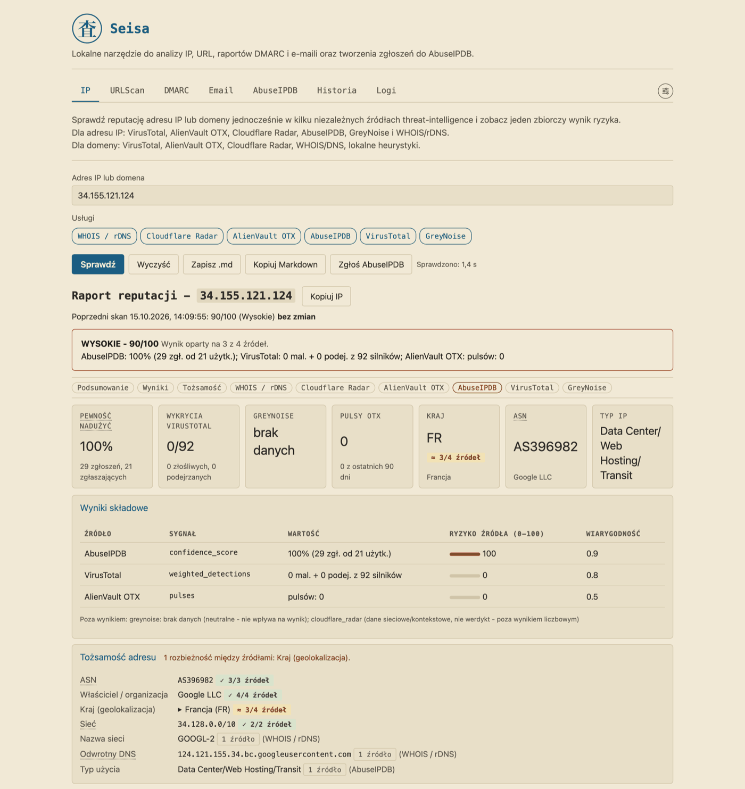
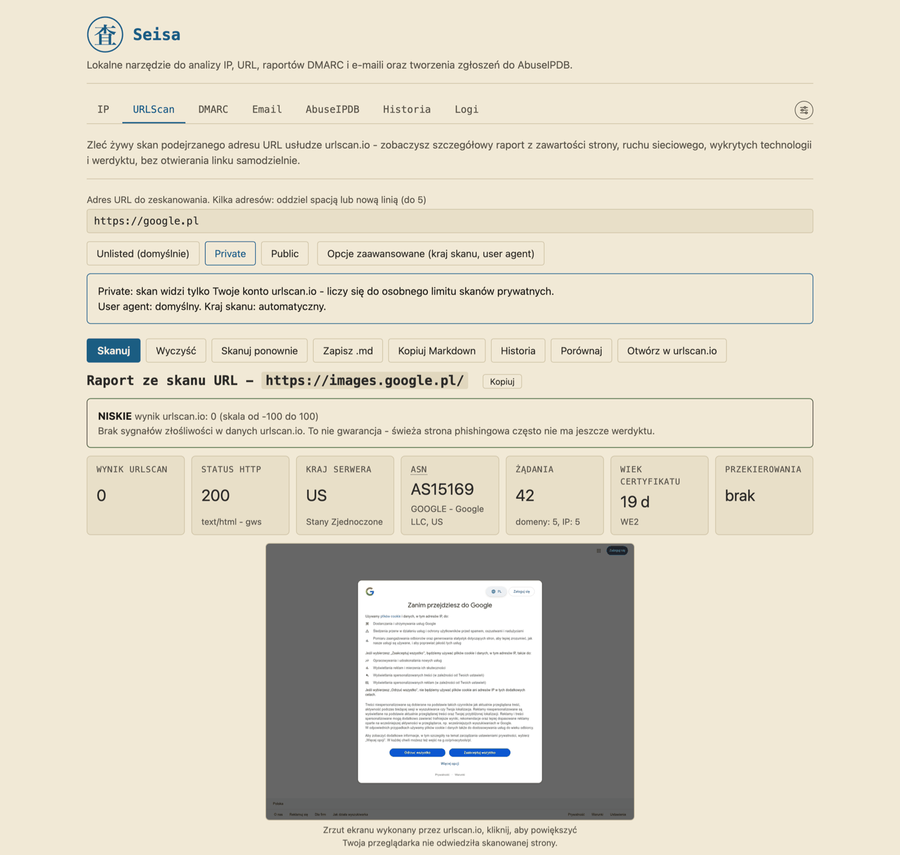
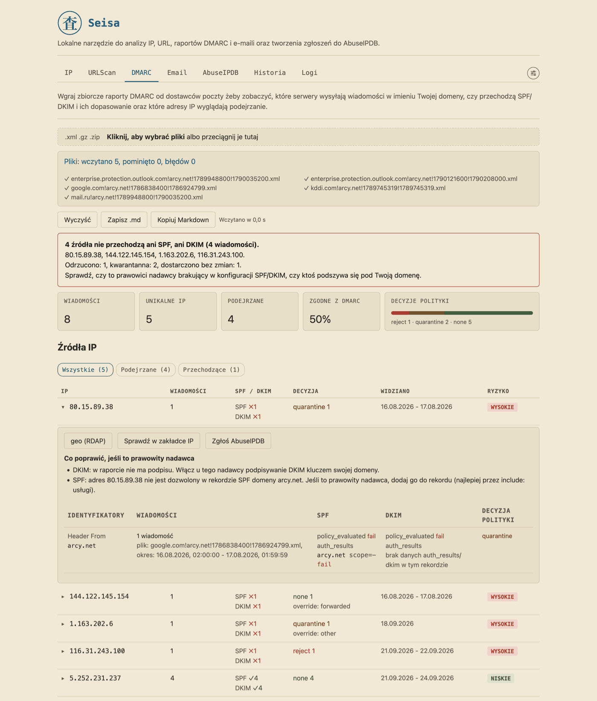
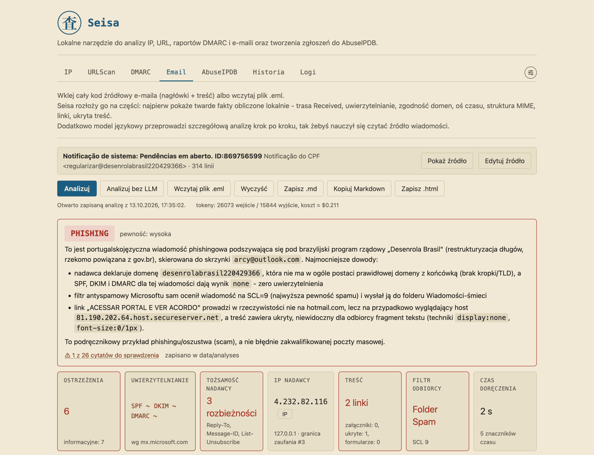
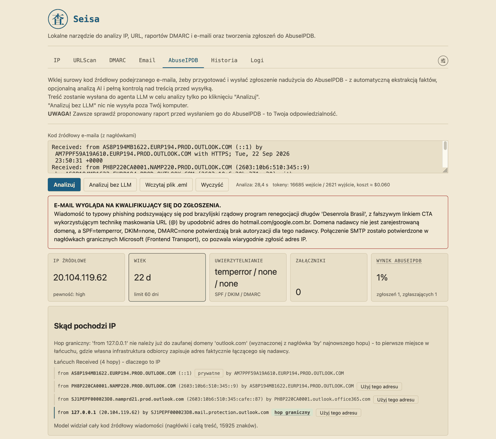

<p align="center">
  <br>
  <b>Seisa</b>
</p>

[English](README.md) | **Polski**

# Seisa

Seisa (精査, „dokładne, szczegółowe zbadanie"; czytaj „sejsa") to narzędzie działające na Twoim własnym komputerze, które pomaga ocenić, czy adresowi IP, linkowi, raportowi DMARC (podsumowaniu, które dostawcy poczty wysyłają o poczcie wysłanej w imieniu Twojej domeny) lub e-mailowi można ufać, oraz zgłaszać nadużycia do AbuseIPDB. Nie musisz być informatykiem: każdy wynik ma prosty komentarz.

## Co robi Seisa

Wybierz zakładkę, która pasuje do tego, co masz w ręku. [docs/pl/USER_GUIDE.md](docs/pl/USER_GUIDE.md) opisuje każdą zakładkę szczegółowo.

| Zakładka | Co robi | Potrzebny klucz? |
|---|---|---|
| IP | Sprawdza adres IP lub domenę w kilku źródłach naraz i łączy wyniki w jedną ocenę ryzyka 0-100 | Każde źródło ma własny klucz (WHOIS, RDAP i DNS, czyli publiczne rejestry mówiące, kto jest właścicielem adresu lub domeny, nie potrzebują) |
| URLScan | Zleca urlscan.io otwarcie podejrzanego linku za Ciebie i zwraca raport ze zrzutem ekranu | `URLSCAN_API_KEY` |
| DMARC | Czyta w przeglądarce raporty DMARC Twojej domeny i pokazuje, kto wysyła pocztę w Twoim imieniu | Nie |
| Email | Wyjaśnia podejrzany e-mail krok po kroku: fakty lokalne i opcjonalna lekcja od modelu językowego | Tylko do lekcji |
| AbuseIPDB | Przygotowuje, sprawdza i, po Twoim kliknięciu, wysyła zgłoszenie nadużycia nadawcy e-maila | Do wysyłki |
| Historia | Twoje ostatnie sprawdzenia, skany, importy, analizy i zgłoszenia w jednym miejscu | Nie |
| Logi | Błędy i ostrzeżenia usług | Nie |
| Info | Wersja, status kluczy, limity, język, skórka i ikona aplikacji | Nie |

## Zasady

- **Lokalnie.** Seisa nasłuchuje tylko na `127.0.0.1`. Nie ma konta, telemetrii ani sprawdzania aktualizacji.
- **Nic bez Twojego kliknięcia.** Nic nie trafia do usługi zewnętrznej, dopóki nie klikniesz, z jednym opisanym wyjątkiem (patrz „Co opuszcza Twój komputer").
- **Fakty pochodzą z kodu.** Fakty bezpieczeństwa (adres nadawcy, trasa poczty, wyniki SPF/DKIM/DMARC, które pokazują, czy wiadomość naprawdę pochodzi z domeny, za którą się podaje) oblicza zwykły kod programu. Model językowy tylko je wyjaśnia i może dać doradczą drugą opinię.
- **Domyślnie nieufnie.** Linki z e-maili i skanowanych stron nigdy nie są klikalne, a niczego z e-maila nie otwiera się ani nie pobiera.
- **Zgłoszenia ręcznie.** Zgłoszenie trafia do AbuseIPDB dopiero po Twoim kliknięciu i po sprawdzeniach w backendzie.

## Zrzuty ekranu

| IP | URLScan |
|---|---|
|  |  |
| **DMARC** | **Email** |
|  |  |



## Wymagania

- macOS lub Linux. Skrypty startowe są w Bashu; Windows nie jest obsługiwany bezpośrednio (może działać przez WSL, czyli Linuksa wewnątrz Windows, ale nie testowano).
- Python 3.11 lub nowszy.
- Przeglądarka. Seisa otwiera się pod adresem `http://127.0.0.1:54321`, więc port 54321 musi być wolny.
- Do uruchomienia nie jest potrzebny żaden klucz API. Każdy dodany klucz włącza jedną usługę więcej.
- Opcjonalnie: git, do aktualizacji Seisy i do wyświetlania „Ostatnich zmian" w zakładce Info.

## Szybki start

### Instalacja i uruchomienie

```bash
git clone https://github.com/arcymonek/seisa.git
cd seisa
bash install.sh
./seisa.sh
```

Instalator przygotowuje prywatne środowisko Pythona, instaluje biblioteki i tworzy plik ustawień `.env`. Potrzebuje Pythona 3.11 lub nowszego i połączenia z internetem, a gdy Pythona brakuje, mówi, co zainstalować. Ostatnie polecenie uruchamia Seisę i otwiera przeglądarkę. Trzymaj okno terminala otwarte, dopóki z niej korzystasz; zamknięcie go zatrzymuje Seisę. Szczegóły (pobranie ZIP-a, ikona aplikacji, aktualizacja, te same kroki ręcznie, rozwiązywanie problemów) są w [docs/pl/OPERATIONS.md](docs/pl/OPERATIONS.md).

### Klucze API (.env)

Klucz API to długi kod, który daje Ci usługa, żeby wiedziała, kto pyta. Załóż konto w usłudze, wklej klucz do pliku `.env` po znaku `=` i uruchom Seisę ponownie. Usługa bez klucza jest po prostu pomijana.

| Klucz | Usługa | Co włącza | Gdzie go zdobyć |
|---|---|---|---|
| `URLSCAN_API_KEY` | urlscan.io | Zakładkę URLScan: skany, wcześniejsze skany, zrzuty ekranu | [urlscan.io](https://urlscan.io) |
| `VIRUSTOTAL_API_KEY` | VirusTotal | Źródło w zakładce IP dla adresów IP i domen (Seisa sama ogranicza się do 4 zapytań na minutę i 500 na dobę) | [virustotal.com](https://www.virustotal.com) |
| `OTX_API_KEY` | AlienVault OTX | Źródło w zakładce IP dla adresów IP i domen | [otx.alienvault.com](https://otx.alienvault.com) |
| `CLOUDFLARE_RADAR_API_KEY` | Cloudflare Radar | Kontekst w zakładce IP: sieć i miejsce adresu IP, ranking domeny (nie wlicza się do wyniku) | [dash.cloudflare.com](https://dash.cloudflare.com) |
| `ABUSEIPDB_API_KEY` | AbuseIPDB | Źródło w zakładce IP; w zakładce AbuseIPDB historię adresu i wysyłanie zgłoszeń | [abuseipdb.com](https://www.abuseipdb.com) |
| `GREYNOISE_API_KEY` | GreyNoise | Źródło w zakładce IP dla adresów IP | [greynoise.io](https://www.greynoise.io) |
| `OPENROUTER_API_KEY` | OpenRouter | Model językowy: lekcję w zakładce Email oraz ocenę i szkic komentarza w zakładce AbuseIPDB (płatne za użycie) | [openrouter.ai](https://openrouter.ai) |
| `OPENROUTER_MODEL` | OpenRouter | Którego modelu użyć (domyślnie `anthropic/claude-sonnet-4.5`) | - |

Sprawdzenia WHOIS, RDAP i DNS nie potrzebują klucza i są zawsze włączone. Zakładka Info pokazuje, czy każdy klucz jest „ustawiony" czy ma „brak", ale nigdy samego klucza. Strony kont i ceny należą do usług i mogą się zmienić; sprawdź je u źródła.

## Co opuszcza Twój komputer

To skrócona wersja pełnej tabeli w [docs/pl/PRIVACY.md](docs/pl/PRIVACY.md), która wylicza każde połączenie.

| Akcja | Co jest wysyłane | Do kogo |
|---|---|---|
| IP: „Sprawdź" | Adres IP lub domena | Wybrane źródła (WHOIS, RDAP i DNS bez klucza; pozostałe z kluczami) |
| URLScan: „Skanuj" | Adres URL i Twoje opcje | urlscan.io, które samo otwiera stronę |
| DMARC: „geo (RDAP)" | Jeden adres IP źródła. Wczytanie raportu nic nie wysyła | RDAP i DNS |
| Email: „Analizuj" | E-mail (nagłówki, zdekodowany tekst, załączniki tylko jako rozmiar i skrót) oraz obliczone fakty. „Analizuj bez LLM" nic nie wysyła | OpenRouter i dostawca modelu |
| AbuseIPDB: „Analizuj" | Jak w zakładce Email | OpenRouter i dostawca modelu |
| AbuseIPDB: adres w formularzu | Adres IP, sprawdzany **automatycznie** (jedyne połączenie bez własnego kliknięcia, i tylko z kluczem) | AbuseIPDB |
| AbuseIPDB: „Wyślij przez AbuseIPDB API" | Publiczne zgłoszenie: IP, kategorie, czas i komentarz | AbuseIPDB |
| Info: „Odśwież limity" | Zapytania o limity | VirusTotal, urlscan.io, OpenRouter |

## Dokumentacja

- [docs/pl/USER_GUIDE.md](docs/pl/USER_GUIDE.md): każda zakładka krok po kroku, z przykładem od podejrzanego e-maila do zgłoszenia.
- [docs/pl/OPERATIONS.md](docs/pl/OPERATIONS.md): instalacja, uruchamianie, aktualizacja, limity, Twoje dane, odinstalowanie, rozwiązywanie problemów.
- [docs/pl/PRIVACY.md](docs/pl/PRIVACY.md): co opuszcza Twój komputer, co na nim zostaje, zabezpieczenia i model zagrożeń.
- [docs/pl/COMPLIANCE.md](docs/pl/COMPLIANCE.md): jak zgłoszenia przestrzegają zasad AbuseIPDB, rola modelu, licencje.
- [docs/pl/ARCHITECTURE.md](docs/pl/ARCHITECTURE.md): jak zbudowana jest Seisa i dlaczego.
- [docs/pl/API.md](docs/pl/API.md): endpointy.
- [docs/pl/DEVELOPMENT.md](docs/pl/DEVELOPMENT.md): przygotowanie środowiska, kontrole, hooki, wersjonowanie, pisanie dokumentacji.
- [CONTRIBUTING.md](docs/pl/CONTRIBUTING.md), [SECURITY.md](docs/pl/SECURITY.md), [CODE_OF_CONDUCT.md](docs/pl/CODE_OF_CONDUCT.md), [CHANGELOG.md](CHANGELOG.md) (po angielsku).
- [AGENTS.md](AGENTS.md): zasady dla agentów AI (po angielsku).

## Stan projektu

Seisę rozwija jedna osoba, to projekt hobbystyczny, a nie produkt z obsługą klienta. Odpowiedź na zgłoszenie albo pull request może potrwać kilka dni. Poprawki trafiają tylko do gałęzi `main`, starsze wersje ich nie dostają. Jeśli zgłoszenie na jakiś czas cichnie, nie zostało zapomniane.

## Współpraca

Zgłoszenia błędów, pomysły i pull requesty są mile widziane, a żeby pomóc, nie trzeba być programistą. Zacznij od [CONTRIBUTING.md](docs/pl/CONTRIBUTING.md); przygotowanie środowiska deweloperskiego jest w [docs/pl/DEVELOPMENT.md](docs/pl/DEVELOPMENT.md). Problemy z bezpieczeństwem zgłaszaj prywatnie, jak opisuje [SECURITY.md](docs/pl/SECURITY.md). Od wszystkich uczestników oczekujemy przestrzegania [Kodeksu postępowania](docs/pl/CODE_OF_CONDUCT.md).

## Zbudowane z Claude Code

Kod, testy i dokumentacja Seisy powstają z pomocą Claude Code, asystenta programisty AI od Anthropic, pod kierunkiem autora. Autor decyduje, sprawdza działanie i odpowiada za wydania.

## Licencja i kontakt

Copyright (c) 2026 Arkadiusz Polak. Seisa to wolne oprogramowanie na licencji GPL-3.0-or-later: możesz z niej korzystać, ją badać, zmieniać i udostępniać, także komercyjnie, a przekazywana dalej zmodyfikowana wersja musi pozostać na tej samej licencji, razem ze źródłami. Pełny tekst jest w [LICENSE](LICENSE). Dołączona biblioteka `marked` (MIT) renderuje Markdown; logo i ikony są dziełem autora na licencji projektu.

Strona: [seisa.eu](https://seisa.eu). Repozytorium: [github.com/arcymonek/seisa](https://github.com/arcymonek/seisa). Kontakt: `contact@seisa.eu`.
