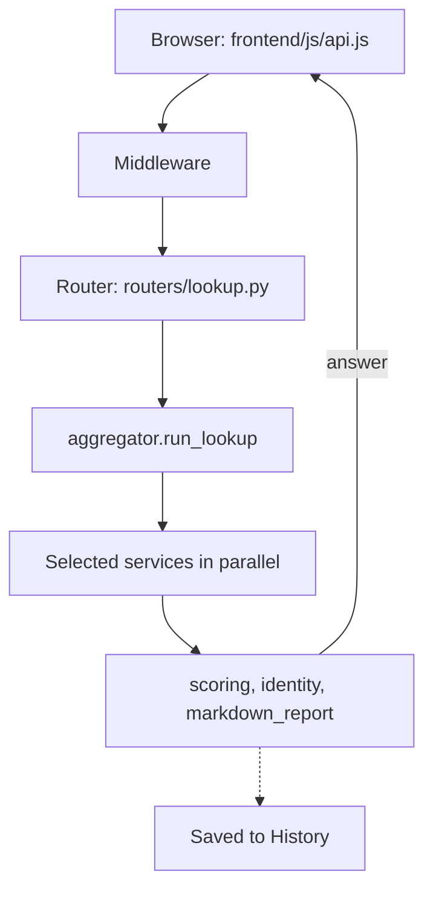

**English** | [Polski](pl/ARCHITECTURE.md)

# Architecture

This page is for contributors: it explains how Seisa is built and why. In one sentence: Seisa is a small web server that runs only on your own computer, plus a plain web page that talks to it.

## Contents

- [Design decisions](#design-decisions)
- [Stack](#stack)
- [How a request travels](#how-a-request-travels)
- [Backend modules](#backend-modules)
- [Frontend modules](#frontend-modules)
- [Data files](#data-files)
- [Internationalisation](#internationalisation)
- [Themes](#themes)
- [LLM prompts](#llm-prompts)
- [Scripts and tests](#scripts-and-tests)
- [Repository layout](#repository-layout)

## Design decisions

These are the choices that shape the whole project. Each one is deliberate, so please talk to the maintainer before changing one.

- **A single-user local tool.** One Python process serves both the API and the web page on `127.0.0.1`. There is no login and no database.
- **Facts come from code, not from the model.** Security facts (the sender's address, the order of the mail hops, SPF/DKIM/DMARC results, whether a report may be sent) are computed by deterministic Python. The language model only explains them or gives an advisory second opinion.
- **No framework in the browser.** The frontend is plain ES modules with no build step. The one exception is `frontend/vendor/marked.min.js`, which renders Markdown.
- **Nothing goes out without a user action.** There is one documented exception: the AbuseIPDB tab looks up the sender's IP when an e-mail is analysed.
- **No result cache.** Every check asks the services again, so a report is always fresh.
- **Plain JSON files.** Storage is JSON files written atomically (a temporary file, then a rename) and readable only by the owner.
- **Two separate e-mail tools.** The Email and AbuseIPDB tabs are different tools. They share only parsing building blocks: `mail_source.py`, `mail_trust.py` and `email_parser.py`.
- **DMARC is read in the browser.** DMARC reports are parsed entirely in the browser. The backend is asked only for the optional "geo (RDAP)" lookup of one source IP.
- **Two languages in one code base.** Every visible text comes from catalogs (English and Polish).

What Seisa deliberately does not do:

- It does not open links or attachments from e-mails, does not load scanned pages, and does not send reports automatically.
- It has no user accounts, no telemetry and no auto-update.
- It has no Windows start script: the launchers are Bash scripts for macOS and Linux.
- It does not let a hostile message freeze the other tabs: heavy parsing runs in worker threads (`asyncio.to_thread`).

## Stack

Seisa uses a small set of well-known tools. This table lists them with the limits that matter.

| Part | What is used |
|---|---|
| Language | Python 3.11 or newer (CI tests 3.11 and the latest 3.x) |
| Libraries | FastAPI, uvicorn, pydantic, pydantic-settings, httpx, python-whois, dnspython (minimum versions in `requirements.txt`, tested versions in `requirements.lock`) |
| Settings and keys | Read from `.env` by pydantic-settings at start-up; the Info tab can rewrite the file and the running settings |
| Outgoing HTTP | `httpx.AsyncClient`: 20 s limit for most services, 30 s for an AbuseIPDB report, 30 s to connect and 120 s of silence for OpenRouter |
| DNS and WHOIS | dnspython with a 5 s limit; WHOIS has a 15 s limit |
| Frontend | One `index.html`, ES modules in `frontend/js/`, one stylesheet `frontend/css/style.css`, the generated `/api/themes.css`, catalogs in `frontend/i18n/` |
| Start | `seisa.sh` (uvicorn, `backend.main:app`, `127.0.0.1:54321`) or the desktop icon through `seisa-launcher.sh` |

## How a request travels

Every request goes through the same few layers before it reaches the code that does the work. The diagram shows the path of an IP check, as an example.

A request passes four middlewares, outermost first:

1. **TrustedHost** refuses any `Host` header that is not `127.0.0.1` or `localhost` (protection against DNS rebinding).
2. **LanguageMiddleware** reads `X-Seisa-Lang` into a context variable for the request.
3. **OriginGuardMiddleware** refuses `/api/` requests that another web page makes through your browser.
4. **NoCacheStaticMiddleware** adds the Content-Security-Policy header and switches off caching outside `/api/`.

Then:

- Routers are mounted under `/api`; the tab routers sit under `/api/abuseipdb`, `/api/dmarc`, `/api/urlscan` and `/api/email`. Everything else is the static frontend.
- An IP check runs `routers/lookup.py`, then `aggregator.run_lookup`, then the selected services in parallel (`asyncio.gather`), then `scoring.compute_risk_score`, `identity.build_identity` and `markdown_report.build_markdown`. The result is saved to History.
- An Email analysis streams Server-Sent Events: local facts first, then the model's text chunk by chunk, then the verdict, the citation check and the id of the saved analysis.
- Service clients return a `ServiceResult` with a status (`ok`, `no_key`, `not_applicable`, `error`, `rate_limited_daily`) instead of raising an error, so one failing source never breaks the whole check.
- An unexpected exception becomes a generic HTTP 500 and one log line.
- The frontend talks to the backend only through `frontend/js/api.js`. Tabs hand data to each other through `window.seisaApp` (for example an address from the Email tab to the IP tab).

The endpoints themselves are described in [API.md](API.md).

## Backend modules

The backend lives in `backend/`. Each module has one job; look at this list before adding a new one.

### Entry point and settings

| Module | Role |
|---|---|
| `backend/main.py` | FastAPI app, security middleware, routers under `/api`, static frontend |
| `backend/config.py` | Paths (`data/`, `logs/`, prompts, `frontend/`), size and retention limits, `settings` read from `.env` |
| `backend/models.py` | Shared pydantic models |
| `backend/sse.py` | Server-Sent Events framing |

### Routers

| Module | Role |
|---|---|
| `backend/routers/lookup.py` | IP tab: one lookup, comparison with earlier checks of the same indicator, saving to History |
| `backend/routers/urlscan.py` | URLScan tab: submit, result (summary and Markdown), screenshot, earlier scans |
| `backend/routers/dmarc.py` | DMARC tab: the "geo (RDAP)" lookup of one source IP |
| `backend/routers/email_analysis.py` | Email tab: streamed analysis, finishing a truncated one, duplicate check, saved analyses; builds the Email prompt |
| `backend/routers/abuseipdb_report.py` | AbuseIPDB tab: analysis of the e-mail, preview with hard checks and PII scan, redaction, sending, report log |
| `backend/routers/history.py` | History tab: stored entries plus saved analyses and accepted reports as one list |
| `backend/routers/logs.py` | Logs tab: reads and clears the daily log files |
| `backend/routers/about.py` | Info tab: configured keys (never their values), editing the keys, environment, API limits, recent releases from `git log`, desktop icon, shutdown |
| `backend/routers/themes.py` | Theme list and generated CSS |
| `backend/routers/__init__.py` | Package marker |

### Services (talking to the outside)

| Module | Role |
|---|---|
| `backend/services/base.py` | `IntelService` base class with the shared JSON fetch and uniform results |
| `backend/services/virustotal.py` | VirusTotal client |
| `backend/services/otx.py` | AlienVault OTX client |
| `backend/services/abuseipdb.py` | AbuseIPDB client (check and report) |
| `backend/services/greynoise.py` | GreyNoise client |
| `backend/services/cloudflare_radar.py` | Cloudflare Radar client |
| `backend/services/whois_dns.py` | WHOIS and reverse DNS client |
| `backend/services/dns_records.py` | DNS records of a domain and reverse lookups through the system resolver |
| `backend/services/urlscan.py` | urlscan.io client as plain functions (a scan is asynchronous and returns files) |
| `backend/services/llm_analyzer.py` | OpenRouter client: the AbuseIPDB JSON assessment (builds that prompt) and the streamed Email analysis |
| `backend/services/openrouter_models.py` | The public OpenRouter model list for the model search: one request without a key, reduced to the fields the page shows |
| `backend/services/__init__.py` | Package marker |

The six intelligence clients (VirusTotal, OTX, AbuseIPDB, GreyNoise, Cloudflare Radar, WHOIS) are registered in `aggregator.SERVICE_REGISTRY`.

### Domain logic

| Module | Role |
|---|---|
| `backend/aggregator.py` | Normalises and validates an indicator, runs the selected services in parallel, builds the result |
| `backend/scoring.py` | The 0-100 risk score: risk per source with credibility caps, combined with a noisy-OR model |
| `backend/identity.py` | Merged identity of an IP (ASN, owner, country, network) with an agreement status per field |
| `backend/domain_heuristics.py` | Local hints about a domain name and its age (no network), capped so they never make "high" alone |
| `backend/markdown_report.py` | Markdown report of an IP or domain check |
| `backend/markdown_utils.py` | Keeps untrusted text inert in Markdown exports; mirrored in `frontend/js/markdown-export.js` |
| `backend/email_parser.py` | Deterministic parser: Received chain, boundary hop with confidence, attachments, Bitcoin addresses, ransom words |
| `backend/email_forensics.py` | Deterministic Email-tab analysis (timeline, MIME tree, links, hidden content, authentication summary) and the source prepared for the model |
| `backend/mail_source.py` | Shared building blocks: loading a message, normalising the source, refolding headers, decoding encoded words, describing attachments |
| `backend/mail_trust.py` | Shared trust reasoning about relays: host and domain classification, SMTP-AUTH/DKIM correlation, the receiver's SPF/DKIM/DMARC verdicts |
| `backend/citation_check.py` | Local check that what the model quotes exists in the source |
| `backend/verdict.py` | The machine-readable `VERDICT` line protocol (English codes; old Polish tokens are still accepted) |
| `backend/report_builder.py` | AbuseIPDB report: comment, local pre-assessment, hard checks |
| `backend/report_utils.py` | Comment cleaning, IP eligibility, personal-data scan |
| `backend/known_senders.py` | Well-known mail senders recognised by a forward-confirmed reverse DNS name (used by DMARC "geo") |
| `backend/urlscan_input.py` | URL normalising: refang, reject non-HTTP schemes and private hosts |
| `backend/urlscan_forms.py` | Forms found in the scanned page's DOM |
| `backend/urlscan_report.py` | Summary and Markdown of a scan |

### Storage, limits and helpers

| Module | Role |
|---|---|
| `backend/storage.py` | Atomic JSON storage, owner-only permissions |
| `backend/analyses.py` | Saved Email analyses |
| `backend/history_store.py` | History index and entry files, with retention and migration |
| `backend/api_limits.py` | API usage against free-plan limits (shown in Info) |
| `backend/ratelimit.py` | VirusTotal throttling |
| `backend/logging_config.py` | Daily JSON-lines log of warnings and errors, owner-only, 30-day retention |
| `backend/i18n.py` | Backend translations with the request language in a context variable; plural forms |
| `backend/themes.py` | Validates theme JSON files and generates CSS from them |
| `backend/env_file.py` | Edits the API keys in `.env` from the Info tab: the editable fields, the allowed characters, an atomic 0600 rewrite that keeps the other lines, and the update of the running settings |
| `backend/desktop_icon.py` | Desktop icon for macOS and Linux, from the Info button or `python -m backend.desktop_icon` |
| `backend/__init__.py` | Package marker |

## Frontend modules

The frontend lives in `frontend/js/`. Larger tabs are split into `<tab>-<role>.js` modules, so one file is not one tab.

| Area | Modules |
|---|---|
| Entry | `frontend/js/app.js` (tabs, `window.seisaApp`), `frontend/js/api.js` (backend client), `frontend/js/i18n.js`, `frontend/js/theme.js` with `frontend/theme-init.js` (theme before the first paint), `frontend/js/shutdown.js` |
| IP | `frontend/js/lookup.js` (form, run), `frontend/js/lookup-result.js` (report) |
| URLScan | `frontend/js/urlscan.js` (form, submit, polling, batch, History), `frontend/js/urlscan-result.js`, `frontend/js/urlscan-compare.js` |
| DMARC | `frontend/js/dmarc.js`, `frontend/js/dmarc-data.js` (parse and aggregate, no HTML), `frontend/js/dmarc-export.js`, `frontend/js/archive.js` (gzip and zip in the browser) |
| Email | `frontend/js/email.js`, `frontend/js/email-facts.js`, `frontend/js/email-lesson.js`, `frontend/js/email-source.js`, `frontend/js/email-compare.js`, `frontend/js/email-export.js`, `frontend/js/markdown-render.js` |
| AbuseIPDB | `frontend/js/report-builder.js` (state, events, send), `frontend/js/report-result.js`, `frontend/js/report-checks.js` (pure functions, tested), `frontend/js/report-history.js`, `frontend/js/report-export.js` |
| History, Logs, Info | `frontend/js/history.js`, `frontend/js/history-compare.js`, `frontend/js/logs.js`, `frontend/js/about.js`, `frontend/js/about-keys.js` (the API keys part of Info), `frontend/js/about-models.js` (the model search next to the model field) |
| Shared | `frontend/js/ui.js` (HTML blocks), `frontend/js/util.js` (`escapeHtml`, copy, timers, `formatUsage`), `frontend/js/markdown-export.js`, `frontend/js/fold-state.js`, `frontend/js/clear-button.js`, `frontend/js/services.js` (display names) |

## Data files

Seisa keeps its data in two local folders, `data/` and `logs/`. This section shows the layout and format; permissions and retention are covered in the privacy document ([PRIVACY.md](PRIVACY.md)).

- **History:** `data/history/index.json` holds one small row per entry (what the list and the comparison need). `data/history/entries/<uuid>.json` holds the full entry. The index is a cache that is rebuilt from the entry files if it is damaged. Writes go entry first, then index; deletes go index first, then entry.
- **Old History:** the single-file history of versions before 2.4.25 (`data/history.json`) is migrated on first use and renamed to `history.json.migrated`.
- **Email analyses:** one JSON file per analysis, with the id `YYYYMMDD-HHMMSS-<8 hex characters of a SHA-256>`. The id format is validated, so no path can escape the folder.
- **Small JSON files:** `data/report_log.json`, `data/vt_usage.json`, `data/api_usage.json`.
- **Logs:** `logs/YYYY-MM-DD.jsonl`, one JSON object per line with `time`, `level`, `service` and `message`.
- **Paths:** all data paths are constants in `backend/config.py`. Tests and the harness redirect them to a temporary folder.

## Internationalisation

Seisa speaks English and Polish. All visible text comes from catalogs, never from the code.

- The interface language is `en` or `pl`. The first visit picks it from the browser language; the choice is kept in `localStorage` (`seisa.lang`).
- The frontend sends the language in the `X-Seisa-Lang` header. The backend keeps it per request and translates its own messages (fallback: English, then the key itself).
- Catalogs are plain text with no HTML and with `{placeholders}`. Plural forms use `_one/_few/_many/_other` in Polish and `_one/_other` in English.
- `?lang=qa` is a developer pseudo-language that shows `[[key]]` instead of text, so untranslated strings are easy to spot.
- Prompts for the model are written once, in English. The answer language is set by an instruction (`LANGUAGE_NAMES`).

Catalogs: `frontend/i18n/{en,pl}.json` for the interface and `backend/locales/{en,pl}.json` for backend messages.

## Themes

A theme is a small JSON file in `frontend/themes/`, so adding a look needs no code.

- Shipped themes: `light` ("Light Washi"), `sumi-brown` ("Brown Sumi"), `blue` ("Blue Sumi", the default) and `kohaku` ("Red-and-white Kōhaku"). "System" follows the operating system (dark means Blue Sumi).
- A theme file has `id` (equal to the file name), `name` (`en` and `pl`), `base` (`dark` or `light`), an optional `order` from 0 to 1,000, an optional `logo` (`badge` or `mask`), and exactly the known colour keys as `#rrggbb`.
- At most 24 files of 8 KB are read. A bad file is skipped and logged.
- The CSS is generated from validated values only, so a theme cannot carry `url()`, `@import` or rules.

## LLM prompts

Two prompt files are part of the program, so a change to them changes how the app behaves. They live in `backend/prompts/`.

- `backend/prompts/email-analysis-guide.md`: the model's role, reliability rules, the required answer structure and technical hints for the Email lesson.
- `backend/prompts/abuseipdb-reporting-policy.md`: the reporting rules for the AbuseIPDB assessment.

If a prompt file is missing, Seisa sends the prompt without it and does not report an error.

The Email answer must start with `VERDICT: <code> | CONFIDENCE: <level>`. The interface splits the rest at `## ` headings into cards and labels `[Fact]`, `[Interpretation]` and `[To verify]`.

## Scripts and tests

The folders `scripts/` and `tests/` guard the project. Day-to-day use is explained in the development guide ([DEVELOPMENT.md](DEVELOPMENT.md)); this is only the map.

| Path | What it is |
|---|---|
| `scripts/check_all.py` | Runs the whole local set of checks |
| `scripts/api_harness.py` | End-to-end test of every endpoint with the outside services faked |
| `scripts/check_i18n.py` | Checks the language catalogs and the version in all places |
| `scripts/check_docs.py` | Checks that the documentation matches the code |
| `scripts/dump_facts.py` | Dumps the deterministic e-mail facts for the golden comparison |
| `scripts/make_app_icon.py` | Builds the application icon |
| `scripts/hooks/pre-commit` | Git hook that checks what is about to be committed |
| `scripts/hooks/commit-msg` | Git hook that checks the commit message |
| `tests/` | pytest modules per backend module, Node-run tests of pure frontend functions (`tests/js/*.mjs`), golden facts (`tests/golden/`), synthetic e-mails (`tests/fixtures/`) |

Real e-mails are never committed. An optional private corpus can live in `tests/private/`, which git ignores.

## Repository layout

This is the top level of the repository, so you know where to look.

| Path | What it holds |
|---|---|
| `backend/` | The Python server |
| `frontend/` | The web page: HTML, JavaScript, CSS, catalogs, themes, images |
| `scripts/` | Checks, the harness and git hooks |
| `tests/` | The automated tests |
| `docs/` | Documentation, with Polish files in `docs/pl/` and screenshots in `docs/images/` |
| `.github/` | Issue and pull request templates, CI |
| `data/`, `logs/` | Local data, ignored by git except for `.gitkeep` |
| Top-level files | `install.sh`, `uninstall.sh`, `seisa.sh`, `seisa-launcher.sh`, `requirements*.txt`, `requirements.lock`, `pyproject.toml`, `.env.example`, [LICENSE](../LICENSE), [CHANGELOG.md](../CHANGELOG.md), [CODE_OF_CONDUCT.md](../CODE_OF_CONDUCT.md) |
