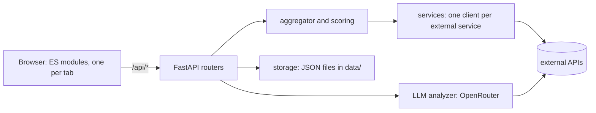

# Architecture and design

**English** | [Polski](../pl/architecture.md) · [Documentation index](index.md) · [README](../../README.md)

## Design decisions and non-goals

- **Local, single user, no login.** The attack surface stays small because nothing is exposed; the price is that you must never expose the port.
- **No database.** All persistence is plain JSON files in `data/` with atomic writes. They are easy to read, back up and delete; the price is no concurrency and a capped history (25 unpinned entries).
- **No frontend framework and no build step.** Plain ES modules; you edit a file and refresh (the server sends no-cache headers).
- **Deterministic first, LLM second.** Facts, hard checks and scores are computed in Python; the LLM explains and drafts and cannot unblock a report the code has blocked.
- **Every user-visible string goes through the catalogs** (PL and EN together).
- **Untrusted content is data.** Nothing from an e-mail, a scanned page or an API answer is executed, opened or downloaded.
- **Non-goals:** multi-user access, authentication, remote hosting, native Windows, bulk or automatic reporting, background jobs.

## Stack

Python 3.11+ with FastAPI, uvicorn, pydantic and pydantic-settings, httpx, python-whois and dnspython (`requirements.txt`; `requirements.lock` pins the tested versions). Frontend: plain JavaScript (ES modules), CSS, and `marked.min.js` bundled locally. Development tools (not dependencies): `ruff` and `pytest`. Automated checks: the pytest unit tests and the API harness, which GitHub Actions (`.github/workflows/ci.yml`) runs together with `ruff`, `check_i18n.py` and `dump_facts.py` on every pull request and every push to `main`.

## Architecture

A single Python FastAPI process serves both the API and the static frontend on `127.0.0.1:54321`.



In words: the browser talks to routers (`backend/routers/`); a lookup goes through the aggregator, which queries the services in `backend/services/` in parallel and computes the score in `backend/scoring.py`; the e-mail and AbuseIPDB tabs use `email_forensics.py`, `email_parser.py` and `report_builder.py` for the deterministic part (both sharing the mail relay-chain trust helpers in `mail_trust.py`) and `services/llm_analyzer.py` for the LLM part; everything persistent goes through `storage.py`, `analyses.py` and `logging_config.py`.

<details>
<summary>The file tree</summary>

```
seisa/
├── .env                    # API keys (gitignored, see .env.example)
├── seisa.sh                 # start script (starts the server and opens the browser)
├── README.md / README.pl.md  # the short README in English (the main one) and in Polish
├── CHANGELOG.md             # every release, newest first
├── pyproject.toml           # ruff and pytest configuration (tool settings only, not a package)
├── requirements-dev.txt     # development tools: requirements.txt plus pytest and ruff, the latter pinned to one minor series
├── LICENSE                  # GNU General Public License v3 (the project is GPL-3.0-or-later)
├── CONTRIBUTING.md          # how to report a bug and send a change (pull requests are welcome)
├── CODE_OF_CONDUCT.md       # rules of conduct (Contributor Covenant 2.1)
├── SECURITY.md              # how to report a vulnerability
├── .github/                 # ISSUE_TEMPLATE/ (bug report and feature idea templates, a link to SECURITY.md), pull_request_template.md (What / Why / Checked) and workflows/ci.yml (CI: ruff, pytest, harness, check_i18n, dump_facts and, on pull requests, the version rule and the added-line rules of the whole branch; for pull requests from forks only the added-line rules, the maintainer adds the version bump)
├── backend/
│   ├── main.py               # FastAPI, routing, no-cache/CSP, origin guard and language middleware, Host check, error handling
│   ├── config.py             # paths, limits, settings from .env
│   ├── models.py             # Pydantic models
│   ├── aggregator.py         # fan-out to the services, aggregate risk score
│   ├── markdown_report.py    # Markdown report builder
│   ├── ratelimit.py          # VirusTotal throttle
│   ├── api_limits.py         # usage of the API limits (Info tab): headers, own counters, quota endpoints
│   ├── storage.py            # atomic JSON storage (history, VirusTotal counter, report log)
│   ├── sse.py                # Server-Sent Events framing shared by the streaming endpoints
│   ├── logging_config.py     # WARNING+ logs to logs/*.jsonl
│   ├── email_parser.py       # fact extraction from the raw e-mail (AbuseIPDB tab)
│   ├── email_forensics.py    # deterministic analysis of the e-mail source (Email tab)
│   ├── mail_trust.py         # shared Received-chain/domain/IP/SMTP-AUTH trust helpers (both tabs)
│   ├── citation_check.py     # local check of the LLM's quotes against the source
│   ├── analyses.py           # storage of e-mail analyses in data/analyses/
│   ├── themes.py             # colour themes: validates frontend/themes/*.json (fixed keys, #rrggbb only) and generates the CSS variables
│   ├── i18n.py               # backend translations: request language (ContextVar), t()/tn(), catalogs in locales/
│   ├── locales/              # backend text catalogs: pl.json, en.json
│   ├── verdict.py            # canonical verdict protocol (EN codes, mapping of the old PL tokens)
│   ├── known_senders.py      # well-known mail senders by reverse DNS name (DMARC tab)
│   ├── scoring.py            # aggregate IP reputation score (noisy-OR)
│   ├── identity.py           # merged identity of an address (ASN, owner, country, network) or a domain (registrar, dates, name servers, DNS, category) with per-field source agreement
│   ├── domain_heuristics.py  # local hints about a domain (age, look-alike characters, random-looking labels ...) for the score
│   ├── report_builder.py     # AbuseIPDB comment builder + policy validation
│   ├── report_utils.py       # text sanitisation, IP checks, personal-data scan and masking
│   ├── urlscan_report.py     # structured summary + Markdown report of a urlscan.io scan result
│   ├── urlscan_input.py      # cleaning and validation of the URL to scan (refang, scheme, private hosts)
│   ├── urlscan_forms.py      # forms of a scanned page (from its DOM): action, method, fields, password/external flags
│   ├── routers/               # /api/* endpoints: lookup, urlscan, email_analysis, abuseipdb_report, dmarc, history, logs, about, themes
│   └── services/               # a client for every service (common IntelService interface; urlscan.py separately - submit+poll; llm_analyzer.py - OpenRouter)
├── frontend/
│   ├── index.html
│   ├── favicon.ico            # icon: the kanji 査 (16/32/48/64 px)
│   ├── logo.png               # round logo, dark badge (page header on dark themes, README)
│   ├── logo-light.png         # the same logo as a cream badge (page header on light themes)
│   ├── theme-init.js          # classic script in <head>: applies the stored theme before the first paint
│   ├── themes/                # colour themes, one JSON file each (dark.json, light.json); colours only
│   ├── css/style.css          # layout and components, no colours (they come from the theme)
│   ├── i18n/                  # interface text catalogs: pl.json, en.json
│   ├── js/                    # one module per tab and shared helpers, listed below
│   └── vendor/marked.min.js   # Markdown rendering, bundled locally (no CDN)
├── tests/                   # pytest unit tests (`python3 -m pytest -q`): mail trust helpers, scoring, report builder, e-mail parser and forensics, the colour themes (`test_themes.py`: validator, WCAG contrast, no colour literals in the stylesheet), the git hook (`test_pre_commit_hook.py`); `conftest.py` points data/ at a temporary directory
│   ├── fixtures/            # SYNTHETIC e-mails (.eml) for comparisons; fictitious data (.example domains, documentation address ranges; the header layout of `multihop.eml` imitates a large mail provider), no personal data
│   │   └── unit/            # extra synthetic cases used only by pytest (prompt injection, encodings, damaged headers); a subfolder on purpose, so the flat `*.eml` glob of `api_harness.py` and `dump_facts.py` does not see it
│   └── private/             # optional REAL e-mails with expected results for `test_corpus.py` (gitignored, never committed)
├── scripts/
│   ├── api_harness.py         # end-to-end test: every API endpoint with all external services mocked (also `--serve PORT`)
│   ├── dump_facts.py          # dumps the deterministic analysis of the fixtures to JSON (compares two code versions byte for byte)
│   ├── check_i18n.py          # checks the PL/EN catalogs, README and docs parity, dead links and the version; `--strict` looks for Polish literals in code
│   └── hooks/                 # git hooks (enable with `git config core.hooksPath scripts/hooks`): `pre-commit` (forbidden files, long dash, PL/EN pairs, check_i18n on the index, privacy scan, one version step with its CHANGELOG entry; `--range BASE` checks a whole branch in CI: the version and the added lines) and `commit-msg` (message rules, calls `pre-commit --commit-msg`)
├── data/                    # history.json, vt_usage.json, api_usage.json, report_log.json, analyses/ (gitignored)
├── logs/                    # error logs, one .jsonl file per day (gitignored)
└── docs/
    ├── en/, pl/                        # the documentation in English and Polish (the same file names in both, index.md is the table of contents)
    ├── abuseipdb-reporting-policy.md   # policy summary + AbuseIPDB category table (English, LLM prompt context)
    └── email-analysis-guide.md         # e-mail analysis guide loaded into the LLM prompt (Email tab), English, with a PL/EN label table
```

Frontend modules in `frontend/js/`:

- `app.js` (tabs and the `window.seisaApp` hand-offs), `i18n.js`, `api.js`, `theme.js` (the footer theme switch: light, dark, system), `util.js` (shared helpers), `markdown-render.js` (the HTML allow-list), `glossary.js` (a one-sentence glossary tooltip on a short, constant label - a tile caption, a `<dt>` term, a table header - shared by the IP, DMARC, URLScan and AbuseIPDB tabs);
- `lookup.js` + `lookup-result.js` (the IP tab and its report view), `urlscan.js` + `urlscan-result.js` + `urlscan-compare.js` (comparison of two scans), `dmarc.js` + `archive.js` (unpacking `.gz` and `.zip`);
- `email.js` + `email-facts.js`, `email-lesson.js`, `email-source.js`, `email-glossary.js`, `email-compare.js`, `email-export.js` (the deterministic facts, the lesson cards, the source drawer, glossary tooltips on free-flowing prose - the same `.gl` tooltip style as `glossary.js`, but scanning rendered text instead of wrapping a known label - comparison and exports);
- `report-builder.js` (the AbuseIPDB tab) + `report-result.js`, `report-history.js`, `report-export.js` (the analysis view, the log of sent reports and the Markdown export);
- `history.js` + `history-compare.js`, `logs.js`, `about.js`.

</details>

## Data files

| Path | Holds | Notes |
|---|---|---|
| `data/history.json` | the history (IP lookups, URL scans with thumbnails, DMARC imports, pins) | 25 unpinned entries; atomic writes |
| `data/vt_usage.json` | the VirusTotal daily counter | resets at 00:00 UTC |
| `data/api_usage.json` | counters and last known limits (Info tab) | |
| `data/report_log.json` | the log of every AbuseIPDB report attempt | an audit trail, not deleted by "Clear history" |
| `data/analyses/` | saved e-mail analyses with the raw messages | files `0600`, directory `0700` |
| `logs/*.jsonl` | WARNING and above, one file per day | |

All of `data/` and `logs/` is gitignored (the directories are kept by `.gitkeep`). To reset Seisa, stop it and delete their contents. Releases before 2.0.27 used `data/analizy/` and `logi/`; Seisa does not migrate them, so rename them by hand before the first start of a newer release (`mv data/analizy data/analyses`, and move the `*.jsonl` files from `logi/` to `logs/`).
