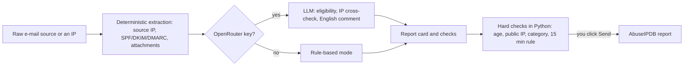

# Tabs and walkthrough

**English** | [Polski](../pl/tabs.md) · [Documentation index](index.md) · [README](../../README.md)

## Tabs

The tab row: [IP](#ip), [URLScan](#urlscan), [DMARC](#dmarc), [Email](#email), [AbuseIPDB](#abuseipdb), [History](#history), [Logs](#logs) and the round info button ([Info](#info)). The IP, URLScan, DMARC, Email, AbuseIPDB, History, Logs and Info tabs share one layout: a verdict banner (colour by level), summary tiles, then collapsible cards that open by themselves only when they carry a signal.

### IP

> The reputation of an IP address from six sources, merged into one explained 0-100 score.

**Input:** an IP address or a domain name (batch: many of them) | **Output:** a report (verdict, tiles, identity card, source cards) | **Sends out:** the address to the services you have keys for, plus free RDAP and DNS lookups | **Keys:** each service optional. Scanning a URL lives in the [URLScan](#urlscan) tab.

<!-- Screenshot to add: docs/img/tab-ip.png -->

| Service | What it provides |
|---|---|
| [VirusTotal](https://www.virustotal.com) | AV engine detections, reputation, ASN, categories, tags, WHOIS |
| [AlienVault OTX](https://otx.alienvault.com) | threat-intel pulses, geolocation, ASN |
| [Cloudflare Radar](https://radar.cloudflare.com) | network/context data - ASN, location, routing (not a verdict) |
| [AbuseIPDB](https://www.abuseipdb.com) | confidence score, number of reports, author of the latest report, ISP |
| [GreyNoise](https://www.greynoise.io) | full IP Lookup (`/v3/ip`) - actor, tags, VPN/Tor, network metadata; falls back to the free community endpoint if the key has no access to the full API; "no information in the service" counts as a contribution of 0.0, not as "unknown" |
| WHOIS / rDNS | for an IP: reverse DNS (PTR) + full RDAP (RFC 9083, the successor of WHOIS) - network range, owner, abuse/technical contact, registration dates; for a domain: WHOIS (registrar, dates, name servers, status) + DNS records (A, AAAA, NS, MX, CAA, SPF, DMARC, wildcard, name servers that do not exist) - no API key needed |
| Cisco Talos | no official API - only a button for a manual check |

What you get:

- **One aggregate score** 0-100 and a verdict banner: LOW below 25, MEDIUM 25-59, HIGH from 60 (colour by level, with the values behind it).
- **Summary tiles:** abuse confidence, detections, GreyNoise, OTX pulses, country, ASN, IP type, and the component-score table. For a domain: domain age, registrar, time to expiry, Cloudflare popularity, category, name servers and IP addresses.
- **An address identity card** (for a domain: **domain identity**) that merges owner, ASN, country, network, reverse DNS, usage type and Tor from all sources (for a domain: registrar, dates, age, name servers checked against WHOIS and DNS, IP addresses, mail servers, SPF, DMARC, CAA, category, popularity) and shows how many sources agree. It is collapsed with a green "sources agree" note, and opens by itself when the sources disagree.
- **One collapsible card per source**, open only for sources with a signal (source risk of 25 or more, i.e. Medium or High); lists (tags, CVEs, ports, pulses) are chips with "show more". The WHOIS / rDNS card repeats the identity rows that come from it, so nothing has to be looked up in two places.
- **Pasted input is cleaned up:** a URL (`https://Example.com:8080/a?b`), a defanged indicator (`hxxps://evil[.]example`, `1[.]2[.]3[.]4`), `ip:port`, `user@host` or an upper-case name is reduced to the bare host or IP address. Private, loopback and reserved addresses are refused with an explanation instead of being sent to the services.
- **Comparison with the previous scan:** when the same indicator is in the History, a line under the banner shows the previous score, the difference, the sources whose risk moved by 10 or more and a bar per earlier scan (the History keeps 25 unpinned entries, so the trend is at most that long).
- **Sources without a result** (error, no key, daily limit, not applicable) share one collapsed bar instead of a card each; it opens by itself on an error. "Component scores" is a collapsible card, open by default. When GreyNoise answers with its search limit (HTTP 429) the card says so in plain words, with the reset date when GreyNoise names one; the score is then computed without it.
- **Batch mode** (many addresses or domains at once, with the VirusTotal throttle visible): duplicates in the list (`Example.com`, `https://example.com/x`) are checked once, a summary table sorted by score comes first (with the change against the previous scan, the strongest signal and the owner or registrar; a click jumps to the report) and "Save CSV" exports it (cells that could be read as a spreadsheet formula are prefixed with `'`). A 15-minute in-memory cache, with an option to force a refresh; in a single scan "Force refresh" replaces the per-report refresh button, which only batch reports keep.
- **A domain report** has a "Scan in URLScan" button that fills the URLScan tab with `https://<domain>/`.
- **Mail volume per day:** a bar chart (messages per day, the failing share in red) when the reports span at least two days; it opens by itself when some day has failures.
- **Comparison with the previous import** of the same domain (from [History](#history)): new sources, sources that are gone, sources that got worse and the DMARC pass rate before and now; it opens by itself when a new suspicious source appeared or a source got worse.
- **Export:** "Save .md" (the browser's native save dialog) or copy; the Markdown contains the whole report including the identity table.

Details: the scoring model, the identity card, raw responses

**Scoring** (`backend/scoring.py`). A noisy-OR model: every source - AbuseIPDB, VirusTotal, GreyNoise, OTX - gives a risk of 0-100 on a non-linear scale and has its own credibility (0.9, 0.8, 0.7 and 0.5). A source without data does not vote, so it cannot dilute the result. A known good IP (an AbuseIPDB whitelist entry, GreyNoise benign/RIOT, an OTX validation) lowers the score to 15 unless strong contradicting signals exist. Cloudflare Radar is contextual and deliberately excluded from the number. For a domain, one more low-credibility source (0.4) joins: local heuristics (`backend/domain_heuristics.py`) - a domain younger than 90 days, look-alike characters from mixed alphabets (homograph), punycode, a frequently abused TLD, a random-looking label, lure words such as `login` or `secure`; it can raise a domain to Medium but never to High on its own. The report also states how many sources took part and adds notes.

**Address identity** (`backend/identity.py`). The values are normalised first (ASN to a number, country to an ISO code, owner names without legal-form suffixes, RDAP ranges to CIDR). Each field shows how many sources agree. Where they disagree, the majority value is shown with an amber badge (a click lists every value with its sources); on a tie the value of the highest-priority source (RDAP first, as the registry) is shown with a red badge. The registration country (RDAP) and the geolocation country are separate fields, since they legitimately differ for hosting and anycast. This affects the display only, not the score.

**Raw responses.** The complete API response of each source, with line numbers, sits in a "Full API response" section of its card.

### URLScan

> A live scan of a URL through urlscan.io, laid out like the IP tab.

**Input:** a URL or up to 5 URLs at once (defanged links accepted) | **Output:** verdict, screenshot, page identity, detail cards | **Sends out:** the URL to urlscan.io | **Keys:** `URLSCAN_API_KEY`.

<!-- Screenshot to add: docs/img/tab-urlscan.png -->

What you get:

- **A verdict banner** coloured from the urlscan.io score and the engine and community verdicts; "no verdict" is shown neutrally and explicitly not as "safe".
- **Summary tiles:** score, HTTP status, server country, ASN, requests, certificate age (with a "new" mark below 7 days), redirects.
- **The page screenshot** and a **Page identity** card: submitted and final URL, the redirect chain, title, domain, domain with a **Check domain** button, main IP with a **Check IP** button, location, PTR, server, MIME type, scan time and visibility.
- **Collapsible detail cards:** the urlscan.io verdict (open only when it signals a risk), forms, the TLS certificate, technologies, contacted IP addresses (each with **Check IP**), contacted domains and links.
- **Earlier scans** of the same domain (the **History** button), so a recent report can be opened instead of ordering a new scan (a "?" tip explains what the list contains); "Scan again" repeats the scan.
- **One action line:** Scan, then (after a report) Scan again, Save .md and Copy Markdown, then History (earlier scans of the domain), Compare (with the previous scan) and Open in urlscan.io; the state and the time are always at the end of the line. A running scan has a **Cancel** button (only the waiting stops - the scan itself goes on at urlscan.io).
- **Compare with the previous scan:** finds the newest earlier scan of the domain (the very same URL first), fetches it and shows a side-by-side table - risk level, score, redirects, IP, ASN, server, certificate, forms, technologies - with unchanged rows dimmed, plus the domains that appeared or disappeared.
- **Several addresses at once:** paste up to 5 addresses separated by spaces, commas or new lines; they are submitted one by one (with a pause, to stay within the rate limit) and shown in a list with the risk level of each, "Open report" and a link to urlscan.io. Every finished scan is saved in the History (without a thumbnail).
- **Export:** "Save .md" and "Copy Markdown"; in the export addresses found on the scanned page are defanged. On screen the addresses (the scanned URL, the redirect chain, contacted domains, links, the lists of earlier and batch scans) are shown in full, as plain text that is never clickable.

Details: submission, cleaning, the Forms card, history

**How a scan runs.** `POST /api/v1/scan/`, then polling `GET /api/v1/result/{uuid}/` every 5 seconds until the result is ready (urlscan.io answers 404 while the scan is running; a three-step indicator shows the progress). The backend cleans the address first: a defanged link (`hxxps://evil[.]example`) is restored, a missing scheme becomes `https://`, and what urlscan.io can never scan is refused with a clear message (non-HTTP schemes, `localhost`, private and local addresses, intranet names).

**Submission choices.**

- **Visibility, your choice (three buttons under the URL field, remembered in the browser):** `unlisted` by default (not on the urlscan.io front page or in public search, but visible to verified security researchers in urlscan Pro), `private` (only your account) or `public` (anyone; the tab warns about it, and also when the address contains parameters such as `token=`, `key=`, `email=` or `user:password@`).
- **Earlier scans:** urlscan.io is first searched for earlier scans of the same domain (public ones plus those of your account); a hit is marked when it is the very same URL.
- **Advanced options** (a collapsed section, remembered in the browser): the scan country (a short list, sent as `country`) and the user agent (Chrome on Windows or Android, Safari on iPhone, or your own text, sent as `customagent`). By default both fields are left out of the request, so urlscan.io picks the country automatically and uses its default user agent. A phishing page often shows different content depending on the country or the device.

**Screenshot.** The backend fetches it from urlscan.io and serves it from your own origin, so neither the browser nor the Content-Security-Policy ever touch urlscan.io or the scanned page.

**The Forms card** reads the rendered DOM that urlscan.io keeps (structure only - nothing from the page is loaded): where each form posts, its method and fields. A password field that posts to another domain or over plain HTTP is the classic phishing kit and lifts a "low" or missing urlscan.io verdict to Medium (with a note).

**History.** Every finished scan is saved in the [History](#history) tab as a structured summary plus a small JPEG thumbnail of the screenshot (640 px wide, tens of KB). "Reopen" shows it again in this tab, and "Load full report" fetches the complete result from urlscan.io by its identifier.

### DMARC

> Drag in aggregate DMARC reports and see everything they contain, without anything leaving your browser.

**Input:** `.xml`, `.gz` or `.zip` reports exactly as providers send them (Google, Microsoft and others) | **Output:** verdict, tiles, policy hints, sources aggregated by IP | **Sends out:** nothing from the browser (the optional geo button makes the backend ask RDAP about one IP, as the IP tab does) | **Keys:** none.

<!-- Screenshot to add: docs/img/tab-dmarc.png -->

What you get:

- **Unpacking and parsing 100% in the browser**; a report loaded twice (the same provider and report ID) is skipped and marked in the file list.
- **A verdict banner:** red when a source fails both SPF and DKIM, amber when only one of them fails, green otherwise; report errors get their own banner. The rating rule is unchanged: high = SPF and DKIM both failed, medium = one of them failed.
- **Hints on the latest published policy of each domain:** `p=none` only monitors, a policy that can probably be tightened, `pct` below 100.
- **Summary tiles:** messages, unique IPs, suspicious sources, the share of messages that pass DMARC, and a bar of the policy decisions reject/quarantine/none; with more than one report, a table by provider.
- **Sources aggregated by IP address**, the first section right below the tiles, riskiest first, filterable (all / suspicious / passing), with SPF and DKIM pass/fail counts and policy decisions.
- **Diagnosis, not only a verdict:** a click on a row expands every single record, which shows exactly *why* alignment failed.
- **Export:** "Save .md" and "Copy Markdown"; every import is saved in [History](#history) with its records and "Reopen" restores the full analysis.

Details: what each part shows

**Reports.** Each uploaded report is an expandable block with every field of its metadata and published policy: provider, contact and additional contact, report ID and version, period, domain, `p`/`sp`/`pct`/`fo`, alignment (`adkim`/`aspf`, with defaults marked), report errors and any other element the report carries (for example `np`, `testing` or vendor tags).

**Sources.** An override such as `forwarded` is noted next to the policy decision, so legitimate forwarding is not mistaken for an attack.

**Records.** An expanded row shows: header/envelope from and to, the reason of a policy override (`policy_evaluated > reason`), the raw `auth_results` outcome (domain/selector/result/`human_result` for DKIM, domain/scope/result for SPF) and any extra fields.

**Fix hints.** An expanded source that fails SPF or DKIM lists concrete fixes derived from its records (no DKIM signature, a failing key for a selector, a signature or SPF pass for a different domain than the From header, an address missing from the SPF record); they apply only if the sender is legitimate. **Many reports.** With more than one report the list of reports is a single folded card, so the sources stay near the top. **Banner.** With more than five failing sources the banner shows five addresses and expands to the full list.

**geo and next steps.** The optional "geo (RDAP)" button in the expanded row asks the backend about that single IP address (only on click). The backend queries RDAP, the same service as the IP tab, and the row shows the registration country, the owner, the network name and the reverse DNS name. When the reverse DNS name belongs to a well-known sender (Google, Microsoft 365, Amazon SES, SendGrid, Mailgun, Mailchimp and a few more) **and** resolves back to the same address, the row says so; a PTR alone would prove nothing, because whoever owns an IP block sets its PTR freely. RDAP has no ASN, so none is shown; the [IP](#ip) tab has it. From there you can jump to a full reputation check (the [IP](#ip) tab) or to preparing an AbuseIPDB report.

**Glossary and export.** A short glossary of SPF, DKIM, the policy terms and the table closes the tab as a collapsible card, folded by default. The Markdown export holds the summary, the reports, the sources and every record (values from the XML sit in code spans).

### Email

> An educational analysis of an e-mail's source: what the headers say, why, and what to do.

**Input:** the pasted source (headers + body) or an `.eml` file (UTF-8 or windows-1252; the mbox envelope and line endings are normalised) | **Output:** deterministic findings at once, plus an optional LLM lesson | **Sends out:** with "Analyze", the whole source to OpenRouter | **Keys:** `OPENROUTER_API_KEY` for the LLM part. Binary base64 attachments never go to the model (only their size and sha256 stay); text base64 parts are decoded.

<!-- Screenshots to add: docs/img/tab-email-overview.png and docs/img/tab-email-lesson.png -->

What you get:

- **A deterministic analysis, immediately and locally** (no LLM): anomalies, the Received route with the role of each hop in the chain of trust, authentication, domain alignment, a UTC timeline, the MIME tree, attachments, links, hidden content and the recipient's anti-spam filters.
- **A detailed LLM analysis**, streamed live (OpenRouter, the same key and model as in AbuseIPDB), following the guide `docs/email-analysis-guide.md`; the first line is the verdict with a confidence level.
- **Three panes with a table of contents:** Overview (route diagram, warnings, checklist, what to do, the citation check), Facts (the deterministic analysis as collapsible cards) and Lesson (the whole LLM analysis).
- **Evidence cards and a source drawer:** quotes from the message show line numbers and a "Show in source" button.
- **Saved analyses** with duplicate detection, comparison of two analyses, follow-up questions and exports (`.md`, `.html`).
- **Nothing from the message is opened or downloaded**; links are shown as non-clickable, defanged text.

Details: the deterministic analysis

Findings about anomalies, the Received route with the role in the chain of trust, authentication (SPF/DKIM/DMARC/ARC, authserv-id, signed and unsigned headers, `bh=` length), domain alignment relative to `From`, a UTC timeline, epoch conversions, the MIME tree, attachments (sha256, double extensions), links (text vs `href`), hidden content, HTML comments, template placeholders, the recipient's anti-spam filters (SCL/BCL/CAT, the Junk target folder, AuthAs, the decoded X-Message-Delivery) and flags set by the sender (X-Message-Flag, Importance, read-receipt requests). When the whole Received chain belongs to one operator (for example Microsoft), the table marks the oldest entry as the trust boundary. Identical findings caused by repeated links are reported once with a count, for example `(x4)`. The logic is in `backend/email_forensics.py`.

Details: the layout of the result

Like the IP, DMARC and URLScan tabs:

- **A verdict banner** on top: the verdict, the confidence, the summary of the analysis, the citation check status and the actions (report, save/copy, finish a truncated analysis).
- **A row of tiles:** warnings, SPF/DKIM/DMARC as written by the recipient's server, sender identity alignment, the IP at the trust boundary (with a button that puts it into the IP tab), links/attachments/hidden content, the recipient's filter, the delivery time.
- **Three panes with a table of contents on the left:** **Overview** (the route of the message as a diagram with the trust boundary, the warnings, the checklist and the "what to do" part of the analysis, the citation check), **Facts** (the deterministic analysis as collapsible cards; a card opens by itself only when it carries a signal, and shows a one-line state in its header) and **Lesson** (the whole LLM analysis).
- The source collapses to a one-line bar after the analysis ("Edit source" brings the field back). The tab remembers the chosen pane.

Details: the LLM lesson

- The guide `docs/email-analysis-guide.md` drives the analysis: a mental model, a line-by-line analysis of both the good and the bad elements, a checklist, traps, an assessment, control questions with answers in collapsible sections.
- The text is split at its `##` headings into collapsible cards. All cards start collapsed; the state you choose is remembered; "Expand all" / "Collapse all"; the sub-blocks of the line-by-line part are collapsible too. If the model breaks the structure, the text is shown as one block. The lesson can be searched (hits open the collapsed cards).
- Quotes from the message become **evidence cards** with line numbers and a "Show in source" button that opens the **source drawer** (the message with line numbers, the quoted lines highlighted, several hits can be stepped through). A quote that is not literally in the source is marked as a diagram or example. Inline code found in the source is clickable in the same way.
- Technical terms (SPF, DKIM, DMARC, ARC, PTR, SCL, HELO...) get a dotted underline and a short explanation on hover, once in the whole analysis.
- The LLM analysis does not reproduce the tables visible in the deterministic analysis (timeline, links, Received and so on), it only interprets them, so that you do not pay for repetition; the complete set is in the export.
- The output is rendered safely: raw HTML from the e-mail and links are neutralised.
- The response limit of the model is 64000 tokens (counted together with the hidden reasoning of the model, about 45% of the output; it is a ceiling, you pay for the tokens actually generated). If the analysis is cut off anyway, the tab shows a warning and a **"Finish the analysis"** button (the model receives the text so far and writes the missing parts; token usage and cost add up in the saved analysis).

Details: verdict protocol, language, citation check

- **Verdict protocol** (`backend/verdict.py`): the first line of the model answer has the form `VERDICT: <legit|phishing|spam|scam|malware|inconclusive> | CONFIDENCE: <high|medium|low>` and always uses these canonical codes, whatever the language of the analysis; the interface maps them to labels in the selected language. Analyses saved earlier with Polish tokens (`WERDYKT`/`PEWNOSC`) are read without any file migration.
- **Analysis language:** the analysis is written in the interface language (a directive in the prompt plus a table of literal headings and tags `[Fakt]`/`[Fact]` for both languages in `docs/email-analysis-guide.md`); the language is stored in the record (`lang`; older records = Polish). "Finish the analysis" uses the language of the stored record, not the current interface language. A saved analysis in a language other than the interface is marked with a PL/EN badge, and opening it shows a banner with a paid re-analysis button (the cost of the previous one is given as a guide); the facts and the text stay in the language they were created in, while the labels and the `.md` export use the interface language. Duplicate detection does not depend on the language: the banner shows the language of the existing analysis.
- **Citation check** (local, free; `backend/citation_check.py`): after the analysis the code checks whether the IP addresses, the header lines quoted in code blocks, `Header: value` quotes, SCL/BCL numbers and identifiers given by the model appear in the source or in the deterministic analysis. The banner shows the result ("quotes verified" or a warning that jumps to the details in the Overview pane); discrepancies are also in the `.md` export. This is information, not proof of an error (an example or a paraphrase may be flagged too). It does not check domains or entries such as `spf=pass`, because the analysis also discusses examples of a legitimate message.

Details: saved analyses, duplicates, comparison, questions, exports, hand-offs

- **Saved analyses:** every completed analysis is saved together with the raw e-mail in `data/analyses/` (files 0600, gitignored); the list of saved analyses (open/delete/compare) is at the bottom of the tab.
- **Duplicate detection:** before a paid analysis Seisa checks the fingerprint (sha256 of the normalised source) in `data/analyses/`. If the message was already analysed, it offers to open the saved analysis (with the date, verdict and cost) or to run it again deliberately.
- **Comparison:** tick two saved analyses and click "Compare selected" to see their facts side by side (verdict, SPF/DKIM/DMARC, sender IP, domains, IPs, hosts of links, attachment hashes) with the shared items highlighted - a local operation, nothing is sent.
- **Ask about this message** (a card at the end of the Lesson pane): a follow-up question about a saved analysis, optionally with a fragment of the source (select text in the source drawer and click "Ask about the selection"; the "Show source" button next to "Ask" opens the drawer). Every question is an explicit, paid click that sends the whole source, the question and the fragment to OpenRouter; the answer is streamed, rendered safely and saved together with the analysis (`questions` in the record; `POST /api/email/analyses/{id}/ask`, question up to 600 and fragment up to 2000 characters). The questions are part of the exports.
- **Exports:** "Save .md", "Copy Markdown" and "Save .html". The export labels follow the interface language at the moment of export, while the text of the LLM analysis stays in the language it was written in. They export the whole set: metadata (date, verdict, model, input/output tokens, cost), the whole deterministic analysis (tables), the LLM analysis and the follow-up questions. The HTML file is a self-contained copy of the result with all cards expanded (no scripts; a Content-Security-Policy forbids everything but inline styles).
- **Hand-offs (nothing is sent by them):** next to every link of the deterministic analysis (links, plain URLs, List-Unsubscribe) there is a **URLScan** button, and next to public IP addresses an **IP** button; they only put the address into the URLScan or IP tab - nothing is opened, scanned or looked up until you click the action there. Rows of the Received and authentication tables have a "source" button that highlights the header in the source drawer. The **"Report to AbuseIPDB"** button (visible only when the verdict is not `legit`) pastes the original source into the e-mail field of the AbuseIPDB tab (overwriting the field) and takes you there.

### AbuseIPDB

> Prepare, check and send an abuse report that follows the AbuseIPDB reporting policy.

**Input:** the raw source of a suspicious e-mail (optional; you can also start from an IP alone) | **Output:** a checked report ready to send | **Sends out:** the source to OpenRouter on "Analyze"; the IP and, on "Send", the report to AbuseIPDB | **Keys:** `ABUSEIPDB_API_KEY`; `OPENROUTER_API_KEY` optional. The workflow follows the [AbuseIPDB reporting policy](../abuseipdb-reporting-policy.md) (60-day limit, no reporting based on the confidence score alone, the 1024-character comment limit and so on). The Email and AbuseIPDB tabs are two different tools that only share small UI elements and the LLM on an e-mail's source: the Email tab teaches, this one reports.

<!-- Screenshot to add: docs/img/tab-abuseipdb.png -->

In words: the code extracts the facts, the optional LLM assesses and writes the comment, the report card and the checks are shown, the backend re-checks the hard criteria, and only your click sends anything.

**Checks before sending** (a collapsible card that opens by itself when something blocks, with a state on its header):

| Kind | Items | Effect |
|---|---|---|
| Required | age of the attack, public IP, category selected, the 15-minute rule, the eligibility verdict | gate the "Send" button |
| Blocking, judged by the LLM | `Received` verified, the source is not spoofed (only a "fail" blocks) | gate the "Send" button |
| Informational | Spoofing, category fit, the local personal-data scan, the model's PII opinion | a hint to read before sending |

A date up to one hour in the future counts as "now" to tolerate a clock offset; a further future date fails. Spoofing is one of three states, always with a short reason: detected (SPF/DMARC fail), not detected (authentication passed) or cannot be assessed (no or ambiguous SPF/DKIM/DMARC results in the pasted source). The backend recomputes the hard checks on every change and again when sending, independently of the state of the form.

Details: the ten steps of the workflow

1. **Paste the raw source of the suspicious e-mail** (headers + body) - optional; you can also start from the IP alone (the "Report to AbuseIPDB" button in the IP or DMARC tab, or "Use as draft" on an earlier report). The "Load .eml file" button (also dragging a file onto the field), a timer of the analysis and the tokens and cost after "Analyze" are shown next to the buttons.
2. **The backend extracts the facts deterministically:** the trusted source IP address, together with a confidence level (`ip_confidence`) and the full chain of hops. In addition: the SPF/DKIM/DMARC result, attachments (with detection of double extensions such as `invoice.pdf.exe`), the Message-ID, BTC address and ransom demand patterns. **The hard checks (age of the attack, whether the IP is private) are always computed in Python and are never delegated to the LLM.**
3. **Optionally an LLM through OpenRouter** (if `.env` has `OPENROUTER_API_KEY`) assesses whether the e-mail qualifies for a report, independently verifies the IP address chosen by the code on the basis of the raw headers (`source_ip_check` - if it disagrees, the address card shows a warning with the model's suggestion and a button to use it), assesses the fit of the suggested categories and possible PII in the comment, and **writes a ready, detailed report comment in English** based on the facts and the complete raw source of the message (all headers and the whole body, up to the source size limit; the address card states how many characters the model saw). Without a key the tool works in rule-based mode.
4. **The result is laid out like the IP, DMARC and URLScan tabs.** A verdict banner (green = eligible, red = not eligible and sending blocked, blue = not assessed; the text is always white) with the reasoning and alternatives, then summary tiles (source IP with its confidence, age of the e-mail against the 60-day limit, SPF/DKIM/DMARC, attachments, and the AbuseIPDB score of the address once `/check` answers) and the **address card**: the `Received` chain with the boundary hop marked and, on every hop with a public address, a "Use this address" button (also for the address the model suggests instead). An address you have already reported is marked. Only the boundary hop is the real sender - the other hops are usually the recipient's or the provider's own servers (the tooltip says so) - so after a report the tab offers the remaining non-relay addresses of the same e-mail one by one. Attachments sit in a collapsible card that opens by itself when a double extension is found. Without an LLM the tool never claims that an e-mail qualifies: it only checks the hard criteria (public IP, age) and recognises the obvious case of a test sent from your own account to yourself (sender = envelope sender = recipient, no sign of an attack).
5. **The report card** holds the IP, the categories, the attack timestamp and the comment. The category chips carry a short description on hover, and notes appear under them where a choice is usually wrong or incomplete (`20 Exploited Host`, `22 SSH` and `13 VPN IP` alone; `23 IoT Targeted` without a device type in the comment; `17 Spoofing` when SPF/DMARC passed). The timestamp is taken from the `Date` header and shown in the browser's local time; it is sent in UTC (ISO 8601). The comment field has a character counter (limit 1024) and a **personal-data scan**: your own addresses (recipients of the message and their domains, except freemail domains), any other e-mail address and internal IP addresses are listed, and "Mask them" replaces them with placeholders (AbuseIPDB shows comments publicly and, per its documentation, is not responsible for PII you reveal); sending with findings left asks for confirmation. The "What will be sent to the API" block shows the exact request the backend will make (categories without duplicates, the comment after cleaning: ASCII only, at most 1024 characters, formula prefixes neutralised).
6. **The comment is filled with what the LLM wrote.** `comment` is an optional field in the AbuseIPDB API ([`/report`](https://docs.abuseipdb.com/#report-endpoint), only `ip` and `categories` are required), but the AbuseIPDB policy itself expects a detailed, technically justified description - hence the LLM writes the comment (attack mechanism, meaning of SPF/DKIM/DMARC, malicious attachments with a detected double extension such as `invoice.pdf.exe`, a ransom/BTC demand, mass-mailing patterns) within about 900 characters. Without an LLM (or when the analysis fails) a poorer, deterministic fallback built solely from the facts is used (with only the local part of the `Message-ID`, because the domain after `@` is usually your own). In both cases the text is fully editable before sending. If you know the port number, add it by hand.
7. **Checks before sending** (the table above).
8. **What AbuseIPDB already knows** appears under the IP field (reports, distinct reporters, confidence score and last report in 90 days; one `/check` query per address, only with an API key). It warns when the address is whitelisted and when it already has reports in one of your chosen categories from the last 7 days (a new one probably only adds noise - the policy also forbids reporting on the score alone). Your own earlier reports of the address come from `data/report_log.json`.
9. **The API contract** ([docs.abuseipdb.com](https://docs.abuseipdb.com/#report-endpoint)): a form-encoded `POST /report` with the `Key` header and `ip`, `categories` (comma-separated, at most 30, no duplicates), `comment` (at most 1024 characters) and `timestamp` (ISO 8601). AbuseIPDB accepts a repeated report of the same IP from one account only after 15 minutes, so within that time the "Send" button is disabled and the backend refuses the request (HTTP 409) instead of spending a call. The API's own answers are turned into readable errors: 429 with no requests left = the daily limit is used up (with the limit and the time it resets, from `X-RateLimit-Limit` and `X-RateLimit-Reset`), 429 otherwise = the same-IP rule (report sent from elsewhere), 422 = the refused field with the API's own detail, 401/403 = the API key, anything else = an API error. After a success the tab shows the confidence score the API returns and the daily limit left (`X-RateLimit-Remaining`); every attempt, failed ones included, goes to the local log with the last known limit.
10. **Your reports** (a card at the bottom): sent today (UTC), the daily limit left, the number of accepted reports and a table of every attempt with its result; "Use as draft" loads an earlier report into the form. Accepted reports are also listed in the [History](#history) tab (they open as a draft and cannot be deleted from there - the log is an audit trail). "Save .md" exports the prepared report (address, categories, timestamp, verdict, the address chain, the checks and the comment) for your own archive. You can also copy the comment for manual pasting on the website.

Details: how the sender IP is chosen

The algorithm goes from the newest `Received` header downwards and looks for the first hop whose "from" host no longer belongs to the same domain as the "by" host of the newest hop. In multi-hop chains of large providers (for example Microsoft 365 or Outlook.com) the first few hops are internal transfers of the same provider and are skipped, so that their address is not taken instead of the real sender. When the first hop outside the recipient's domain is only a relay of an operator (for example Microsoft Exchange Online), the parser walks through the operator's internal hops to the hop where the address of the connecting sender was recorded. If the message originated inside a shared provider (for example a hotmail account) and there is no public sender IP, the IP stays empty (confidence low). Authentication results are also read from `X-MS-Exchange-Authentication-Results` and `ARC-Authentication-Results`. After an analysis with an LLM the tab shows how much of the content the model saw, and the hard checks (IP, age) take precedence over the opinion of the model.

### History

> Everything Seisa remembers, reopenable and comparable.

**Keeps:** IP lookups, URL scans (reopened in the URLScan tab, with a thumbnail of the screenshot), DMARC imports, saved e-mail analyses (reopened in the Email tab) and accepted AbuseIPDB reports (reopened as a draft in the AbuseIPDB tab) | **Sends out:** nothing.

<!-- Screenshot to add: docs/img/tab-history.png -->

- **Summary tiles** (the total, one per type, the number of high-risk entries) that also work as filters: a click filters the list, a second click on "High risk" removes the filter. Below them chips for the date range and the risk, and a search box over the labels.
- **Cards grouped by day** (pinned ones first), showing the type, label, risk, the language of the entry when it differs from the interface, and how long ago it was made (the exact time is in the tooltip). The list shows the newest 25 entries that are not pinned. When the same IP, URL or domain was rated differently earlier, the card says so ("Earlier: Low").
- **Actions on a card:** "Reopen" (an IP check unfolds inside the card, the others open in their own tab), "Repeat" (IP and URL scan: runs the check again in its tab, for the IP with the cache skipped), "Pin" / "Unpin" (IP, URL scan and DMARC: a pinned entry never falls out of the size limit and survives "Clear history") and "Delete" (two clicks; not for reports - the local report log is an audit trail).
- **Compare:** tick two IP checks and "Compare the selected" shows what changed between them: risk level and score, the sources used, the address identity and what every source reported.
- **Export and clean-up:** "Export JSON" and "Export CSV" save the metadata of the list as filtered on screen (id, type, time, label, risk, pinned). "Clear history" (two clicks) removes only unpinned IP checks, URL scans and DMARC reports; e-mail analyses (with the raw messages) are deleted one by one; the report log stays.

### Logs

> Errors and warnings of every service; normal, error-free operation leaves no trace on disk.

**Keeps:** WARNING level and above | **Sends out:** nothing.

<!-- Screenshot to add: docs/img/tab-logs.png -->

- **Summary tiles** (errors, warnings, the service with the most entries, the last entry) or, when there is nothing to show, a green banner.
- **Filters:** chips for the date range (today / 3 days / week / month / all; the default is all), the level (all / errors / warnings) and the service (built from the entries, each with a count), and a search box over the messages. The tiles and chip counts always describe the whole date range; the level, service and search only narrow the list.
- **Collapsible entry cards** (time, level, service and the first line of the message; the full text, for example a whole API error, opens on a click and can be copied); the cards you opened stay open across refreshes.
- **"Refresh every 10 s"** reloads the list on its own while the tab is open, and **"Clear logs"** (two clicks, the second one confirms) deletes all log files. Up to the newest 500 entries are shown (a banner says so when older ones are cut off).
- All OpenRouter API errors (Email and AbuseIPDB tabs: limits, insufficient credits, provider errors, timeouts) go to a single `open_router` service; the other application errors go to `app`.

### Info

> The round info button at the far right of the tab row: a short description of Seisa and its state.

**Shows:** the version (read from the page header), how many services have an API key set, the LLM model or "off" | **Sends out:** nothing, except quota requests on "Refresh limits".

<!-- Screenshot to add: docs/img/tab-info.png -->

Collapsible cards in this order (a card you opened stays open when you come back to the tab):

1. **Author:** e-mail, GitHub, website (open).
2. **Name:** the meaning of the name (精査, *せいさ*; open).
3. **Service status** (collapsed): the status of every integration - only whether a key is set; the keys are never shown or sent to the browser.
4. **API limits** (collapsed): described below.
5. **Recent changes** (collapsed): the recent releases from the git log of the directory Seisa runs from; the card says so when it is not a git checkout. The full history is in [CHANGELOG.md](../../CHANGELOG.md).
6. **License** (collapsed): the same summary as in [License and contributing](../../README.md#license-and-contributing).

Details: the API limits card

The card shows the usage of the limits of the *free plans* for every service that has a key, one row per service and window: a bar and "used / limit", when the window resets and where the number comes from.

- **Real quota, on demand:** VirusTotal (per hour, day and month), urlscan (per day, per kind of scan, search and retrieval) and OpenRouter (credits of the key, free-model requests). Seisa asks for it only when you click "Refresh limits" (one request to each; none of these calls uses up quota, and the last answer is remembered).
- **From rate-limit headers** of your latest requests: AbuseIPDB (`check` and `report` separately; the limit is read from the answer, 5,000/day assumed until the first request) and Cloudflare Radar (1,200 requests per 5 minutes).
- **Counted by Seisa:** GreyNoise (50 searches per 7 days) and OTX (10,000 requests per hour) report nothing. That count is a lower bound, because requests made elsewhere (for example in the GreyNoise Visualizer) are invisible to it, and the limits marked with `*` are assumptions for the free plans.
- **When a service answers HTTP 429** (limit exceeded, on a lookup or a report), its row gets a "limit exceeded" badge and, where the count is Seisa's own or from headers, a full counter; the reset date comes from `Retry-After`, `X-RateLimit-Reset` or the message itself (GreyNoise names it). The mark stays until the next successful answer of that service or until the reset time passes.
- The summary line of the card names the entry closest to its limit (amber from 70%, red from 90%); a service that reported HTTP 429 comes first, in red. Counters and the last known values live in `data/api_usage.json`.

### Interface language (PL/EN)

The `EN | PL` switch is in the footer. The choice is remembered by the browser (`localStorage`, key `seisa.lang`); without a stored choice the browser language is used (`en` or `pl`), and English in all other cases. Changing the language reloads the page (you are asked first if that would lose work in progress).

Details: how the languages work

- The interface texts live in the catalogs `frontend/i18n/pl.json` and `en.json` (flat keys, `{name}` parameters, plural forms through `Intl.PluralRules`); dates use the `pl-PL` or `en-GB` format. The development mode `/?lang=qa` shows `[[key]]` instead of texts, so places that bypass the translations are visible at once.
- The frontend sends the selected language in the `X-Seisa-Lang` header (only to its own backend) and the backend translates error messages, the deterministic e-mail analysis, the IP scoring notes and the Markdown reports on its side (catalogs `backend/locales/pl.json` and `en.json`, module `backend/i18n.py`).
- Analyses and history entries saved earlier keep the language they were created in. The logs (Logs tab) are in English regardless of the interface language.
- LLM answers (Email and AbuseIPDB tabs) are written in the interface language of the moment of the request; the prompts and guides are single, in English, and the answer language is set by an explicit directive. The AbuseIPDB report comment is always in English (an AbuseIPDB policy requirement). The cost of requests depends on the model.

## Walkthrough: from a suspicious e-mail to a report

The tabs are designed to hand work to each other. A typical path:

1. **Load the message.** In the [Email](#email) tab paste the source or load the `.eml` file. The deterministic analysis appears at once, locally.
2. **Read the Overview.** The route diagram shows where the trust boundary is; the warnings and tiles show SPF/DKIM/DMARC as the recipient's server wrote them, and what the sender's domains do not match.
3. **Ask for the lesson (optional, paid).** Click "Analyze": a streamed explanation with a verdict and evidence cards. Open a card, jump to the quoted lines with "Show in source", and use "Ask" for follow-up questions. The citation check tells you whether the quotes really are in the source.
4. **Check what it points to.** Next to a link the **URLScan** button and next to the source IP the **IP** button carry the address to their tabs; nothing is scanned until you click there. The [IP](#ip) tab gives the aggregate score and the address identity; [URLScan](#urlscan) shows a live scan, screenshot and forms.
5. **Report it.** If the verdict is not `legit`, "Report to AbuseIPDB" moves the source into the [AbuseIPDB](#abuseipdb) tab, where the code finds the sender IP, the hard checks run and an English comment is drafted. Read it, mask personal data, choose categories.
6. **Send deliberately.** When the checks pass, "Send" reports the address. Everything you did is in [History](#history); the report is also in "Your reports". For a mailbox that receives DMARC reports, the [DMARC](#dmarc) tab is the counterpart for spotting sources that spoof your domain.
