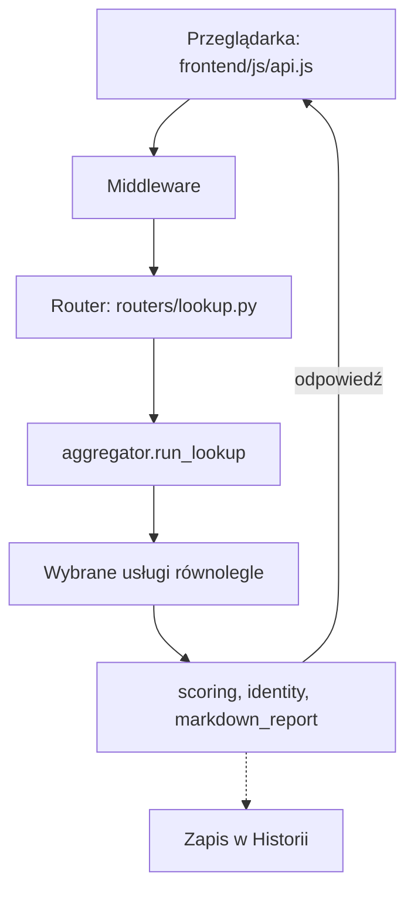

[English](../ARCHITECTURE.md) | **Polski**

# Architektura

Ta strona jest dla osób, które współtworzą Seisę: wyjaśnia, jak jest zbudowana i dlaczego. W jednym zdaniu: Seisa to mały serwer WWW, który działa wyłącznie na Twoim komputerze, oraz zwykła strona internetowa, która z nim rozmawia.

## Spis treści

- [Decyzje projektowe](#decyzje-projektowe)
- [Technologie](#technologie)
- [Droga żądania](#droga-żądania)
- [Moduły backendu](#moduły-backendu)
- [Moduły frontendu](#moduły-frontendu)
- [Pliki danych](#pliki-danych)
- [Wielojęzyczność](#wielojęzyczność)
- [Skórki kolorystyczne](#skórki-kolorystyczne)
- [Prompty LLM](#prompty-llm)
- [Skrypty i testy](#skrypty-i-testy)
- [Układ repozytorium](#układ-repozytorium)

## Decyzje projektowe

To wybory, które kształtują cały projekt. Każdy z nich jest świadomy, więc przed zmianą któregokolwiek porozmawiaj z opiekunem projektu.

- **Narzędzie lokalne dla jednej osoby.** Jeden proces Pythona obsługuje i API, i stronę na adresie `127.0.0.1`. Nie ma logowania ani bazy danych.
- **Fakty pochodzą z kodu, nie z modelu.** Fakty bezpieczeństwa (adres nadawcy, kolejność przeskoków poczty, wyniki SPF/DKIM/DMARC, to, czy zgłoszenie wolno wysłać) wylicza deterministyczny Python. Model językowy tylko je wyjaśnia albo daje pomocniczą drugą opinię.
- **Bez frameworka w przeglądarce.** Frontend to zwykłe moduły ES bez etapu budowania. Jedyny wyjątek to `frontend/vendor/marked.min.js`, który wyświetla Markdown.
- **Nic nie wychodzi bez działania użytkownika.** Jest jeden opisany wyjątek: zakładka AbuseIPDB sprawdza adres IP nadawcy przy analizie e-maila.
- **Bez pamięci podręcznej wyników.** Każde sprawdzenie pyta usługi od nowa, więc raport jest zawsze świeży.
- **Zwykłe pliki JSON.** Dane to pliki JSON zapisywane atomowo (plik tymczasowy, potem zmiana nazwy), czytelne tylko dla właściciela.
- **Dwa osobne narzędzia do e-maili.** Zakładki Email i AbuseIPDB to różne narzędzia. Łączą je tylko klocki do parsowania: `mail_source.py`, `mail_trust.py` i `email_parser.py`.
- **DMARC czytany w przeglądarce.** Raporty DMARC są w całości parsowane w przeglądarce. Backend pytamy tylko o opcjonalne sprawdzenie „geo (RDAP)" jednego adresu źródłowego.
- **Dwa języki w jednym kodzie.** Każdy widoczny tekst pochodzi z katalogów (angielski i polski).

Czego Seisa celowo nie robi:

- Nie otwiera linków ani załączników z e-maili, nie ładuje skanowanych stron i nie wysyła zgłoszeń automatycznie.
- Nie ma kont użytkowników, telemetrii ani automatycznych aktualizacji.
- Nie ma skryptu startowego dla Windows: skrypty uruchamiające to skrypty Bash dla macOS i Linuksa.
- Nie pozwala, by złośliwa wiadomość zamroziła pozostałe zakładki: ciężkie parsowanie działa w wątkach roboczych (`asyncio.to_thread`).

## Technologie

Seisa używa niewielkiego zestawu znanych narzędzi. Tabela pokazuje je razem z ważnymi limitami.

| Element | Co jest użyte |
|---|---|
| Język | Python 3.11 lub nowszy (CI testuje 3.11 i najnowszy 3.x) |
| Biblioteki | FastAPI, uvicorn, pydantic, pydantic-settings, httpx, python-whois, dnspython (wersje minimalne w `requirements.txt`, przetestowane w `requirements.lock`) |
| Ustawienia i klucze | Czytane z `.env` przez pydantic-settings przy starcie |
| Wychodzące HTTP | `httpx.AsyncClient`: limit 20 s dla większości usług, 30 s dla zgłoszenia do AbuseIPDB, 30 s na połączenie i 120 s ciszy dla OpenRouter |
| DNS i WHOIS | dnspython z limitem 5 s; WHOIS ma limit 15 s |
| Frontend | Jeden `index.html`, moduły ES w `frontend/js/`, jeden arkusz stylów `frontend/css/style.css`, generowany `/api/themes.css`, katalogi w `frontend/i18n/` |
| Start | `seisa.sh` (uvicorn, `backend.main:app`, `127.0.0.1:54321`) albo ikona na pulpicie przez `seisa-launcher.sh` |

## Droga żądania

Każde żądanie przechodzi przez te same warstwy, zanim trafi do kodu, który wykonuje pracę. Diagram pokazuje drogę sprawdzenia IP, jako przykład.

Żądanie przechodzi przez cztery middleware, od zewnętrznego:

1. **TrustedHost** odrzuca każdy nagłówek `Host`, który nie jest `127.0.0.1` ani `localhost` (ochrona przed DNS rebinding).
2. **LanguageMiddleware** wczytuje `X-Seisa-Lang` do zmiennej kontekstowej na czas żądania.
3. **OriginGuardMiddleware** odrzuca żądania `/api/`, które inna strona internetowa wysyła przez Twoją przeglądarkę.
4. **NoCacheStaticMiddleware** dodaje nagłówek Content-Security-Policy i wyłącza pamięć podręczną poza `/api/`.

Dalej:

- Routery są podpięte pod `/api`; routery zakładek leżą pod `/api/abuseipdb`, `/api/dmarc`, `/api/urlscan` i `/api/email`. Cała reszta to statyczny frontend.
- Sprawdzenie IP uruchamia `routers/lookup.py`, potem `aggregator.run_lookup`, potem wybrane usługi równolegle (`asyncio.gather`), potem `scoring.compute_risk_score`, `identity.build_identity` i `markdown_report.build_markdown`. Wynik trafia do Historii.
- Analiza Email przesyła strumień Server-Sent Events: najpierw fakty lokalne, potem tekst modelu kawałek po kawałku, potem werdykt, kontrola cytatów i id zapisanej analizy.
- Klienci usług zwracają `ServiceResult` ze statusem (`ok`, `no_key`, `not_applicable`, `error`, `rate_limited_daily`) zamiast zgłaszać wyjątek, więc jedno zawodzące źródło nie psuje całego sprawdzenia.
- Nieoczekiwany wyjątek zamienia się w ogólny błąd HTTP 500 i jedną linię w logu.
- Frontend rozmawia z backendem tylko przez `frontend/js/api.js`. Zakładki przekazują sobie dane przez `window.seisaApp` (na przykład adres z zakładki Email do zakładki IP).

Same endpointy opisuje [API.md](API.md).

## Moduły backendu

Backend leży w `backend/`. Każdy moduł ma jedno zadanie; zajrzyj do tej listy, zanim dodasz nowy.

### Punkt wejścia i ustawienia

| Moduł | Rola |
|---|---|
| `backend/main.py` | Aplikacja FastAPI, middleware bezpieczeństwa, routery pod `/api`, statyczny frontend |
| `backend/config.py` | Ścieżki (`data/`, `logs/`, prompty, `frontend/`), limity rozmiaru i przechowywania, `settings` czytane z `.env` |
| `backend/models.py` | Wspólne modele pydantic |
| `backend/sse.py` | Ramkowanie Server-Sent Events |

### Routery

| Moduł | Rola |
|---|---|
| `backend/routers/lookup.py` | Zakładka IP: jedno sprawdzenie, porównanie z wcześniejszymi sprawdzeniami tego samego wskaźnika, zapis w Historii |
| `backend/routers/urlscan.py` | Zakładka URLScan: wysłanie, wynik (podsumowanie i Markdown), zrzut ekranu, wcześniejsze skany |
| `backend/routers/dmarc.py` | Zakładka DMARC: sprawdzenie „geo (RDAP)" jednego adresu źródłowego |
| `backend/routers/email_analysis.py` | Zakładka Email: analiza strumieniowa, dokończenie ucięte analizy, wykrywanie duplikatów, zapisane analizy; buduje prompt Email |
| `backend/routers/abuseipdb_report.py` | Zakładka AbuseIPDB: analiza e-maila, podgląd z twardymi sprawdzeniami i skanem danych osobowych, zamazywanie, wysyłka, dziennik zgłoszeń |
| `backend/routers/history.py` | Zakładka Historia: zapisane wpisy oraz zapisane analizy i przyjęte zgłoszenia jako jedna lista |
| `backend/routers/logs.py` | Zakładka Logi: czyta i czyści dzienne pliki logów |
| `backend/routers/about.py` | Zakładka Info: skonfigurowane klucze (nigdy ich wartości), środowisko, limity API, ostatnie wydania z `git log`, ikona na pulpicie, zamknięcie |
| `backend/routers/themes.py` | Lista skórek i wygenerowany CSS |
| `backend/routers/__init__.py` | Znacznik pakietu |

### Usługi (rozmowa ze światem)

| Moduł | Rola |
|---|---|
| `backend/services/base.py` | Klasa bazowa `IntelService` ze wspólnym pobieraniem JSON i jednolitymi wynikami |
| `backend/services/virustotal.py` | Klient VirusTotal |
| `backend/services/otx.py` | Klient AlienVault OTX |
| `backend/services/abuseipdb.py` | Klient AbuseIPDB (sprawdzenie i zgłoszenie) |
| `backend/services/greynoise.py` | Klient GreyNoise |
| `backend/services/cloudflare_radar.py` | Klient Cloudflare Radar |
| `backend/services/whois_dns.py` | Klient WHOIS i odwrotnego DNS |
| `backend/services/dns_records.py` | Rekordy DNS domeny i zapytania odwrotne przez systemowy resolver |
| `backend/services/urlscan.py` | Klient urlscan.io jako zwykłe funkcje (skan jest asynchroniczny i zwraca pliki) |
| `backend/services/llm_analyzer.py` | Klient OpenRouter: ocena JSON dla AbuseIPDB (buduje ten prompt) i strumieniowa analiza Email |
| `backend/services/__init__.py` | Znacznik pakietu |

Sześciu klientów źródeł informacji (VirusTotal, OTX, AbuseIPDB, GreyNoise, Cloudflare Radar, WHOIS) jest zarejestrowanych w `aggregator.SERVICE_REGISTRY`.

### Logika domenowa

| Moduł | Rola |
|---|---|
| `backend/aggregator.py` | Normalizuje i sprawdza wskaźnik, uruchamia wybrane usługi równolegle, buduje wynik |
| `backend/scoring.py` | Wynik ryzyka 0-100: ryzyko z każdego źródła z limitami wiarygodności, łączone modelem noisy-OR |
| `backend/identity.py` | Połączona tożsamość adresu IP (ASN, właściciel, kraj, sieć) ze statusem zgodności dla każdego pola |
| `backend/domain_heuristics.py` | Lokalne podpowiedzi o nazwie domeny i jej wieku (bez sieci), ograniczone tak, by same nigdy nie dawały „wysokiego" |
| `backend/markdown_report.py` | Raport Markdown ze sprawdzenia IP lub domeny |
| `backend/markdown_utils.py` | Utrzymuje niezaufany tekst „martwym" w eksportach Markdown; odbicie `frontend/js/markdown-export.js` |
| `backend/email_parser.py` | Deterministyczny parser: łańcuch Received, przeskok graniczny z pewnością, załączniki, adresy Bitcoin, słowa okupu |
| `backend/email_forensics.py` | Deterministyczna analiza zakładki Email (oś czasu, drzewo MIME, linki, ukryta treść, podsumowanie uwierzytelnienia) i źródło przygotowane dla modelu |
| `backend/mail_source.py` | Wspólne klocki: wczytanie wiadomości, normalizacja źródła, składanie nagłówków, dekodowanie zakodowanych słów, opis załączników |
| `backend/mail_trust.py` | Wspólne rozumowanie o zaufaniu do przekaźników: klasyfikacja hosta i domeny, powiązanie SMTP-AUTH i DKIM, werdykty SPF/DKIM/DMARC odbiorcy |
| `backend/citation_check.py` | Lokalna kontrola, czy to, co cytuje model, istnieje w źródle |
| `backend/verdict.py` | Maszynowy protokół linii `VERDICT` (kody angielskie; stare polskie tokeny nadal przyjmowane) |
| `backend/report_builder.py` | Zgłoszenie AbuseIPDB: komentarz, lokalna ocena wstępna, twarde sprawdzenia |
| `backend/report_utils.py` | Czyszczenie komentarza, kwalifikowalność IP, skan danych osobowych |
| `backend/known_senders.py` | Znani nadawcy poczty rozpoznawani po nazwie z potwierdzonego odwrotnego DNS (używane w „geo" DMARC) |
| `backend/urlscan_input.py` | Normalizacja URL: zamiana zapisu zabezpieczonego, odrzucanie schematów innych niż HTTP i hostów prywatnych |
| `backend/urlscan_forms.py` | Formularze znalezione w DOM skanowanej strony |
| `backend/urlscan_report.py` | Podsumowanie i Markdown skanu |

### Przechowywanie, limity i pomocnicze

| Moduł | Rola |
|---|---|
| `backend/storage.py` | Atomowy zapis JSON, uprawnienia tylko dla właściciela |
| `backend/analyses.py` | Zapisane analizy Email |
| `backend/history_store.py` | Indeks Historii i pliki wpisów, z retencją i migracją |
| `backend/api_limits.py` | Zużycie API na tle limitów darmowych planów (pokazywane w Info) |
| `backend/ratelimit.py` | Dławienie zapytań do VirusTotal |
| `backend/logging_config.py` | Dzienny log ostrzeżeń i błędów w formacie JSON-lines, tylko dla właściciela, retencja 30 dni |
| `backend/i18n.py` | Tłumaczenia backendu z językiem żądania w zmiennej kontekstowej; formy liczby mnogiej |
| `backend/themes.py` | Sprawdza pliki JSON skórek i generuje z nich CSS |
| `backend/desktop_icon.py` | Ikona na pulpicie dla macOS i Linuksa, z przycisku w Info lub `python -m backend.desktop_icon` |
| `backend/__init__.py` | Znacznik pakietu |

## Moduły frontendu

Frontend leży w `frontend/js/`. Większe zakładki są podzielone na moduły `<zakładka>-<rola>.js`, więc jeden plik to nie jedna zakładka.

| Obszar | Moduły |
|---|---|
| Wejście | `frontend/js/app.js` (zakładki, `window.seisaApp`), `frontend/js/api.js` (klient backendu), `frontend/js/i18n.js`, `frontend/js/theme.js` z `frontend/theme-init.js` (skórka przed pierwszym narysowaniem strony), `frontend/js/shutdown.js` |
| IP | `frontend/js/lookup.js` (formularz, uruchomienie), `frontend/js/lookup-result.js` (raport) |
| URLScan | `frontend/js/urlscan.js` (formularz, wysyłka, odpytywanie, partia, Historia), `frontend/js/urlscan-result.js`, `frontend/js/urlscan-compare.js` |
| DMARC | `frontend/js/dmarc.js`, `frontend/js/dmarc-data.js` (parsowanie i agregacja, bez HTML), `frontend/js/dmarc-export.js`, `frontend/js/archive.js` (gzip i zip w przeglądarce) |
| Email | `frontend/js/email.js`, `frontend/js/email-facts.js`, `frontend/js/email-lesson.js`, `frontend/js/email-source.js`, `frontend/js/email-compare.js`, `frontend/js/email-export.js`, `frontend/js/email-glossary.js`, `frontend/js/markdown-render.js` |
| AbuseIPDB | `frontend/js/report-builder.js` (stan, zdarzenia, wysyłka), `frontend/js/report-result.js`, `frontend/js/report-checks.js` (czyste funkcje, testowane), `frontend/js/report-history.js`, `frontend/js/report-export.js` |
| Historia, Logi, Info | `frontend/js/history.js`, `frontend/js/history-compare.js`, `frontend/js/logs.js`, `frontend/js/about.js` |
| Wspólne | `frontend/js/ui.js` (bloki HTML), `frontend/js/util.js` (`escapeHtml`, kopiowanie, liczniki czasu, `formatUsage`), `frontend/js/markdown-export.js`, `frontend/js/glossary.js`, `frontend/js/fold-state.js`, `frontend/js/clear-button.js`, `frontend/js/services.js` (nazwy wyświetlane) |

## Pliki danych

Seisa trzyma dane w dwóch lokalnych katalogach, `data/` i `logs/`. Ta sekcja pokazuje układ i format; uprawnienia i retencję opisuje dokument o prywatności ([PRIVACY.md](PRIVACY.md)).

- **Historia:** `data/history/index.json` zawiera jeden mały wiersz na wpis (to, czego potrzebują lista i porównanie). `data/history/entries/<uuid>.json` zawiera cały wpis. Indeks to pamięć podręczna, odbudowywana z plików wpisów, jeśli się uszkodzi. Zapis idzie najpierw do wpisu, potem do indeksu; kasowanie najpierw z indeksu, potem wpis.
- **Stara Historia:** jednoplikowa historia z wersji sprzed 2.4.25 (`data/history.json`) jest przenoszona przy pierwszym użyciu i zmienia nazwę na `history.json.migrated`.
- **Analizy Email:** jeden plik JSON na analizę, z id `YYYYMMDD-HHMMSS-<8 znaków szesnastkowych SHA-256>`. Format id jest sprawdzany, więc żadna ścieżka nie wyjdzie poza katalog.
- **Małe pliki JSON:** `data/report_log.json`, `data/vt_usage.json`, `data/api_usage.json`.
- **Logi:** `logs/YYYY-MM-DD.jsonl`, jeden obiekt JSON w linii z polami `time`, `level`, `service` i `message`.
- **Ścieżki:** wszystkie ścieżki danych to stałe w `backend/config.py`. Testy i harness przekierowują je do katalogu tymczasowego.

## Wielojęzyczność

Seisa mówi po angielsku i po polsku. Każdy widoczny tekst pochodzi z katalogów, nigdy z kodu.

- Językiem interfejsu jest `en` albo `pl`. Przy pierwszej wizycie wybiera go język przeglądarki; wybór zapamiętuje `localStorage` (`seisa.lang`).
- Frontend wysyła język w nagłówku `X-Seisa-Lang`. Backend trzyma go dla żądania i tłumaczy własne komunikaty (zapasowo angielski, potem sam klucz).
- Katalogi to czysty tekst bez HTML, z `{placeholderami}`. Formy liczby mnogiej to `_one/_few/_many/_other` w polskim i `_one/_other` w angielskim.
- `?lang=qa` to pseudo-język dla programistów, który zamiast tekstu pokazuje `[[klucz]]`, żeby łatwo było znaleźć nieprzetłumaczone teksty.
- Prompty dla modelu są pisane raz, po angielsku. Język odpowiedzi ustawia polecenie (`LANGUAGE_NAMES`).

Katalogi: `frontend/i18n/{en,pl}.json` dla interfejsu i `backend/locales/{en,pl}.json` dla komunikatów backendu.

## Skórki kolorystyczne

Skórka to mały plik JSON w `frontend/themes/`, więc dodanie nowego wyglądu nie wymaga kodu.

- Dostarczane skórki: `light` („Light Washi", domyślna), `sumi-brown` („Brown Sumi"), `blue` („Blue Sumi") i `kohaku` („Red-and-white Kōhaku"). „Systemowy" idzie za systemem operacyjnym (ciemny oznacza Brown Sumi).
- Plik skórki ma `id` (równe nazwie pliku), `name` (`en` i `pl`), `base` (`dark` albo `light`), opcjonalne `order` od 0 do 1 000, opcjonalne `logo` (`badge` albo `mask`) oraz dokładnie znane klucze kolorów w formacie `#rrggbb`.
- Czytane jest najwyżej 24 pliki po 8 KB. Zły plik jest pomijany i zapisywany w logu.
- CSS powstaje wyłącznie ze sprawdzonych wartości, więc skórka nie może zawierać `url()`, `@import` ani reguł.

## Prompty LLM

Dwa pliki promptów są częścią programu, więc ich zmiana zmienia działanie aplikacji. Leżą w `backend/prompts/`.

- `backend/prompts/email-analysis-guide.md`: rola modelu, zasady wiarygodności, wymagana struktura odpowiedzi i techniczne podpowiedzi do lekcji Email.
- `backend/prompts/abuseipdb-reporting-policy.md`: zasady zgłaszania dla oceny AbuseIPDB.

Jeśli pliku promptu brakuje, Seisa wysyła prompt bez niego i nie zgłasza błędu.

Odpowiedź Email musi zaczynać się od `VERDICT: <kod> | CONFIDENCE: <poziom>`. Interfejs dzieli resztę na nagłówkach `## ` na karty i oznacza fragmenty `[Fact]`, `[Interpretation]` i `[To verify]`.

## Skrypty i testy

Katalogi `scripts/` i `tests/` pilnują projektu. Codzienną pracę z nimi opisuje przewodnik dewelopera ([DEVELOPMENT.md](DEVELOPMENT.md)); tu jest tylko mapa.

| Ścieżka | Co to jest |
|---|---|
| `scripts/check_all.py` | Uruchamia cały lokalny zestaw kontroli |
| `scripts/api_harness.py` | Test end-to-end wszystkich endpointów z atrapami usług zewnętrznych |
| `scripts/check_i18n.py` | Sprawdza katalogi językowe i wersję we wszystkich miejscach |
| `scripts/check_docs.py` | Sprawdza, czy dokumentacja zgadza się z kodem |
| `scripts/dump_facts.py` | Zrzuca deterministyczne fakty z e-maili do porównania ze złotym wzorcem |
| `scripts/make_app_icon.py` | Buduje ikonę aplikacji |
| `scripts/hooks/pre-commit` | Hook gita sprawdzający to, co ma trafić do commita |
| `scripts/hooks/commit-msg` | Hook gita sprawdzający komunikat commita |
| `tests/` | Moduły pytest dla modułów backendu, testy czystych funkcji frontendu uruchamiane w Node (`tests/js/*.mjs`), złote wzorce faktów (`tests/golden/`), syntetyczne e-maile (`tests/fixtures/`) |

Prawdziwe e-maile nigdy nie trafiają do commitów. Opcjonalny prywatny zbiór może leżeć w `tests/private/`, który git ignoruje.

## Układ repozytorium

To najwyższy poziom repozytorium, żeby było wiadomo, gdzie czego szukać.

| Ścieżka | Co zawiera |
|---|---|
| `backend/` | Serwer w Pythonie |
| `frontend/` | Strona: HTML, JavaScript, CSS, katalogi, skórki, obrazy |
| `scripts/` | Kontrole, harness i hooki gita |
| `tests/` | Testy automatyczne |
| `docs/` | Dokumentacja, z plikami polskimi w `docs/pl/` i zrzutami w `docs/images/` |
| `.github/` | Szablony zgłoszeń i pull requestów, CI |
| `data/`, `logs/` | Dane lokalne, ignorowane przez git poza `.gitkeep` |
| Pliki w katalogu głównym | `install.sh`, `seisa.sh`, `seisa-launcher.sh`, `requirements*.txt`, `requirements.lock`, `pyproject.toml`, `.env.example`, [LICENSE](../../LICENSE), [CHANGELOG.md](../../CHANGELOG.md), [CODE_OF_CONDUCT.md](CODE_OF_CONDUCT.md) |
