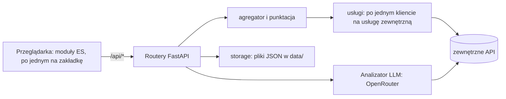

# Architektura i założenia

[English](../en/architecture.md) | **Polski** · [Spis dokumentacji](index.md) · [README](../../README.pl.md)

## Założenia projektowe i świadome ograniczenia

- **Lokalnie, jeden użytkownik, bez logowania.** Powierzchnia ataku pozostaje mała, bo nic nie jest wystawione; ceną jest to, że nigdy nie wolno wystawiać portu.
- **Bez bazy danych.** Cała trwałość to proste pliki JSON w `data/` z atomowym zapisem. Łatwo je czytać, archiwizować i usuwać; ceną jest brak współbieżności i ograniczona historia (25 nieprzypiętych wpisów).
- **Bez frameworka frontendowego i bez etapu budowania.** Zwykłe moduły ES; edytujesz plik i odświeżasz stronę (serwer wysyła nagłówki no-cache).
- **Najpierw deterministycznie, potem LLM.** Fakty, twarde sprawdzenia i wyniki liczy Python; LLM wyjaśnia i pisze szkic, a nie może odblokować zgłoszenia, które kod zablokował.
- **Każdy tekst widoczny dla użytkownika przechodzi przez katalogi** (PL i EN razem).
- **Niezaufana treść to dane.** Nic z e-maila, skanowanej strony ani odpowiedzi API nie jest wykonywane, otwierane ani pobierane.
- **Poza-cele:** dostęp wielu użytkowników, uwierzytelnianie, hosting zdalny, natywny Windows, zgłaszanie masowe lub automatyczne, zadania w tle.

## Stos technologiczny

Python 3.11+ z FastAPI, uvicorn, pydantic i pydantic-settings, httpx, python-whois i dnspython (`requirements.txt`; `requirements.lock` przypina przetestowane wersje). Frontend: zwykły JavaScript (moduły ES), CSS i lokalnie dołączony `marked.min.js`. Narzędzia deweloperskie (nie zależności): `ruff` i `pytest`. Kontrole automatyczne: testy jednostkowe pytest i harness API, które GitHub Actions (`.github/workflows/ci.yml`) uruchamia razem z `ruff`, `check_i18n.py` i `dump_facts.py` przy każdym pull requeście i każdym pushu na `main`.

## Architektura

Jeden proces Pythona FastAPI serwuje zarówno API, jak i statyczny frontend na `127.0.0.1:54321`.



Słowami: przeglądarka rozmawia z routerami (`backend/routers/`); sprawdzenie IP przechodzi przez agregator, który równolegle odpytuje usługi z `backend/services/` i liczy wynik w `backend/scoring.py`; zakładki Email i AbuseIPDB używają `email_forensics.py`, `email_parser.py` i `report_builder.py` dla części deterministycznej (obie współdzielą pomocnicze funkcje łańcucha zaufania w `mail_trust.py`) oraz `services/llm_analyzer.py` dla części LLM; wszystko, co trwałe, przechodzi przez `storage.py`, `analyses.py` i `logging_config.py`.

<details>
<summary>Drzewo plików</summary>

```
seisa/
├── .env                    # klucze API (gitignored, patrz .env.example)
├── seisa.sh                 # skrypt startowy (uruchamia serwer i otwiera przeglądarkę)
├── README.md / README.pl.md  # krótkie README po angielsku (główne) i po polsku
├── CHANGELOG.md             # każde wydanie, od najnowszego
├── pyproject.toml           # konfiguracja ruff i pytest (tylko ustawienia narzędzi, to nie pakiet)
├── requirements-dev.txt     # narzędzia deweloperskie: requirements.txt plus pytest i ruff, ten ostatni przypięty do jednej serii wersji
├── LICENSE                  # licencja PolyForm Noncommercial 1.0.0
├── CONTRIBUTING.md          # zasady współpracy (bez zewnętrznych zmian w kodzie)
├── SECURITY.md              # jak zgłosić podatność
├── .github/                 # ISSUE_TEMPLATE/ (szablon zgłoszenia błędu), pull_request_template.md (What / Why / Checked) i workflows/ci.yml (CI: ruff, pytest, harness, check_i18n, dump_facts i, przy pull requestach, reguła wersji dla całej gałęzi)
├── backend/
│   ├── main.py               # FastAPI, routing, middleware no-cache/CSP, strażnika originu i języka, kontrola Host, obsługa błędów
│   ├── config.py             # ścieżki, limity, ustawienia z .env
│   ├── models.py             # modele Pydantic
│   ├── aggregator.py         # rozesłanie do usług, wynik ryzyka zbiorczy
│   ├── markdown_report.py    # budowa raportu Markdown
│   ├── ratelimit.py          # throttle VirusTotal
│   ├── api_limits.py         # zużycie limitów API (zakładka Informacje): nagłówki, własne liczniki, endpointy limitów
│   ├── storage.py            # atomowy zapis JSON (historia, licznik VirusTotal, log zgłoszeń)
│   ├── sse.py                # ramkowanie Server-Sent Events wspólne dla endpointów streamujących
│   ├── logging_config.py     # logi WARNING+ do logs/*.jsonl
│   ├── email_parser.py       # wyciąganie faktów z surowego e-maila (zakładka AbuseIPDB)
│   ├── email_forensics.py    # analiza deterministyczna źródła e-maila (zakładka Email)
│   ├── mail_trust.py         # wspólne funkcje zaufania łańcucha Received/domen/IP/SMTP AUTH (obie zakładki)
│   ├── citation_check.py     # lokalna kontrola cytatów LLM względem źródła
│   ├── analyses.py           # zapis analiz e-maili w data/analyses/
│   ├── i18n.py               # tłumaczenia backendu: język żądania (ContextVar), t()/tn(), katalogi w locales/
│   ├── locales/              # katalogi tekstów backendu: pl.json, en.json
│   ├── verdict.py            # kanoniczny protokół werdyktu (kody EN, mapowanie starych tokenów PL)
│   ├── known_senders.py      # znani nadawcy poczty wg nazwy odwrotnego DNS (zakładka DMARC)
│   ├── scoring.py            # wynik zbiorczy reputacji IP (szum-OR)
│   ├── identity.py           # scalona tożsamość adresu (ASN, właściciel, kraj, sieć) lub domeny (rejestrator, daty, serwery nazw, DNS, kategoria) ze zgodnością źródeł per pole
│   ├── domain_heuristics.py  # lokalne wskazówki o domenie (wiek, podobne znaki, losowo wyglądające etykiety ...) do wyniku
│   ├── report_builder.py     # budowa komentarza AbuseIPDB + walidacja polityki
│   ├── report_utils.py       # sanityzacja tekstu, sprawdzanie IP, skan i maskowanie danych osobowych
│   ├── urlscan_report.py     # ustrukturyzowane podsumowanie + raport Markdown wyniku skanu urlscan.io
│   ├── urlscan_input.py      # czyszczenie i walidacja skanowanego URL (refang, schemat, hosty prywatne)
│   ├── urlscan_forms.py      # formularze skanowanej strony (z jej DOM): action, method, pola, flagi hasła/zewnętrzne
│   ├── routers/               # endpointy /api/*: lookup, urlscan, email_analysis, abuseipdb_report, dmarc, history, logs, about
│   └── services/               # klient każdej usługi (wspólny interfejs IntelService; urlscan.py osobno - zlecenie+odpytywanie; llm_analyzer.py - OpenRouter)
├── frontend/
│   ├── index.html
│   ├── favicon.ico            # ikona: kanji 査 (16/32/48/64 px)
│   ├── logo.png               # okrągłe logo (nagłówek strony i README)
│   ├── css/style.css          # ciemny motyw
│   ├── i18n/                  # katalogi tekstów interfejsu: pl.json, en.json
│   ├── js/                    # po jednym module na zakładkę i wspólne pomocnicze, poniżej
│   └── vendor/marked.min.js   # renderowanie Markdown, dołączone lokalnie (bez CDN)
├── tests/                   # testy jednostkowe pytest (`python3 -m pytest -q`): pomocnicze funkcje zaufania poczty, scoring, budowanie zgłoszeń, parser e-maili i forensyka, hook git (`test_pre_commit_hook.py`); `conftest.py` kieruje data/ do katalogu tymczasowego
│   ├── fixtures/            # SYNTETYCZNE e-maile (.eml) do porównań; fikcyjne dane (domeny .example, zakresy adresów dokumentacyjnych; układ nagłówków `multihop.eml` naśladuje dużego dostawcę poczty), bez danych osobowych
│   │   └── unit/            # dodatkowe przypadki syntetyczne tylko dla pytest (prompt injection, kodowania, uszkodzone nagłówki); podkatalog celowo, żeby płaski glob `*.eml` w `api_harness.py` i `dump_facts.py` ich nie widział
│   └── private/             # opcjonalne PRAWDZIWE e-maile z oczekiwanymi wynikami dla `test_corpus.py` (gitignored, nigdy nie commitowane)
├── scripts/
│   ├── api_harness.py         # test end-to-end: każdy endpoint API z zamockowanymi usługami zewnętrznymi (także `--serve PORT`)
│   ├── dump_facts.py          # zrzuca analizę deterministyczną fixtures do JSON (porównanie dwóch wersji kodu bajt w bajt)
│   ├── check_i18n.py          # sprawdza katalogi PL/EN, zgodność README i docs, martwe linki i wersję; `--strict` szuka polskich literałów w kodzie
│   └── hooks/                 # hooki git (włączane `git config core.hooksPath scripts/hooks`): `pre-commit` (zakazane pliki, długi myślnik, pary PL/EN, check_i18n na indeksie, skan prywatności, jeden krok wersji z wpisem w CHANGELOG; `--range BASE` sprawdza całą gałąź w CI) i `commit-msg` (reguły komunikatu, woła `pre-commit --commit-msg`)
├── data/                    # history.json, vt_usage.json, api_usage.json, report_log.json, analyses/ (gitignored)
├── logs/                    # logi błędów, jeden plik .jsonl na dzień (gitignored)
└── docs/
    ├── en/, pl/                        # dokumentacja po angielsku i po polsku (te same nazwy plików, index.md to spis treści)
    ├── abuseipdb-reporting-policy.md   # streszczenie polityki + tabela kategorii AbuseIPDB (angielski, kontekst promptu LLM)
    └── email-analysis-guide.md         # przewodnik analizy e-maila ładowany do promptu LLM (zakładka Email), angielski, z tabelą etykiet PL/EN
```

Moduły frontendu w `frontend/js/`:

- `app.js` (zakładki i przekazania `window.seisaApp`), `i18n.js`, `api.js`, `util.js` (wspólne pomocnicze), `markdown-render.js` (allow-lista HTML), `glossary.js` (jednozdaniowy dymek glosariusza na krótkiej, stałej etykiecie - podpisie kafelka, terminie `<dt>`, nagłówku tabeli - współdzielony przez zakładki IP, DMARC, URLScan i AbuseIPDB);
- `lookup.js` + `lookup-result.js` (zakładka IP i widok raportu), `urlscan.js` + `urlscan-result.js` + `urlscan-compare.js` (porównanie dwóch skanów), `dmarc.js` + `archive.js` (rozpakowywanie `.gz` i `.zip`);
- `email.js` + `email-facts.js`, `email-lesson.js`, `email-source.js`, `email-glossary.js`, `email-compare.js`, `email-export.js` (fakty deterministyczne, karty lekcji, szuflada źródła, dymki słownika na płynącej prozie - ten sam styl `.gl` co `glossary.js`, ale skanujący wyrenderowany tekst zamiast owijać znaną etykietę - porównanie i eksporty);
- `report-builder.js` (zakładka AbuseIPDB) + `report-result.js`, `report-history.js`, `report-export.js` (widok analizy, log wysłanych zgłoszeń i eksport Markdown);
- `history.js` + `history-compare.js`, `logs.js`, `about.js`.

</details>

## Pliki danych

| Ścieżka | Zawiera | Uwagi |
|---|---|---|
| `data/history.json` | historię (sprawdzenia IP, skany URL z miniaturami, importy DMARC, przypięcia) | 25 nieprzypiętych wpisów; zapis atomowy |
| `data/vt_usage.json` | dzienny licznik VirusTotal | zeruje się o 00:00 UTC |
| `data/api_usage.json` | liczniki i ostatnie znane limity (zakładka Informacje) | |
| `data/report_log.json` | log każdej próby zgłoszenia do AbuseIPDB | ślad audytowy, nie jest usuwany przez "Wyczyść historię" |
| `data/analyses/` | zapisane analizy e-maili z surowymi wiadomościami | pliki `0600`, katalog `0700` |
| `logs/*.jsonl` | WARNING i wyżej, jeden plik na dzień | |

Całe `data/` i `logs/` jest w `.gitignore` (katalogi zachowuje `.gitkeep`). Aby zresetować Seisę, zatrzymaj ją i usuń zawartość tych katalogów. Wydania przed 2.0.27 używały `data/analizy/` i `logi/`; Seisa ich nie migruje, więc zmień nazwy ręcznie przed pierwszym startem nowszego wydania (`mv data/analizy data/analyses` oraz przeniesienie plików `*.jsonl` z `logi/` do `logs/`).
