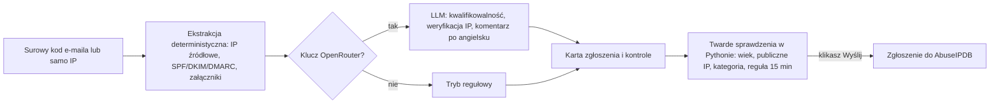

# Zakładki i przykład

[English](../en/tabs.md) | **Polski** · [Spis dokumentacji](index.md) · [README](../../README.pl.md)

## Zakładki

Rząd zakładek: [IP](#ip), [URLScan](#urlscan), [DMARC](#dmarc), [Email](#email), [AbuseIPDB](#abuseipdb), [Historia](#historia), [Logi](#logi) i okrągły przycisk informacji ([Informacje](#informacje)). Zakładki IP, URLScan, DMARC, Email, AbuseIPDB, Historia, Logi i Informacje mają wspólny układ: baner werdyktu (kolor wg poziomu), kafelki podsumowania, a niżej zwijane karty, które otwierają się same tylko przy sygnale; większość ma też sekcję "Wyjaśnienia" pisaną zrozumiałym językiem oraz dymki glosariusza na żargonowych terminach (podkreślenie kropkami - najedź myszą albo zaznacz klawiaturą, żeby zobaczyć definicję).

### IP

> Reputacja adresu IP z sześciu źródeł, scalona w jeden objaśniony wynik 0-100.

**Wejście:** adres IP lub nazwa domeny | **Wynik:** raport (werdykt, kafelki, karta tożsamości, karty źródeł) | **Wysyła na zewnątrz:** adres do usług, dla których masz klucze, oraz darmowe zapytania RDAP i DNS | **Klucze:** każda usługa opcjonalna. Skanowanie URL jest w zakładce [URLScan](#urlscan).

| Usługa | Co dostarcza |
|---|---|
| [VirusTotal](https://www.virustotal.com) | detekcje silników AV, reputacja, ASN, kategorie, tagi, WHOIS |
| [AlienVault OTX](https://otx.alienvault.com) | pulsy threat-intel, geolokalizacja, ASN |
| [Cloudflare Radar](https://radar.cloudflare.com) | dane sieciowe/kontekstowe - ASN, lokalizacja, routing (nie werdykt) |
| [AbuseIPDB](https://www.abuseipdb.com) | confidence score, liczba zgłoszeń, autor najnowszego zgłoszenia, ISP |
| [GreyNoise](https://www.greynoise.io) | pełny IP Lookup (`/v3/ip`) - aktor, tagi, VPN/Tor, metadane sieciowe; spada na darmowy endpoint community, jeśli klucz nie ma dostępu do pełnego API; "brak informacji w usłudze" liczone jako wkład 0.0, nie jako "unknown" |
| WHOIS / rDNS | dla IP: odwrotny DNS (PTR) + pełny RDAP (RFC 9083, następca WHOIS) - zakres sieci, właściciel, kontakt abuse/techniczny, daty rejestracji; dla domeny: WHOIS (rejestrator, daty, serwery nazw, status) + rekordy DNS (A, AAAA, NS, MX, CAA, SPF, DMARC, wildcard, nieistniejące serwery nazw) - bez klucza API |
| Cisco Talos | brak oficjalnego API - tylko przycisk do ręcznego sprawdzenia |

Co dostajesz:

- **Jeden wynik zbiorczy** 0-100 i baner werdyktu: LOW poniżej 25, MEDIUM 25-59, HIGH od 60 (kolor wg poziomu, z wartościami, na których się opiera).
- **Kafelki podsumowania:** pewność nadużyć, wykrycia, GreyNoise, pulsy OTX, kraj, ASN, typ IP oraz tabela wyników składowych. Dla domeny: wiek domeny, rejestrator, czas do wygaśnięcia, popularność w Cloudflare, kategoria, serwery nazw i adresy IP.
- **Karta tożsamości adresu** (dla domeny: **tożsamość domeny**), która scala właściciela, ASN, kraj, sieć, odwrotny DNS, typ użycia i Tor ze wszystkich źródeł (dla domeny: rejestrator, daty, wiek, serwery nazw sprawdzone między WHOIS a DNS, adresy IP, serwery poczty, SPF, DMARC, CAA, kategoria, popularność) i pokazuje, ile źródeł się zgadza. Jest zwinięta z zieloną informacją "źródła są zgodne", a gdy źródła się rozchodzą, rozwija się sama.
- **Jedna zwijana karta na źródło** (przyciski "Rozwiń wszystko" / "Zwiń wszystko" obok nagłówka "Źródła" otwierają lub zwijają je naraz), otwarta tylko dla źródeł z sygnałem (ryzyko źródła co najmniej 25, czyli Średnie lub Wysokie); listy (tagi, CVE, porty, pulsy) to chipy z "pokaż więcej". Karta WHOIS / rDNS powtarza wiersze tożsamości, które od niej pochodzą, więc nie trzeba szukać w dwóch miejscach.
- **Wklejone dane są porządkowane:** URL (`https://Example.com:8080/a?b`), zdefangowany wskaźnik (`hxxps://evil[.]example`, `1[.]2[.]3[.]4`), `ip:port`, `user@host` czy nazwa wielkimi literami są sprowadzane do samego hosta lub adresu IP. Adresy prywatne, pętli zwrotnej i zarezerwowane są odrzucane z wyjaśnieniem, zamiast trafiać do usług.
- **Porównanie z poprzednim skanem:** gdy ten sam wskaźnik jest w Historii, linia pod banerem pokazuje poprzedni wynik, różnicę, źródła, których ryzyko zmieniło się o 10 lub więcej, i słupek na każdy wcześniejszy skan (Historia trzyma 25 niezapiętych wpisów, więc trend jest co najwyżej tak długi).
- **Źródła bez wyniku** (błąd, brak klucza, limit dzienny, nie dotyczy) mają jedną zwiniętą belkę zamiast karty każde; przy błędzie rozwija się sama. "Wyniki składowe" to zwijana karta, domyślnie rozwinięta. Gdy GreyNoise odpowiada wyczerpanym limitem wyszukiwań (HTTP 429), karta mówi o tym zwykłym językiem, z datą odnowienia, jeśli GreyNoise ją podaje; wynik jest wtedy liczony bez tego źródła.
- **Raport domeny** ma przycisk "Skanuj w URLScan", który wypełnia zakładkę URLScan adresem `https://<domena>/`.
- **Wiadomości w czasie:** wykres słupkowy (wiadomości na dzień, udział niezgodnych na czerwono), gdy raporty obejmują co najmniej dwa dni.
- **Porównanie z poprzednim importem** tej samej domeny (z [Historii](#historia)): nowe źródła, źródła, których już nie ma, źródła, które pogorszyły wynik, oraz zgodność z DMARC przed i teraz.
- **Eksport:** "Zapisz .md" (natywne okno wyboru miejsca zapisu w przeglądarce) albo kopiowanie; Markdown zawiera cały raport, także tabelę tożsamości.
- **Pomoc w prostym języku:** zwijana sekcja "Wyjaśnienia" (wynik, ryzyko źródła a sygnał, zgodność tożsamości, confidence score, GreyNoise/RIOT, porównanie...) pisana najpierw dla nieprofesjonalistów, potem ze szczegółami technicznymi; żargonowe etykiety (ASN, pola RDAP, własne rekordy SPF/DKIM/DMARC/CAA domeny) mają dymek glosariusza.

Szczegóły: model punktacji, karta tożsamości, surowe odpowiedzi

**Punktacja** (`backend/scoring.py`). Model szum-OR: każde źródło - AbuseIPDB, VirusTotal, GreyNoise, OTX - daje ryzyko 0-100 nieliniową skalą i ma własną wiarygodność (0,9, 0,8, 0,7 i 0,5). Źródło bez danych nie głosuje, więc nie rozrzedza wyniku. Znane dobre IP (wpis na białej liście AbuseIPDB, GreyNoise benign/RIOT, walidacja OTX) obniża wynik do 15, chyba że występują silne sprzeczne sygnały. Cloudflare Radar jest kontekstowy i celowo wyłączony z liczby. Dla domeny dołącza jeszcze jedno źródło o niskiej wiarygodności (0,4): lokalne heurystyki (`backend/domain_heuristics.py`) - domena młodsza niż 90 dni, podobnie wyglądające znaki z różnych alfabetów (homograf), punycode, często nadużywana domena najwyższego poziomu, etykieta wyglądająca na losową, słowa-wabiki jak `login` czy `secure`; mogą podnieść domenę do Medium, ale same nigdy do High. Raport podaje też, ile źródeł wzięło udział, i dodaje uwagi.

**Tożsamość adresu** (`backend/identity.py`). Wartości są najpierw normalizowane (ASN do liczby, kraj do kodu ISO, nazwy właścicieli bez form prawnych, zakresy RDAP do CIDR). Przy każdym polu widać, ile źródeł się zgadza. Gdy się różnią, pokazywana jest wartość większości z bursztynową plakietką (kliknięcie wypisuje wszystkie wartości ze źródłami); przy remisie wartość z najwyżej cenionego źródła (RDAP jako rejestr pierwszy) z czerwoną plakietką. Kraj rejestracji (RDAP) i kraj geolokalizacji to osobne pola, bo przy hostingu i anycaście zwykle się różnią. Dotyczy to tylko wyświetlania, nie wyniku.

**Surowe odpowiedzi.** Pełna odpowiedź API każdego źródła, z numerami linii, jest w sekcji "Pełna odpowiedź API" jego karty.

### URLScan

> Żywy skan adresu URL przez urlscan.io, w układzie jak zakładka IP.

**Wejście:** adres URL albo do 5 adresów naraz (przyjmuje zdefangowane linki) | **Wynik:** werdykt, zrzut ekranu, tożsamość strony, karty szczegółów | **Wysyła na zewnątrz:** adres URL do urlscan.io | **Klucze:** `URLSCAN_API_KEY`.

Co dostajesz:

- **Baner werdyktu** w kolorze z wyniku urlscan.io oraz werdyktów silników i społeczności; "brak werdyktu" jest pokazany neutralnie i wprost nie jako "bezpieczne".
- **Kafelki podsumowania:** wynik, status HTTP, kraj serwera, ASN, żądania, wiek certyfikatu (ze znacznikiem "nowy" poniżej 7 dni), przekierowania.
- **Zrzut ekranu strony** i karta **Tożsamość strony**: zgłoszony i końcowy URL, łańcuch przekierowań, tytuł, domena z przyciskiem **Sprawdź domenę**, główne IP z przyciskiem **Sprawdź IP**, lokalizacja, PTR, serwer, typ MIME, czas skanu i widoczność.
- **Zwijane karty szczegółów** (z przyciskami "Rozwiń wszystko" / "Zwiń wszystko" obok nagłówka "Szczegóły"): werdykt urlscan.io (otwarty tylko przy sygnale ryzyka), formularze, certyfikat TLS, technologie, kontaktowane adresy IP (każdy z przyciskiem **Sprawdź IP**), kontaktowane domeny i linki.
- **Wcześniejsze skany** tej samej domeny (przycisk **Historia**), żeby otworzyć świeży raport zamiast zlecać nowy skan (podpowiedź "?" tłumaczy, co zawiera lista); "Skanuj ponownie" powtarza skan.
- **Jedna linia akcji:** Skanuj, po raporcie Skanuj ponownie, Zapisz .md i Kopiuj Markdown, potem Historia (wcześniejsze skany domeny), Porównaj (z poprzednim skanem) i Otwórz w urlscan.io; stan i czas są zawsze na końcu linii. Trwający skan ma przycisk **Anuluj** (przerywa tylko czekanie - sam skan trwa dalej w urlscan.io).
- **Porównanie z poprzednim skanem:** znajduje najnowszy wcześniejszy skan domeny (najpierw ten sam URL), pobiera go i pokazuje tabelę obok siebie - poziom ryzyka, wynik, przekierowania, IP, ASN, serwer, certyfikat, formularze, technologie - z przyciemnionymi wierszami bez zmian oraz domenami, które doszły lub zniknęły.
- **Kilka adresów naraz:** wklej do 5 adresów oddzielonych spacją, przecinkiem lub nową linią; są zgłaszane po kolei (z przerwą, żeby nie przekroczyć limitu zapytań) i pokazane na liście z poziomem ryzyka każdego, "Otwórz raport" i linkiem do urlscan.io. Każdy zakończony skan trafia do Historii (bez miniatury).
- **Eksport:** "Zapisz .md" i "Kopiuj Markdown"; w eksporcie adresy znalezione na skanowanej stronie są zdefangowane. Na ekranie adresy (skanowany URL, łańcuch przekierowań, kontaktowane domeny, linki, listy wcześniejszych i wsadowych skanów) są pokazane w całości, jako zwykły tekst, który nigdy nie jest klikalny.
- **Pomoc w prostym języku:** zwijana sekcja "Wyjaśnienia" (wynik i skala urlscan.io, silniki a społeczność, kategorie/marki, oznaczone żądania, wiek certyfikatu, ranking Umbrella, domena-matka a subdomena, sygnały formularzy, widoczność skanu) pisana najpierw dla nieprofesjonalistów; żargonowe etykiety jak ASN, liczniki werdyktów silników/społeczności i pole domeny-matki mają dymek glosariusza.

Szczegóły: zlecanie skanu, czyszczenie adresu, karta Formularze, historia

**Jak przebiega skan.** `POST /api/v1/scan/`, potem odpytywanie `GET /api/v1/result/{uuid}/` co 5 sekund, aż wynik będzie gotowy (urlscan.io zwraca 404, dopóki skan trwa; postęp pokazuje trzyetapowy wskaźnik). Backend najpierw czyści adres: zdefangowany link (`hxxps://evil[.]example`) zostaje przywrócony, brakujący schemat zamieniany jest na `https://`, a to, czego urlscan.io nigdy nie zeskanuje, jest odrzucane z czytelnym komunikatem (schematy inne niż HTTP, `localhost`, adresy prywatne i lokalne, nazwy z sieci wewnętrznej).

**Wybory przy zlecaniu.**

- **Widoczność, którą wybierasz (trzy przyciski pod polem URL, zapamiętywane w przeglądarce):** domyślnie `unlisted` (nie trafia na stronę główną ani do publicznego wyszukiwania urlscan.io, ale jest widoczny dla zweryfikowanych badaczy bezpieczeństwa w urlscan Pro), `private` (tylko Twoje konto) lub `public` (każdy; zakładka ostrzega o tym, a także gdy adres zawiera parametry takie jak `token=`, `key=`, `email=` albo `user:hasło@`).
- **Wcześniejsze skany:** najpierw przeszukiwane jest urlscan.io pod kątem wcześniejszych skanów tej samej domeny (publicznych oraz z Twojego konta); trafienie jest oznaczone, gdy to dokładnie ten sam URL.
- **Opcje zaawansowane** (zwinięta sekcja, zapamiętywana w przeglądarce): kraj skanu (krótka lista, wysyłany jako `country`) i user agent (Chrome na Windows lub Androidzie, Safari na iPhonie albo własny tekst, wysyłany jako `customagent`). Domyślnie oba pola są pominięte w zapytaniu, więc urlscan.io sam dobiera kraj i używa domyślnego user agenta. Strona phishingowa często pokazuje inną treść zależnie od kraju albo urządzenia.

**Zrzut ekranu.** Pobiera go z urlscan.io backend i serwuje z Twojego własnego źródła, więc ani przeglądarka, ani Content-Security-Policy nie mają styczności z urlscan.io ani ze skanowaną stroną.

**Karta Formularze** czyta wyrenderowany DOM, który przechowuje urlscan.io (tylko struktura - nic ze strony nie jest ładowane): dokąd wysyła każdy formularz, jaką metodą i z jakimi polami. Pole hasła wysyłane na inną domenę lub przez zwykłe HTTP to klasyczny zestaw phishingowy i podnosi "niski" lub brakujący werdykt urlscan.io do Średniego (z adnotacją).

**Historia.** Każdy zakończony skan trafia do zakładki [Historia](#historia) jako ustrukturyzowane podsumowanie oraz mała miniatura zrzutu w JPEG (640 px szerokości, dziesiątki KB). "Otwórz ponownie" pokazuje go znów w tej zakładce, a "Wczytaj pełny raport" pobiera z urlscan.io kompletny wynik po identyfikatorze.

### DMARC

> Przeciągnij raporty zbiorcze DMARC i zobacz wszystko, co zawierają, bez wysyłania czegokolwiek poza przeglądarkę.

**Wejście:** raporty `.xml`, `.gz` lub `.zip` dokładnie takie, jakie wysyłają dostawcy (Google, Microsoft i inni) | **Wynik:** werdykt, kafelki, wskazówki o polityce, źródła zagregowane wg IP | **Wysyła na zewnątrz:** nic z przeglądarki (opcjonalny przycisk geo każe backendowi zapytać RDAP o jeden adres IP, tak jak zakładka IP) | **Klucze:** brak.

Co dostajesz:

- **Rozpakowywanie i parsowanie w 100% w przeglądarce**; raport wgrany dwa razy (ten sam dostawca i ID raportu) jest pomijany i oznaczony na liście plików.
- **Baner werdyktu:** czerwony, gdy jakieś źródło nie przechodzi ani SPF, ani DKIM; żółty, gdy zawodzi tylko jedna z metod; w innym razie zielony; błędy zgłoszone w raporcie mają osobny baner. Ocena ryzyka bez zmian: wysokie = SPF i DKIM oba niezgodne, średnie = jedna z metod niezgodna.
- **Wskazówki o ostatniej opublikowanej polityce każdej domeny:** `p=none` tylko monitoruje, politykę można prawdopodobnie zaostrzyć, `pct` poniżej 100.
- **Kafelki podsumowania:** wiadomości, unikalne IP, źródła podejrzane, odsetek wiadomości zgodnych z DMARC oraz pasek decyzji polityki reject/quarantine/none; przy więcej niż jednym raporcie tabela według dostawcy.
- **Źródła zagregowane wg adresu IP**, pierwsza sekcja tuż pod kafelkami, od najbardziej ryzykownych, z filtrem (wszystkie / podejrzane / przechodzące), licznikami SPF i DKIM pass/fail i decyzjami polityki.
- **Diagnoza, nie tylko werdykt:** kliknięcie wiersza rozwija każdy pojedynczy rekord, co pokazuje dokładnie, *dlaczego* dopasowanie nie przeszło.
- **Eksport:** "Zapisz .md" i "Kopiuj Markdown"; każdy import trafia do [Historii](#historia) razem z rekordami, a "Otwórz ponownie" przywraca pełną analizę.

Szczegóły: co pokazuje każda część

**Raporty.** Zwinięta karta zaraz po źródłach; domyślnie rozwinięta jest tylko sekcja Źródła IP, każda inna jest zwinięta (także tabela dostawców). Każdy wgrany raport w środku to rozwijany blok z każdym polem metadanych i opublikowanej polityki: dostawca, kontakt i dodatkowy kontakt, ID i wersja raportu, okres, domena, `p`/`sp`/`pct`/`fo`, alignment (`adkim`/`aspf`, z oznaczonymi wartościami domyślnymi), błędy raportu i każdy inny element, który raport zawiera (np. `np`, `testing` albo znaczniki dostawcy).

**Źródła.** Override, np. `forwarded`, jest odnotowany obok decyzji polityki, żeby prawowite przekazywanie poczty nie wyglądało jak atak.

**Rekordy.** Rozwinięty wiersz pokazuje: header/envelope from i to, powód nadpisania polityki (`policy_evaluated > reason`), surowy wynik `auth_results` (domena/selektor/wynik/`human_result` dla DKIM, domena/scope/wynik dla SPF) i ewentualne dodatkowe pola.

**Wskazówki naprawy.** Rozwinięte źródło, które nie przechodzi SPF lub DKIM, ma listę konkretnych poprawek wyliczonych z jego rekordów (brak podpisu DKIM, nieprzechodzący klucz dla selektora, podpis lub SPF dla innej domeny niż w nagłówku From, adres brakujący w rekordzie SPF); dotyczą tylko prawowitego nadawcy. **Wiele raportów.** Przy więcej niż jednym raporcie lista raportów jest jedną zwiniętą kartą, więc źródła zostają blisko góry. **Baner.** Przy więcej niż pięciu niezgodnych źródłach baner pokazuje pięć adresów i rozwija się do pełnej listy.

**geo i dalsze kroki.** Opcjonalny przycisk "geo (RDAP)" w rozwiniętym wierszu pyta backend o ten jeden adres IP (wyłącznie po kliknięciu). Backend odpytuje RDAP, tę samą usługę co zakładka IP, a wiersz pokazuje kraj rejestracji, właściciela, nazwę sieci i nazwę odwrotnego DNS. Gdy nazwa rDNS należy do znanego nadawcy (Google, Microsoft 365, Amazon SES, SendGrid, Mailgun, Mailchimp i kilku innych) **i** wskazuje z powrotem na ten sam adres, wiersz to zaznacza; sam PTR nic nie dowodzi, bo właściciel bloku IP ustawia go dowolnie. RDAP nie zawiera ASN, więc go tu nie ma; jest w zakładce [IP](#ip). Stamtąd można przejść do pełnego sprawdzenia reputacji (zakładka [IP](#ip)) albo do przygotowania zgłoszenia AbuseIPDB.

**Wyjaśnienia i eksport.** Zakładkę zamyka sekcja wyjaśnień pojęć: SPF, DKIM, polityka, tabela, poziomy ryzyka, kafelki, geo/rDNS/znany nadawca, wskazówki naprawy oraz porównanie z wykresem, jako zwijana karta domyślnie zwinięta, pisana najpierw prostym językiem, potem ze szczegółami technicznymi. Etykiety "Polityka" i "Zgodność" na liście pól każdego raportu mają też krótki dymek glosariusza po najechaniu lub zaznaczeniu. Eksport Markdown zawiera podsumowanie, raporty, źródła i każdy rekord (wartości z XML trafiają do bloków kodu).

### Email

> Edukacyjna analiza źródła e-maila: co mówią nagłówki, dlaczego i co z tym zrobić.

**Wejście:** wklejony kod źródłowy (nagłówki + treść) albo plik `.eml` (UTF-8 lub windows-1252; koperta mbox i zakończenia linii są normalizowane) | **Wynik:** od razu ustalenia deterministyczne, opcjonalnie lekcja LLM | **Wysyła na zewnątrz:** przy "Analizuj" cały kod źródłowy do OpenRouter | **Klucze:** `OPENROUTER_API_KEY` dla części LLM. Binarne załączniki base64 nigdy nie idą do modelu (zostaje tylko ich rozmiar i sha256); tekstowe części base64 są dekodowane.

Co dostajesz:

- **Analiza deterministyczna, od razu i lokalnie** (bez LLM): anomalie, trasa Received z rolą każdego hopu w łańcuchu zaufania, uwierzytelnianie, zgodność domen, oś czasu w UTC, drzewo MIME, załączniki, linki, ukryta treść i filtry antyspamowe odbiorcy.
- **Szczegółowa analiza LLM**, streamowana na żywo (OpenRouter, ten sam klucz i model co w AbuseIPDB), według przewodnika `docs/email-analysis-guide.md`; pierwsza linia to werdykt z poziomem pewności.
- **Trzy panele ze spisem treści:** Przegląd (diagram trasy, ostrzeżenia, lista kontrolna, co robić, kontrola cytatów), Fakty (analiza deterministyczna jako zwijane karty, z przyciskami "Rozwiń wszystko" / "Zwiń wszystko"; tabela Received przewija się poziomo, gdy potrzebuje miejsca) i Lekcja (cała analiza LLM).
- **Karty dowodowe i szuflada źródła:** cytaty z wiadomości pokazują numery linii i przycisk "Pokaż w źródle".
- **Zapisane analizy** z wykrywaniem duplikatów, porównaniem dwóch analiz i eksportami (`.md`, `.html`).
- **Nic z wiadomości nie jest otwierane ani pobierane**; linki są pokazywane jako nieklikalny, zdefangowany tekst.

Szczegóły: analiza deterministyczna

Uwagi o anomaliach, trasa Received z rolą w łańcuchu zaufania, uwierzytelnianie (SPF/DKIM/DMARC/ARC, authserv-id, podpisane i niepodpisane nagłówki, długość `bh=`), zgodność domen względem `From`, oś czasu w UTC, konwersje epoch, drzewo MIME, załączniki (sha256, podwójne rozszerzenia), linki (tekst vs `href`), ukryta treść, komentarze HTML, placeholdery szablonu, filtry antyspamowe odbiorcy (SCL/BCL/CAT, folder docelowy Junk, AuthAs, zdekodowany X-Message-Delivery) i flagi ustawione przez nadawcę (X-Message-Flag, Importance, żądania potwierdzenia odbioru). Gdy cały łańcuch Received należy do jednego operatora (np. Microsoft, także gdy jego wewnętrzne hopy mają nazwy bez kropki w stylu Kubernetes, o ile ich własny adres jest prywatny), tabela wskazuje granicę zaufania na najstarszym wpisie - ale tylko gdy jego adres jest faktycznie publiczny, inaczej zostaje przy ogólnym podziale góra/dół. Gdy łańcuch obejmuje więcej niż jednego operatora (np. własny serwer odbiorcy plus zewnętrzny dostawca poczty masowej), Seisa dodatkowo próbuje przejść przez wewnętrzne hopy tego zewnętrznego operatora (tym samym mechanizmem, co w AbuseIPDB) - jeśli znajdzie głębszy hop z publicznym IP, to on staje się granicą zaufania (kafelek "IP nadawcy" i diagram trasy pokazują wtedy ten adres, a wcześniejsze hopy oznaczane są jako jego wewnętrzna sieć), zamiast domyślnie najnowszego wpisu. Każdy adres IP w tabeli jest oznaczony jako prywatny lub publiczny, a hop z uwierzytelnionym kontem SMTP AUTH zgodnym z domeną DKIM dostaje plakietkę potwierdzenia. Identyczne uwagi wynikające z powtórzonych linków są zgłaszane raz z liczbą wystąpień, np. `(x4)`. Logika jest w `backend/email_forensics.py` i współdzielonym `backend/mail_trust.py`.

Szczegóły: układ wyniku

Jak w zakładkach IP, DMARC i URLScan:

- **Baner werdyktu** na górze: werdykt, pewność, streszczenie analizy, stan kontroli cytatów i akcje (zgłoszenie, zapis/kopia, dokończenie ściętej analizy).
- **Rząd kafelków:** ostrzeżenia, SPF/DKIM/DMARC zapisane przez serwer odbiorcy, zgodność tożsamości nadawcy, IP na granicy zaufania (z przyciskiem wstawiającym je do zakładki IP), linki/załączniki/ukryta treść, filtr odbiorcy, czas doręczenia.
- **Trzy panele ze spisem treści po lewej:** **Przegląd** (trasa wiadomości jako diagram z granicą zaufania, ostrzeżenia, lista kontrolna i część "co robić" z analizy, kontrola cytatów), **Fakty** (analiza deterministyczna jako zwijane karty; karta otwiera się sama tylko przy sygnale i pokazuje jednoliniowy stan w nagłówku) i **Lekcja** (cała analiza LLM).
- Po analizie źródło zwija się do jednolinijkowego paska ("Edytuj źródło" przywraca pole). Zakładka pamięta wybrany panel.

Szczegóły: lekcja LLM

- Analizę prowadzi przewodnik `docs/email-analysis-guide.md`: model mentalny, analiza linijka po linijce zarówno elementów dobrych, jak i złych, lista kontrolna, pułapki, ocena, pytania kontrolne z odpowiedziami w zwijanych sekcjach.
- Tekst jest dzielony po nagłówkach `##` na zwijane karty. Wszystkie karty startują zwinięte; wybrany przez Ciebie stan jest zapamiętywany; "Rozwiń wszystko" / "Zwiń wszystko"; podbloki części linia po linii też się zwijają. Jeśli model zepsuje strukturę, tekst pokazuje się jako jeden blok. Lekcję można przeszukiwać (trafienia otwierają zwinięte karty).
- Cytaty z wiadomości stają się **kartami dowodowymi** z numerami linii i przyciskiem "Pokaż w źródle", który otwiera **szufladę źródła** (wiadomość z numerami linii, cytowane linie podświetlone, po kilku trafieniach można przechodzić). Cytat, którego nie ma dosłownie w źródle, jest oznaczony jako schemat lub przykład. Kod w tekście, który występuje w źródle, jest klikalny tak samo.
- Terminy techniczne (SPF, DKIM, DMARC, ARC, PTR, SCL, HELO...) mają kropkowane podkreślenie i krótkie wyjaśnienie po najechaniu, raz w całej analizie.
- Analiza LLM nie odtwarza tabel widocznych w analizie deterministycznej (oś czasu, linki, Received itd.), tylko je interpretuje, żeby nie płacić za powtórki; komplet jest w eksporcie.
- Wynik jest renderowany bezpiecznie: surowy HTML z e-maila i linki są neutralizowane.
- Limit odpowiedzi modelu to 64000 tokenów (liczony razem z ukrytym rozumowaniem modelu, ok. 45% wyjścia; to sufit, płaci się za tokeny faktycznie wygenerowane). Jeśli analiza mimo to zostanie ucięta, zakładka pokazuje ostrzeżenie i przycisk **"Dokończ analizę"** (model dostaje dotychczasowy tekst i dopisuje brakujące części; zużycie tokenów i koszt sumują się w zapisanej analizie).

Szczegóły: protokół werdyktu, język, kontrola cytatów

- **Protokół werdyktu** (`backend/verdict.py`): pierwsza linia odpowiedzi modelu ma postać `VERDICT: <legit|phishing|spam|scam|malware|inconclusive> | CONFIDENCE: <high|medium|low>` i zawsze używa tych kanonicznych kodów, niezależnie od języka analizy; interfejs mapuje je na etykiety w wybranym języku. Analizy zapisane wcześniej z polskimi tokenami (`WERDYKT`/`PEWNOSC`) są odczytywane bez migracji plików.
- **Język analizy:** analiza powstaje w języku interfejsu (dyrektywa w prompcie plus tabela dosłownych nagłówków i tagów `[Fakt]`/`[Fact]` w obu językach w `docs/email-analysis-guide.md`); język zapisuje się w rekordzie (`lang`; starsze rekordy = polski). „Dokończ analizę" używa języka zapisanego rekordu, a nie bieżącego języka interfejsu. Zapisana analiza w innym języku niż interfejs jest oznaczona plakietką PL/EN, a przy jej otwarciu pojawia się baner z płatnym przyciskiem ponownej analizy (koszt poprzedniej podany orientacyjnie); fakty i tekst zostają w języku powstania, etykiety i eksport `.md` w języku interfejsu. Wykrywanie duplikatów nie zależy od języka: baner pokazuje język istniejącej analizy.
- **Kontrola cytatów** (lokalna, bez kosztu; `backend/citation_check.py`): po analizie kod sprawdza, czy adresy IP, cytowane w blokach kodu linie nagłówków, cytaty `Nagłówek: wartość`, liczby SCL/BCL i identyfikatory podane przez model występują w źródle lub w analizie deterministycznej. Baner pokazuje wynik ("cytaty zweryfikowane" albo ostrzeżenie prowadzące do szczegółów w panelu Przegląd); rozbieżności są też w eksporcie `.md`. To informacja, nie dowód błędu (przykład lub parafraza też mogą zostać oznaczone). Nie sprawdza domen ani wpisów typu `spf=pass`, bo analiza omawia też przykłady wiadomości legalnej.

Szczegóły: zapisane analizy, duplikaty, porównanie, eksporty, przekazywanie

- **Zapisane analizy:** każda ukończona analiza zapisuje się razem z surowym e-mailem w `data/analyses/` (pliki 0600, gitignored); lista zapisanych analiz (otwórz/usuń/porównaj) jest na dole zakładki.
- **Wykrywanie duplikatów:** przed płatną analizą Seisa sprawdza odcisk (sha256 znormalizowanego źródła) w `data/analyses/`. Jeśli ta wiadomość była już analizowana, proponuje otwarcie zapisanej analizy (z datą, werdyktem i kosztem) albo świadome uruchomienie ponownie.
- **Porównanie:** zaznacz dwie zapisane analizy i kliknij "Porównaj zaznaczone", by zobaczyć ich fakty obok siebie (werdykt, SPF/DKIM/DMARC, IP nadawcy, domeny, adresy IP, hosty linków, skróty załączników) z wyróżnieniem elementów wspólnych - operacja lokalna, nic nie jest wysyłane.
- **Eksporty:** "Zapisz .md", "Kopiuj Markdown" i "Zapisz .html". Etykiety eksportu są w języku interfejsu z chwili eksportu, a treść analizy LLM w języku, w którym powstała. Eksportują komplet: metadane (data, werdykt, model, tokeny wejścia/wyjścia, koszt), całą analizę deterministyczną (tabele) i analizę LLM. Plik HTML to samodzielna kopia wyniku z rozwiniętymi kartami (bez skryptów; Content-Security-Policy zabrania wszystkiego poza stylami inline).
- **Przekazywanie (żadne z nich niczego nie wysyła):** przy każdym linku analizy deterministycznej (linki, zwykłe URL-e, List-Unsubscribe) jest przycisk **URLScan**, a przy publicznych adresach IP przycisk **IP**; wstawiają one tylko adres do zakładki URLScan lub IP - nic nie jest otwierane, skanowane ani sprawdzane, dopóki nie klikniesz tam akcji. Wiersze tabel Received i uwierzytelniania mają przycisk "źródło", który podświetla nagłówek w szufladzie źródła. Przycisk **"Zgłoś AbuseIPDB"** (widoczny tylko gdy werdykt to nie `legit`) wkleja oryginalny kod do pola e-maila w zakładce AbuseIPDB (nadpisując pole) i przenosi tam użytkownika.

### AbuseIPDB

> Przygotuj, sprawdź i wyślij zgłoszenie nadużycia zgodne z polityką raportowania AbuseIPDB.

**Wejście:** surowy kod źródłowy podejrzanego e-maila (opcjonalnie; można też zacząć od samego IP) | **Wynik:** sprawdzone zgłoszenie gotowe do wysłania | **Wysyła na zewnątrz:** przy "Analizuj" kod źródłowy do OpenRouter; IP oraz, po "Wyślij", zgłoszenie do AbuseIPDB | **Klucze:** `ABUSEIPDB_API_KEY`; `OPENROUTER_API_KEY` opcjonalnie. Workflow jest zgodny z [polityką raportowania AbuseIPDB](../abuseipdb-reporting-policy.md) (limit 60 dni, zakaz zgłaszania na podstawie samego confidence score, limit 1024 znaków komentarza itd.). Zakładki Email i AbuseIPDB to dwa różne narzędzia, które dzielą tylko drobne elementy UI oraz LLM działający na kodzie e-maila: Email uczy, ta zakładka zgłasza.

Słowami: kod wyciąga fakty, opcjonalny LLM ocenia i pisze komentarz, pokazywane są karta zgłoszenia i kontrole, backend ponownie sprawdza twarde kryteria, a cokolwiek zostaje wysłane dopiero po Twoim kliknięciu.

**Kontrole przed wysyłką** (zwijana karta, która otwiera się sama, gdy coś blokuje, ze stanem w nagłówku):

| Rodzaj | Pozycje | Skutek |
|---|---|---|
| Wymagane | wiek ataku, publiczne IP, wybrana kategoria, reguła 15 minut, werdykt kwalifikowalności | bramkują przycisk "Wyślij" |
| Blokujące, oceniane przez LLM | `Received` zweryfikowany, źródło nie jest sfałszowane (blokuje tylko "fail") | bramkują przycisk "Wyślij" |
| Informacyjne | Spoofing, dopasowanie kategorii, lokalny skan danych osobowych, opinia modelu o PII | podpowiedź do przeczytania przed wysłaniem |

Data do godziny w przyszłość liczy się jako "teraz", żeby tolerować przesunięcie zegara; dalsza data z przyszłości nie przechodzi. Spoofing ma jeden z trzech stanów, zawsze z krótkim uzasadnieniem: wykryty (fail SPF/DMARC), nie wykryty (uwierzytelnianie przeszło) albo nie da się ocenić (brak lub niejednoznaczne wyniki SPF/DKIM/DMARC w wklejonym źródle). Backend liczy twarde sprawdzenia od nowa przy każdej zmianie i przy wysyłce, niezależnie od stanu formularza.

**Pomoc w prostym języku:** zwijana sekcja "Wyjaśnienia" tuż pod kontrolami (wymagane a blokujące a informacyjne, hop graniczny, SMTP-AUTH zweryfikowany, sztuczka z podwójnym rozszerzeniem, reguła 15 minut, maskowanie danych osobowych i to, dlaczego kwalifikowalność tutaj jest osobną sprawą od wyniku ryzyka 0-100 adresu w zakładce IP) jest pisana najpierw dla nieprofesjonalistów; plakietki hopu granicznego i SMTP-AUTH oraz kilka etykiet kontroli mają też krótki dymek glosariusza.

Szczegóły: dziesięć kroków workflow

1. **Wklej surowy kod źródłowy podejrzanego e-maila** (nagłówki + treść) - opcjonalnie; można też zacząć od samego IP (przycisk "Zgłoś AbuseIPDB" w zakładce IP lub DMARC albo "Użyj jako szkic" przy wcześniejszym zgłoszeniu). Przycisk "Wczytaj plik .eml" (także przeciągnięcie pliku na pole), licznik czasu analizy oraz tokeny i koszt po "Analizuj" są wyświetlane obok przycisków.
2. **Backend deterministycznie wyciąga fakty:** zaufany adres IP źródłowy, wraz z poziomem pewności (`ip_confidence`) i pełnym łańcuchem hopów. Dodatkowo: wynik SPF/DKIM/DMARC, załączniki (z wykrywaniem podwójnych rozszerzeń typu `faktura.pdf.exe`), Message-ID, wzorce adresów BTC i żądań okupu. **Twarde sprawdzenia (wiek ataku, czy IP jest prywatne) są zawsze liczone w Pythonie, nigdy nie są delegowane do LLM.**
3. **Opcjonalnie LLM przez OpenRouter** (jeśli w `.env` jest `OPENROUTER_API_KEY`) ocenia, czy e-mail kwalifikuje się do zgłoszenia, niezależnie weryfikuje wybrany przez kod adres IP na podstawie surowych nagłówków (`source_ip_check` - jeśli się nie zgadza, karta adresu pokazuje ostrzeżenie z sugestią modelu i przycisk, którym można ją przyjąć), ocenia dopasowanie sugerowanych kategorii i ewentualne PII w komentarzu - i **pisze gotowy, szczegółowy komentarz zgłoszenia po angielsku**, na podstawie faktów i kodu źródłowego wiadomości (wszystkie nagłówki bez zmian; tekstowe części base64 zdekodowane do czytelnego tekstu, a części binarne zastąpione znacznikiem z rozmiarem i sumą kontrolną, jak w zakładce Email; całość oznaczona jako dane niezaufane i ucięta do 120 000 znaków; karta adresu podaje, ile znaków widział model). Bez klucza narzędzie działa w trybie regułowym.
4. **Wynik ma układ jak zakładki IP, DMARC i URLScan.** Baner werdyktu (zielony = nadaje się, czerwony = nie nadaje się i wysyłka zablokowana, niebieski = nie oceniono; tekst zawsze biały) z uzasadnieniem i alternatywami, potem kafelki (IP źródłowe z pewnością, wiek e-maila wobec limitu 60 dni, SPF/DKIM/DMARC, załączniki oraz wynik AbuseIPDB dla adresu, gdy odpowie `/check`) i **karta adresu**: łańcuch `Received` z zaznaczonym hopem granicznym, oznaczeniem prywatny/publiczny przy każdym adresie i plakietką potwierdzonego SMTP AUTH/DKIM przy dowolnym hopie (nie tylko granicznym) oraz, przy każdym hopie z publicznym adresem, przycisk "Użyj tego adresu" (także dla adresu, który zamiast tego sugeruje model). Adres, który już zgłosiłeś(-aś), jest oznaczony. Prawdziwym nadawcą jest tylko hop graniczny - pozostałe hopy to zwykle serwery odbiorcy lub dostawcy (mówi o tym podpowiedź) - więc po zgłoszeniu zakładka proponuje kolejno pozostałe adresy tego e-maila, które nie są przekaźnikami. Załączniki są w zwijanej karcie, która otwiera się sama, gdy wykryto podwójne rozszerzenie. Bez LLM narzędzie nigdy nie twierdzi, że e-mail się kwalifikuje: sprawdza tylko twarde kryteria (publiczne IP, wiek) i rozpoznaje oczywisty przypadek testu wysłanego z własnego konta do samego siebie (nadawca = nadawca koperty = odbiorca, brak śladów ataku).
5. **Karta zgłoszenia** zawiera IP, kategorie, timestamp ataku i komentarz. Kategorie mają krótki opis w podpowiedzi, a pod nimi pojawiają się uwagi tam, gdzie wybór zwykle bywa błędny lub niepełny (`20 Exploited Host`, `22 SSH` i `13 VPN IP` samodzielnie; `23 IoT Targeted` bez typu urządzenia w komentarzu; `17 Spoofing`, gdy SPF/DMARC przeszły). Timestamp jest brany z nagłówka `Date` i pokazywany w czasie lokalnym przeglądarki; do API idzie w UTC (ISO 8601). Pole komentarza ma licznik znaków (limit 1024) i **skan danych osobowych**: wylistowane są Twoje własne adresy (odbiorcy wiadomości i ich domeny, z wyjątkiem domen darmowej poczty), każdy inny adres e-mail i wewnętrzne adresy IP, a "Zamaskuj" zastępuje je znacznikami (AbuseIPDB pokazuje komentarze publicznie i według swojej dokumentacji nie odpowiada za ujawnione dane osobowe); wysyłka z pozostawionymi znaleziskami wymaga potwierdzenia. Blok "Co zostanie wysłane do API" pokazuje dokładnie to żądanie, które wyśle backend (kategorie bez duplikatów, komentarz po oczyszczeniu: tylko ASCII, najwyżej 1024 znaki, zneutralizowane prefiksy formuł).
6. **Komentarz jest wypełniony tym, co napisał LLM.** `comment` jest polem opcjonalnym w API AbuseIPDB ([`/report`](https://docs.abuseipdb.com/#report-endpoint), wymagane jest tylko `ip` i `categories`), ale sama polityka AbuseIPDB oczekuje szczegółowego, technicznie uzasadnionego opisu - stąd komentarz pisze LLM (mechanizm ataku, znaczenie SPF/DKIM/DMARC, złośliwe załączniki z wykrytym podwójnym rozszerzeniem typu `faktura.pdf.exe`, żądanie okupu/BTC, wzorce masowej wysyłki), w granicach ok. 900 znaków. Bez LLM (lub gdy analiza zawiedzie) używany jest uboższy, deterministyczny fallback zbudowany wyłącznie z faktów (z samą lokalną częścią `Message-ID`, bo domena po `@` jest zwykle Twoja). W obu przypadkach tekst jest w pełni edytowalny przed wysyłką. E-mail nie mówi, który port był atakowany, więc LLM ma zakaz wspominania o jakimkolwiek porcie, a port, który mimo to wpisze, jest usuwany z jego tekstu (całe zdania z portem i końcówki `ip:port`).
7. **Kontrole przed wysyłką** (tabela wyżej).
8. **Co AbuseIPDB już wie** pojawia się pod polem IP (zgłoszenia, liczba zgłaszających, wynik pewności i ostatnie zgłoszenie z 90 dni; jedno zapytanie `/check` na adres, tylko z kluczem API). Ostrzega, gdy adres jest na białej liście i gdy ma już zgłoszenia w jednej z wybranych kategorii z ostatnich 7 dni (kolejne raczej doda tylko szum - polityka zabrania też zgłaszania na podstawie samego wyniku). Twoje wcześniejsze zgłoszenia adresu pochodzą z `data/report_log.json`.
9. **Kontrakt API** ([docs.abuseipdb.com](https://docs.abuseipdb.com/#report-endpoint)): `POST /report` w formacie form-encoded z nagłówkiem `Key` i polami `ip`, `categories` (po przecinku, najwyżej 30, bez duplikatów), `comment` (najwyżej 1024 znaki) i `timestamp` (ISO 8601). AbuseIPDB przyjmuje powtórne zgłoszenie tego samego IP z jednego konta dopiero po 15 minutach, więc w tym czasie przycisk "Wyślij" jest wyłączony, a backend odrzuca żądanie (HTTP 409) zamiast zużywać zapytanie. Własne odpowiedzi API są zamieniane na czytelne błędy: 429 bez pozostałych zapytań = wyczerpany limit dzienny (z wartością limitu i czasem odblokowania z `X-RateLimit-Limit` i `X-RateLimit-Reset`), inne 429 = reguła tego samego IP (zgłoszenie poszło z innego miejsca), 422 = odrzucone pole z własnym opisem API, 401/403 = klucz API, cokolwiek innego = błąd API. Po sukcesie zakładka pokazuje wynik pewności zwrócony przez API i pozostały limit dzienny (`X-RateLimit-Remaining`); każda próba, także nieudana, trafia do lokalnego logu z ostatnim znanym limitem.
10. **Twoje zgłoszenia** (karta na dole): wysłane dziś (UTC), pozostały limit dzienny, liczba przyjętych zgłoszeń i tabela wszystkich prób z wynikiem; "Użyj jako szkic" wczytuje wcześniejsze zgłoszenie do formularza. Przyjęte zgłoszenia są też na liście w zakładce [Historia](#historia) (otwierają się jako szkic i nie można ich stamtąd usunąć - log jest śladem audytowym). "Zapisz .md" eksportuje przygotowane zgłoszenie (adres, kategorie, timestamp, werdykt, łańcuch adresów, kontrole i komentarz) do własnego archiwum. Komentarz można też skopiować do ręcznego wklejenia na stronie.

Szczegóły: jak wybierane jest IP nadawcy

Algorytm idzie od najnowszego nagłówka `Received` w dół i szuka pierwszego hopu, którego host "from" nie należy już do tej samej domeny co host "by" najnowszego hopu. W łańcuchach wielohopowych dużych dostawców (np. Microsoft 365 lub Outlook.com) pierwsze kilka hopów to transfery wewnętrzne tego samego dostawcy i są pomijane, żeby nie wziąć ich adresu zamiast prawdziwego nadawcy. Gdy pierwszy hop spoza domeny odbiorcy jest tylko przekaźnikiem operatora (np. Microsoft Exchange Online), parser przechodzi wewnętrznymi hopami operatora do hopu, w którym zapisano adres łączącego się nadawcy - dotyczy to też dostawców (np. OVH), którzy nazywają swoje wewnętrzne hopy gołymi identyfikatorami bez kropki (nazwy podów Kubernetes), o ile ich własny adres IP jest prywatny. Starsze linie zapisuje sam przekaźnik, więc przejście robi się tylko dla znanego dostawcy albo przez takie wewnętrzne pody; przy nieznanym przekaźniku parser zostaje na hopie zapisanym przez serwer odbiorcy, bo ten przekaźnik może być serwerem samego nadawcy i sfałszować starsze linie, żeby wskazały niewinny adres (nadawca, który sfałszuje też nazwy w stylu podów z adresami prywatnymi, nadal może obejść tę regułę; zamknięcie tego wymagałoby sprawdzeń, których program nie zrobi offline). Adresy IPv6 są czytane zarówno jako `[2001:db8::1]`, jak i w formie z RFC 5321 `[IPv6:2001:db8::1]`. Jeśli wiadomość powstała wewnątrz współdzielonego dostawcy (np. konto hotmail) i brak publicznego IP nadawcy, IP zostaje puste (pewność low). Gdy nagłówek `Authentication-Results` bezpośrednio sąsiaduje (w oryginalnej kolejności nagłówków) z linią `Received` wybranego hopu granicznego i potwierdza uwierzytelnione konto SMTP AUTH, karta adresu dostaje dodatkowe wyjaśnienie w uzasadnieniu, a gdy domena tego konta zgadza się z domeną DKIM - także plakietkę "SMTP AUTH zweryfikowany" i podniesiony poziom pewności; to tylko dodatkowe potwierdzenie, nigdy osobna ścieżka wyboru adresu. Wyniki uwierzytelniania są czytane też z `X-MS-Exchange-Authentication-Results` i `ARC-Authentication-Results`. Po analizie z LLM zakładka pokazuje, ile treści zobaczył model, a twarde sprawdzenia (IP, wiek) mają pierwszeństwo przed opinią modelu.

### Historia

> Wszystko, co Seisa pamięta, z ponownym otwieraniem i porównywaniem.

**Przechowuje:** wyszukiwania IP, skany URL (otwierane z powrotem w zakładce URLScan, z miniaturą zrzutu ekranu), importy DMARC, zapisane analizy e-maili (otwierane w zakładce Email) i przyjęte zgłoszenia AbuseIPDB (otwierane jako szkic w zakładce AbuseIPDB) | **Wysyła na zewnątrz:** nic.

- **Kafelki podsumowania** (suma, po jednym na typ, liczba wpisów o wysokim ryzyku), które działają też jako filtry: kliknięcie filtruje listę, drugie kliknięcie "Wysokie ryzyko" zdejmuje filtr. Pod nimi, między dwiema liniami, przyciski akcji (Odśwież, eksporty, Wyczyść historię) z liczbą widocznych wpisów; dalej jeden rząd z chipami zakresu dat po lewej i chipami ryzyka po prawej, a nad listą pole wyszukiwania w etykietach z podpowiedzią i przyciskiem porównania obok.
- **Karty pogrupowane po dniach** (przypięte na początku): typ, etykieta, ryzyko, język wpisu, gdy różni się od języka interfejsu, i informacja, jak dawno powstał (dokładny czas w dymku). Lista pokazuje 25 najnowszych wpisów, które nie są przypięte. Jeśli ten sam IP, URL lub domena była wcześniej oceniona inaczej, karta o tym informuje ("Wcześniej: Niskie").
- **Akcje na karcie:** "Otwórz ponownie" (sprawdzenie IP rozwija się w karcie, pozostałe otwierają się w swojej zakładce), "Powtórz" (IP i skan URL: uruchamia sprawdzenie jeszcze raz w jego zakładce,  - każde sprawdzenie IP pyta usługi od nowa), "Przypnij" / "Odepnij" (IP, skan URL i DMARC: przypięty wpis nigdy nie wypada z limitu i przeżywa "Wyczyść historię") i "Usuń" (dwa kliknięcia; nie dotyczy zgłoszeń - lokalny log zgłoszeń jest śladem audytowym).
- **Porównanie:** zaznacz dwa sprawdzenia IP i "Porównaj zaznaczone" pokaże, co się między nimi zmieniło: poziom ryzyka i wynik, użyte źródła, tożsamość adresu i to, co zgłosiło każde źródło.
- **Eksport i porządki:** "Eksportuj JSON" i "Eksportuj CSV" zapisują metadane listy tak, jak jest przefiltrowana na ekranie (id, typ, czas, etykieta, ryzyko, przypięcie). "Wyczyść historię" (dwa kliknięcia) usuwa tylko nieprzypięte sprawdzenia IP, skany URL i raporty DMARC; analizy e-maili (z surowymi wiadomościami) usuwa się pojedynczo; log zgłoszeń zostaje.

### Logi

> Błędy i ostrzeżenia każdej usługi; zwykła, bezbłędna praca narzędzia nie zostawia żadnego śladu na dysku.

**Przechowuje:** poziom WARNING i wyżej | **Wysyła na zewnątrz:** nic.

- **Kafelki podsumowania** (błędy, ostrzeżenia, usługa z największą liczbą wpisów, ostatni wpis) albo, gdy nie ma czego pokazać, zielony baner. Pod nimi, między dwiema liniami, są przyciski **Odśwież** i **Wyczyść logi**.
- **Filtry:** chipy zakresu dat (dziś / 3 dni / tydzień / miesiąc / wszystkie; domyślnie wszystkie), poziomu (wszystkie / błędy / ostrzeżenia) i usługi (budowane z wpisów, z liczbą przy każdej) oraz pole wyszukiwania w wiadomościach. Kafelki i liczby przy chipach zawsze opisują cały zakres dat; poziom, usługa i wyszukiwanie tylko zawężają listę.
- **Zwijane karty wpisów** (czas, poziom, usługa i pierwsza linia wiadomości; pełny tekst, np. cały błąd API, otwiera się kliknięciem i można go skopiować); karty, które otworzyłeś, zostają otwarte po odświeżeniu.
- **"Wyczyść logi"** (dwa kliknięcia, drugie potwierdza) usuwa wszystkie pliki logów. Widać maksymalnie 500 najnowszych wpisów (baner informuje, gdy starsze zostały obcięte).
- Wszystkie błędy API OpenRouter (zakładki Email i AbuseIPDB: limity, brak środków, błędy dostawcy, timeouty) trafiają do jednej usługi `open_router`; pozostałe błędy aplikacji do `app`.

### Informacje

> Okrągły przycisk informacji na prawym końcu rzędu zakładek: krótki opis Seisy i jej stanu.

**Pokazuje:** wersję (czytaną z nagłówka strony) z datą ostatniej aktualizacji, ile usług ma ustawiony klucz API, model LLM albo "wyłączony" | **Wysyła na zewnątrz:** nic, poza zapytaniami o limity po "Odśwież limity".

Pod kafelkami podsumowania dwa kafelki obok siebie: **Autor** (e-mail, GitHub, strona www) i **Nazwa** (znaczenie nazwy, 精査, *せいさ*). Dalej zwijane karty w tej kolejności (karta, którą otworzysz, zostaje otwarta po powrocie do zakładki):

1. **Status i limity API** (zwinięta): kafelki: pierwszy z adresem i portem, na którym nasłuchuje Seisa, informacją, czy istnieje plik `.env` (sprawdzane jest tylko jego istnienie, plik nie jest czytany), oraz wersjami systemu, Pythona i FastAPI; dalej po jednym kafelku na integrację z informacją, czy klucz jest ustawiony (same klucze nigdy nie są pokazywane ani wysyłane do przeglądarki), i jej limitami, opisanymi niżej. Kartę zamyka linia rozdzielająca i objaśnienia.
2. **Ostatnie zmiany** (zwinięta): 10 ostatnich wydań z git log katalogu, z którego działa Seisa; karta informuje o tym, gdy to nie jest checkout git. Pełna historia jest w [CHANGELOG.md](../../CHANGELOG.md).
3. **Licencja** (zwinięta): to samo streszczenie co w sekcji [Licencja i współpraca](../../README.pl.md#licencja-i-współpraca).

Szczegóły: limity w karcie statusu

Każdy kafelek pokazuje zużycie limitów *planów darmowych* usługi z kluczem, po jednej linii na limit (usługa bez limitów jej nie ma): pasek i "zużyto / limit", kiedy okno się zeruje i skąd pochodzi liczba.

- **Prawdziwa kwota, na żądanie:** VirusTotal (na godzinę, dobę i miesiąc), urlscan (na dobę, osobno dla rodzajów skanów, wyszukiwania i pobierania) i OpenRouter (kredyty klucza, zapytania do modeli darmowych). Seisa pyta o nią wyłącznie po kliknięciu "Odśwież limity" (po jednym zapytaniu do każdej; żadne z nich nie zużywa limitu, a ostatnia odpowiedź jest zapamiętywana).
- **Z nagłówków rate-limit** ostatnich zapytań: AbuseIPDB (`check` i `report` osobno; limit czytany z odpowiedzi, do pierwszego zapytania przyjmowane 5 000/dobę) i Cloudflare Radar (1 200 zapytań na 5 minut).
- **Liczone przez Seisę:** GreyNoise (50 wyszukiwań na 7 dni) i OTX (10 000 zapytań na godzinę) nic nie raportują. Ta liczba to dolna granica, bo zapytań wykonanych gdzie indziej (np. w GreyNoise Visualizer) Seisa nie widzi, a limity oznaczone `*` to założenia dla planów darmowych.
- **Gdy usługa odpowie błędem HTTP 429** (przekroczony limit, przy sprawdzeniu lub zgłoszeniu), jej wiersz dostaje plakietkę "limit wyczerpany" i, gdy licznik jest własny Seisy lub z nagłówków, pełny licznik; data odnowienia pochodzi z `Retry-After`, `X-RateLimit-Reset` albo z samego komunikatu (GreyNoise ją podaje). Oznaczenie zostaje do następnej udanej odpowiedzi tej usługi albo do upływu czasu odnowienia.
- Wiersz podsumowania karty wskazuje pozycję najbliższą limitu (bursztynowa od 70%, czerwona od 90%); usługa, która zgłosiła HTTP 429, jest pierwsza, na czerwono. Liczniki i ostatnie znane wartości są w `data/api_usage.json`.

### Język interfejsu (PL/EN)

Przełącznik `EN | PL` jest w stopce. Wybór zapamiętuje przeglądarka (`localStorage`, klucz `seisa.lang`); bez zapisanego wyboru użyty zostanie język przeglądarki (`en` lub `pl`), a w pozostałych przypadkach angielski. Zmiana języka przeładowuje stronę (przed utratą trwającej pracy pojawia się pytanie).

Szczegóły: jak działają języki

- Teksty interfejsu są w katalogach `frontend/i18n/pl.json` i `en.json` (klucze płaskie, parametry `{nazwa}`, liczba mnoga przez `Intl.PluralRules`); daty w formacie `pl-PL` lub `en-GB`. Tryb deweloperski `/?lang=qa` pokazuje klucze `[[klucz]]` zamiast tekstów, więc od razu widać miejsca, które nie przechodzą przez tłumaczenia.
- Frontend wysyła wybrany język w nagłówku `X-Seisa-Lang` (tylko do własnego backendu), a backend tłumaczy po swojej stronie komunikaty błędów, analizę deterministyczną e-maila, uwagi punktacji IP i raporty Markdown (katalogi `backend/locales/pl.json` i `en.json`, moduł `backend/i18n.py`).
- Zapisane wcześniej analizy i wpisy historii zachowują język, w którym powstały. Logi (zakładka Logi) są po angielsku niezależnie od języka interfejsu.
- Odpowiedzi LLM (zakładki Email i AbuseIPDB) powstają w języku interfejsu z chwili zapytania; prompty i przewodniki są jedne, po angielsku, a język odpowiedzi ustawia jawna dyrektywa. Komentarz zgłoszenia do AbuseIPDB jest zawsze po angielsku (wymóg polityki AbuseIPDB). Koszt zapytań zależy od modelu.

## Przykład: od podejrzanego e-maila do zgłoszenia

Zakładki są zaprojektowane tak, by przekazywały sobie pracę. Typowa ścieżka:

1. **Wczytaj wiadomość.** W zakładce [Email](#email) wklej kod źródłowy albo wczytaj plik `.eml`. Analiza deterministyczna pojawia się od razu, lokalnie.
2. **Przeczytaj Przegląd.** Diagram trasy pokazuje, gdzie jest granica zaufania; ostrzeżenia i kafelki pokazują SPF/DKIM/DMARC tak, jak zapisał je serwer odbiorcy, oraz to, co się nie zgadza w domenach nadawcy.
3. **Poproś o lekcję (opcjonalnie, płatnie).** "Analizuj bez LLM" pokazuje tylko ustalenia deterministyczne (za darmo, nic nie opuszcza komputera, nic się nie zapisuje). Kliknij "Analizuj": streamowane wyjaśnienie z werdyktem i kartami dowodowymi. Otwórz kartę, przejdź do cytowanych linii przyciskiem "Pokaż w źródle". Kontrola cytatów mówi, czy cytaty naprawdę są w źródle.
4. **Sprawdź, na co to wskazuje.** Przycisk **URLScan** przy linku i przycisk **IP** przy IP źródłowym przenoszą adres do ich zakładek; nic nie jest skanowane, dopóki nie klikniesz tam akcji. Zakładka [IP](#ip) daje wynik zbiorczy i tożsamość adresu; [URLScan](#urlscan) pokazuje żywy skan, zrzut ekranu i formularze.
5. **Zgłoś.** Jeśli werdykt to nie `legit`, "Zgłoś AbuseIPDB" przenosi kod do zakładki [AbuseIPDB](#abuseipdb), gdzie kod znajduje IP nadawcy, uruchamiają się twarde sprawdzenia i powstaje szkic komentarza po angielsku. Przeczytaj go, zamaskuj dane osobowe, wybierz kategorie.
6. **Wyślij świadomie.** Gdy kontrole przechodzą, "Wyślij" zgłasza adres. Wszystko, co zrobiłeś(-aś), jest w [Historii](#historia); zgłoszenie jest też w "Twoje zgłoszenia". Dla skrzynki, która dostaje raporty DMARC, zakładka [DMARC](#dmarc) jest odpowiednikiem do wyłapywania źródeł podszywających się pod Twoją domenę.
